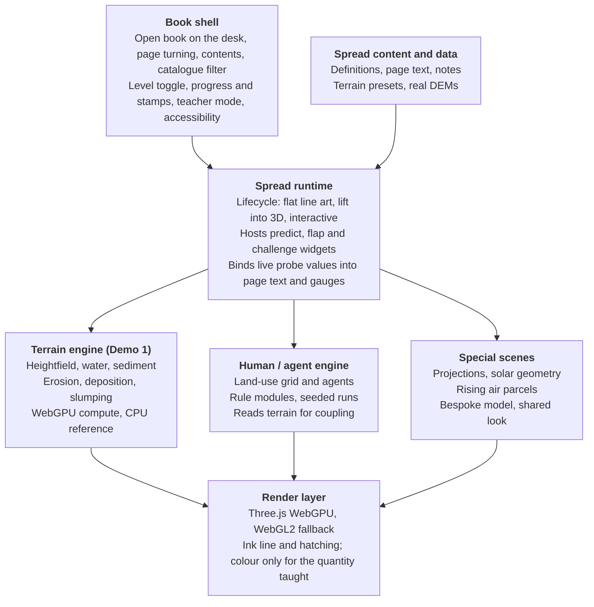

# Uplift — Project Handoff

Oct 28, 2026 · @Frankie Miller

## How to use this handoff

We are building a web-based interactive 3D geography book: textbook-style spreads where line-art diagrams lift off the page into simulations readers can manipulate. The project is at idea stage; this document is the brief for the first demos. The book is called Uplift; the terrain and ink engine underneath is called Hachure.

**Audience.** Coding agents building demos, and the research group reviewing them. Agents should treat the principles and rigour policy as requirements, and the architecture as a strong default they may refine with a written reason.

**Reading order for agents.**

1. Pedagogical design principles and Scientific rigour policy: the non-negotiables.
2. System architecture and Spread specification format: how the code is organised.
3. Demo 1 spec: the first thing to build, with acceptance criteria.
4. Tech stack and rules for agents: conventions and limits.

**Current goal.** Prove three things with one working spread: the shared terrain engine, the ink-line-to-3D look, and the two-level page (high school and university on the same simulation).

## Vision and inspiration

The reference is [Every Joule](https://iamtechartist.com/every-joule/) by Techartist (Three.js, published October 2026): a ten-lesson GCSE/IGCSE energy book. It renders an open book on a desk. Each diagram rises off the page as a 3D ink drawing, energy flows as glowing colour between stores, and students predict, test, prove, lift a flap and earn a stamp. Teachers' notes and sources are included.

**What we take from it.**

- The page and the model show the same numbers. In its lesson 2, the margin computes Ep = mgh = 3.6 J and the 3D gauge reads 3.6 J.
- Predict before you see: a committed guess, then the experiment, then the explanation under a flap.
- The book frame: one idea per spread, one model, one challenge. Restraint is why it feels finished.
- Ink-line aesthetic: hatched line art that becomes 3D, with colour reserved for the quantity being taught.

**What we add for geography.**

- The signature move is often the concept itself: contour lines lifting into terrain, a globe peeling onto a flat page.
- Sandbox processes: readers change water volume and speed, rock hardness and terrain shape (dig, raise, tilt) and watch landforms develop.
- Human-involved phenomena: dams, deforestation, paving, river engineering, urban growth, migration, diffusion.
- Real data: load a real DEM and watch a real watershed fill. Every Joule cannot do this; our group's GIS background can.
- Two levels on one spread: high school and university readers use the same simulation at different depths.
- Coverage beyond GIS: physical geography, human geography, environmental science, and GIS/cartography courses.

## Pedagogical design principles

Every spread follows a guided-sandbox loop: a question first, then free play, then a challenge. Free play without a question is fun but teaches little.

1. **Predict.** The spread opens with a question and 2–4 choices ("Slow the river down. Where does the sediment go?"). The reader must commit before the simulation unlocks its key control.
2. **Test.** The reader runs the simulation and manipulates it freely: sliders, brushes, presets.
3. **Explain.** A flap reveals the answer, tied to what the reader just saw. University level adds the governing relations.
4. **Challenge.** A goal checked by the simulation itself ("Make the river build a delta with two mouths"). Success earns a stamp.

**Rules every spread obeys.**

- One idea per spread. If a spread needs two ideas, it is two spreads.
- Page and model agree. Any number printed on the page (a value, a label, a gauge) is read from the live simulation state, never typed separately.
- Colour carries meaning. Ink line art is the default; colour is reserved for the quantity taught (water, sediment, ice, people, heat), with a legend on the page.
- The 2D drawing comes first. Each spread starts as flat line art on the page and lifts into 3D. The flat version is a real diagram, readable on its own.
- Two levels, one simulation. A level toggle changes text depth, visible controls and overlays, never the underlying model.
- Teachers' notes and sources ship with every spread.
- Accessible by default: keyboard operable controls, text alternatives for the key visual change, reduced-motion mode, colour-blind-safe palette.

## Scientific rigour policy

**Owner clarification, 2026-11-09 — education-first acceptance.** For process-model
spreads, prioritize visible cause and effect, relative comparisons and explanatory
clarity over accurate field magnitudes/rates. Quantitative landscape calibration is
required only when claiming real-world years or rates; an explicitly uncalibrated
model is a valid educational product. Arbitrary absolute effect-size thresholds do
not replace evidence that a relationship is stable and visually understandable.
This clarification supersedes conflicting calibration/quantitative gate wording
below; process-based simulation, truthful claims, numerical correctness and the
physical-law tier remain required. See [the science scope policy](science/education-policy.md)
for the evidence and transition rules.


Showing no equations does not mean not rigorous. Every simulation must be process-based underneath: landforms emerge from simulated flow, transport and deposition, never from scripted animation. Readers then build correct intuitions for the right reasons.

**Every model declares its tier, shown as a badge on the page.**

| Tier | Meaning | Examples |
| --- | --- | --- |
| Physical law | Deterministic physics, quantitatively correct within stated units | Lapse rates, solar geometry, Manning's equation |
| Process model | Simplified but mechanism-faithful; qualitative behaviour correct, magnitudes indicative | Hydraulic erosion, delta building, glacier abrasion |
| Stylised theory | An idealised model taught as a model, not a law | Von Thünen rings, gravity model, central place theory |
| Agent / stochastic | Emergent behaviour from rules and randomness; results vary run to run | Diffusion, urban growth, migration |

**Required on every spread.**

- A "What this model ignores" box listing the main simplifications in plain words.
- Time compression shown on screen at all times ("1 s ≈ 1,000 years"), and spatial scale (a scale bar). Students otherwise assume canyons form in an afternoon.
- Input clamping: controls limited to physically plausible ranges. Where a reader can still create something unphysical (a 2 km pit), the page acknowledges it rather than letting the model behave strangely in silence.
- Sources: a cited reference for each process rule and parameter range.

**Validation.** Each process model ships with qualitative tests that must pass. Examples: lower flow speed increases deposition; harder rock gives steeper, narrower valleys; a dam reduces sediment delivered downstream. Physical-law spreads are checked against worked numerical examples. A geomorphologist or domain expert in the group signs off on each spread before release.

**Stochastic models** use a seeded random generator, so a teacher can replay the same run in class.

## Audience levels and content matrix

Content is organised on three axes: topic domain, level, and course. Each spread is written once and tagged on all three; readers filter by course and level to get their book.

**Levels.**

- **High school:** the phenomenon, simple controls (rain, slope, rock type), predict-then-watch, vocabulary box, plain-language explanation.
- **University:** the same model with the hood open: governing relations (for example stream power law, Hjulström curve), parameters in real units, live graphs (long profile, sediment budget), the "What this model ignores" box expanded, optional real DEM input.

**Course tags (initial set).** Physical geography, geomorphology, hydrology, climatology, human geography, urban geography, economic geography, environmental science, GIS and cartography.

**Candidate spreads.** Engine: T = terrain/surface-process engine, H = human/agent engine, S = special-purpose scene. Priority 1 = build first.

| Spread | Domain | Engine | Tier | Levels | Priority |
| --- | --- | --- | --- | --- | --- |
| Erosion sandbox: V-shaped valleys | Geomorphology | T | Process model | HS, Uni | 1 |
| Contours to terrain | GIS and cartography | T | Physical law | HS, Uni | 1 |
| Deltas and alluvial fans | Geomorphology | T | Process model | HS, Uni | 2 |
| Dam a river: the shrinking delta | Human–environment | T | Process model | HS, Uni | 2 |
| Runoff and flow accumulation on a real DEM | Hydrology, GIS | T | Physical law | Uni | 2 |
| Paving a catchment: flood peaks | Human–environment | T | Process model | HS, Uni | 3 |
| Meanders, oxbow lakes, floodplains | Geomorphology | T | Process model | HS, Uni | 3 |
| Waterfalls and knickpoint retreat | Geomorphology | T | Process model | HS, Uni | 3 |
| Deforestation and gully erosion | Human–environment | T | Process model | HS, Uni | 3 |
| Glaciers: U-shaped valleys | Geomorphology | T (+ice) | Process model | HS, Uni | 4 |
| Coastal erosion, longshore drift, spits | Geomorphology | T (+waves) | Process model | HS, Uni | 4 |
| Landslides: slope stability | Geomorphology | T | Physical law | Uni | 4 |
| Orographic rainfall and rain shadow | Climatology | S | Physical law | HS, Uni | 3 |
| Seasons and solar angle | Climatology | S | Physical law | HS | 3 |
| Urban heat island | Urban, climatology | S | Process model | HS, Uni | 4 |
| Map projections: peeling the globe | GIS and cartography | S | Physical law | HS, Uni | 2 |
| Interpolation: IDW vs kriging | GIS | S | Physical law | Uni | 4 |
| Viewshed | GIS | T | Physical law | HS, Uni | 4 |
| Von Thünen land-use rings | Economic geography | H | Stylised theory | HS, Uni | 3 |
| Gravity model of migration and trade | Human geography | H | Stylised theory | HS, Uni | 4 |
| Spatial diffusion (SIR over a map) | Human, health geography | H | Agent / stochastic | HS, Uni | 4 |
| Urban growth and land-use change | Urban geography | H | Agent / stochastic | Uni | 4 |

The list is a starting point; the group adds and re-prioritises rows.

## System architecture

The key decision: build a few shared simulation engines, not a bespoke model per lesson. A chapter is then mostly data (starting terrain, controls, camera, text), so the book can grow cheaply. Build the first spread end to end, and extract the engine from it as it stabilises; do not build the engine in isolation first.



Content and the book shell feed one spread runtime; the runtime drives whichever engine a spread declares, and all engines share one render layer.

**Naming.** **Uplift** is the book: the shell, the spreads and their content. **Hachure** is the engine underneath: terrain simulation, ink rendering, the spread runtime and the human/agent engine. Hachures are the short ink strokes old maps used to show slope, which is the look the engine draws; the book's front matter explains this in one line as a first small lesson. Uplift depends on Hachure and never the reverse, so the group can publish, version and write papers about the engine on its own.

**Layers, top to bottom.**

1. **Book shell.** The open book on the desk, page turning, table of contents, catalogue filter (course × level), level toggle, progress and stamps, teacher mode, audio and contrast controls.
2. **Spread runtime.** Loads a spread definition and runs its lifecycle: flat line art → lift into 3D → interactive. Hosts the predict, flap and challenge widgets, and binds live simulation values into page text and gauges.
3. **Simulation engines.** Terrain engine, human/agent engine, and special-purpose scenes (below).
4. **Render layer.** Three.js with the ink-line look, plus a colour channel for the quantity being taught.
5. **Data layer.** Presets, real DEM loading, and spread content files.

**Terrain / surface-process engine.** A heightfield on a regular grid (256² default, 512² high quality), with per-cell layers:

- bedrock elevation, loose sediment thickness, rock hardness (erodibility)
- water depth, water flux (virtual-pipe model), suspended sediment concentration
- later: ice thickness, vegetation cover, impervious (paved) mask, sea level

Each fixed time step: add rain and sources → route water (virtual pipes) → compute velocity → erode or deposit against a transport capacity that rises with velocity and slope → advect suspended sediment → thermal slumping above the angle of repose → evaporate. Runs as WebGPU compute shaders, with a CPU reference implementation on small grids for tests. Deterministic: fixed time step, seeded randomness, reproducible runs.

It exposes tools (raise, dig, smooth, harden brush; rain and spring sources; dam, pave, plant and clear vegetation), probes (flux at a point, long profile along a polyline, sediment budget), and a read-only state API that the page binds to.

**Human / agent engine.** A grid or agent layer over a map or the terrain: cells with land use, population and value; agents with movement rules; rule modules per spread; seeded randomness. It can read terrain state, so spreads can couple people and processes.

**Special-purpose scenes.** Bespoke models for map projections, solar geometry and rising air parcels. They share the render layer and spread runtime but not the terrain engine.

**The line-art-to-3D lift is real geometry.** The flat page drawing of terrain is generated from the heightfield as contour lines and hatching; the lift animates vertical exaggeration from 0 to 1 so the contours rise into terrain. The 2D diagram and 3D model can never disagree.

## Spread specification format

Every spread is a declarative definition plus, only where needed, a small amount of spread-specific code. If a new spread needs heavy custom code, that is a signal the engine is missing a primitive; raise it rather than hard-coding it. Draft schema (TypeScript; refine during Demo 1):

```ts
interface Spread {
  id: string;                       // "geomorph.v-valley"
  title: string;
  tags: { domain: string[]; courses: string[]; levels: ("hs" | "uni")[] };
  tier: "physical-law" | "process-model" | "stylised-theory" | "agent-stochastic";
  engine: "terrain" | "human" | "scene";
  scene: {
    preset: string;                 // starting terrain or map, e.g. "tilted-plateau-256"
    camera: CameraPose;
    timeScale: { simSecondsPerRealSecond: number; label: string }; // "1 s ≈ 1,000 years"
    scaleBar: { metresPerCell: number };
  };
  controls: Control[];              // sliders, brushes, toggles, each with min/max clamps and level visibility
  probes: Probe[];                  // live values the page may show
  page: {
    left: LevelText;                // text per level, with {{probe.id}} bindings
    predict: { question: LevelText; options: string[]; answer: number };
    flap: LevelText;
    ignores: string[];              // "What this model ignores"
    keyWords: { term: string; definition: string }[];
    equations?: string[];           // university level only, TeX
  };
  challenge: { prompt: LevelText; check: ChallengeCheck };  // evaluated against sim state
  teacherNotes: string;             // markdown
  sources: { citation: string; url?: string }[];
}
```

Page text never contains a typed number that the simulation also computes; it uses a binding such as {{probe.sedimentOut}}.

## Demo 1 spec: the erosion sandbox spread

One working spread, "How a river carves a valley", that proves the terrain engine, the ink look and the two-level page together. Scope is a single spread inside a minimal book shell; no catalogue, no accounts.

**The experience.**

1. The book opens on the spread. The right page shows a hatched contour drawing of a tilted plateau with a river source marked.
2. The left page asks the predict question (high school): "If it rains harder for 10,000 years, will the valley get deeper, wider, or both?" The reader picks an answer.
3. The contours rise into a 3D ink-drawn terrain. Rain begins; water flows in a colour channel (blue), sediment in a second (ochre).
4. A V-shaped valley incises over compressed time. The clock reads simulated years; the scale bar reads metres.
5. The reader experiments: rain intensity slider, rock-hardness brush (paint a hard band across the valley), dig and raise brushes, reset, pause, speed.
6. The flap explains the answer, referring to what they saw. A hard band should produce a knickpoint or waterfall and a narrower gorge.
7. Challenge: "Make a waterfall" (checked when a slope break above a threshold persists on the river's long profile). A stamp is awarded.

**University level (same simulation).** Adds: the stream power law shown as a TeX display formula with a live erodibility parameter; a live long-profile graph along the river; a sediment budget readout (eroded, in transport, deposited, exported); parameters in real units; the expanded "What this model ignores" box.

**Model scope.** Water routing by virtual pipes, capacity-based erosion and deposition, sediment advection, thermal slumping, evaporation, spatially variable hardness. Out of scope for Demo 1: ice, waves, vegetation, real DEM input, the human engine.

**Acceptance criteria.**

- [ ] Runs at 30 fps or better at 256² on a mid-range laptop integrated GPU, Chrome stable, WebGPU; WebGL2 fallback at 128² is acceptable.
- [ ] Same seed and same inputs give the same terrain after N steps (determinism test passes).
- [ ] Qualitative tests pass: more rain → more incision; a hard band → a knickpoint upstream of it and a narrower channel through it; lower slope → more deposition.
- [ ] Mass is conserved: total rock + sediment change equals exported sediment within 1% over a run (closed boundaries except the outlet).
- [ ] The flat page drawing is generated from the heightfield (contours), and the lift animates from it.
- [ ] Every number on the page comes from a probe binding; none are typed.
- [ ] Time-scale label, scale bar, tier badge and "What this model ignores" box are visible.
- [ ] The level toggle switches text and visible controls without resetting or changing the simulation.
- [ ] Controls are clamped to plausible ranges and keyboard operable; reduced-motion mode pauses auto-play.
- [ ] Source links and a one-page teacher note are present.

**Deliverables.** A repository with the running demo, a short README (run, build, test), the CPU reference solver with its tests, and a 1–2 minute screen recording for the group review.

## Roadmap

Four sequential phases, each closed by a gate the group reviews before the next starts. Dates are set by the group after Demo 1, once real build speed is known.

| Phase | Focus | Scope | Exit gate |
| --- | --- | --- | --- |
| 1 (current) | Demo 1 | Erosion sandbox spread; terrain engine v0; ink renderer; minimal book shell | Acceptance criteria met; expert sign-off |
| 2 | Engine extraction | Contours to terrain; deltas and fans; spread schema v1; spreads as data | A new spread built mostly as data |
| 3 | Human coupling | Dam a river spread; runoff on a real DEM; map projections scene; university overlays | Real DEM runs end to end |
| 4 | Pilot | Human/agent engine; Von Thünen spread; catalogue shell; classroom pilot | Pilot results reviewed by the group |

Phase 2 is the real test of the architecture: if a new terrain spread cannot be built mostly as data, fix the engine before adding content.

## Tech stack and rules for agents

**Stack (defaults; deviations need a written reason in the repo).**

| Concern | Choice |
| --- | --- |
| Language and build | TypeScript, Vite |
| Rendering | Three.js WebGPURenderer with TSL shaders; automatic WebGL2 fallback |
| Simulation | WebGPU compute (TSL or WGSL); CPU reference solver in TypeScript for tests |
| Book UI and page text | DOM or a canvas page texture; choose in Demo 1 and record why |
| Equations | KaTeX |
| Real terrain (later) | GeoTIFF / Cloud-Optimised GeoTIFF reader, resampled to the grid |
| Tests | Vitest for solver and spread logic; Playwright smoke test that the spread loads and renders |

**Performance budget.** Target classroom hardware: school laptops and Chromebooks with integrated GPUs. 30 fps at 256² on WebGPU; degrade grid size before frame rate; first meaningful page within 3 s on a typical school connection; whole demo under 10 MB before real data.

**Repository conventions.**

- Two codebases, or two workspaces in one monorepo (decide in Demo 1): `hachure/` for the engine and `uplift/` for the book.
- Hachure packages: `@hachure/terrain`, `@hachure/human`, `@hachure/ink` (render layer), `@hachure/runtime` (spread runtime and page widgets).
- Uplift layout: `book/` (shell) and `spreads/<spread-id>/` (definition, page text, teacher notes, sources).
- Hachure never imports from Uplift; spreads only use Hachure's public API.
- Simulation parameters live in one typed config with units in the names (`rainMmPerHr`, `metresPerCell`).

**Rules for agents.**

- Follow the rigour policy: process-based simulation, no scripted landform animation, ever.
- Never type a number on the page that the simulation computes; bind it.
- Keep the CPU reference solver and the GPU solver in agreement; add a comparison test whenever either changes.
- Do not invent scientific claims for page text or teacher notes. Draft them, mark them for expert review, and cite sources.
- Keep the art style restrained: ink line, paper, one or two meaning-bearing colours. No gradients or glow beyond what carries a quantity.
- Record decisions and open questions in a `DECISIONS.md` in the repo, so the group can review them.

## Risks and things to watch

| Risk | Why it matters | Mitigation |
| --- | --- | --- |
| Production cost per spread | Every Joule-quality spreads are hand-crafted; without reuse the book stays a few demos | Shared engines; spreads as data; extract primitives from Demo 1 rather than designing them up front |
| Free play loses the lesson | Digging holes is fun but not learning | Predict → test → explain → challenge on every spread |
| Unphysical results from extreme inputs | A 2 km pit or vertical cliff makes the model look broken and teaches wrong ideas | Clamp controls; acknowledge limits on the page |
| Time and scale misconceptions | Compressed time suggests landforms form fast | Time-scale label and scale bar always visible |
| Stylised models read as laws | Human geography models are idealised | Tier badge; "What this model ignores" box; model framed as a model |
| Weak classroom hardware | Chromebooks and old laptops struggle with WebGPU | WebGL2 fallback; smaller grids; the spread still teaches from the flat drawing |
| Engine-first drift | A framework with no content | Build one complete spread first |
| Scientific errors in page text | Credibility with teachers and reviewers | Expert sign-off per spread; cited sources |
| Duplicating existing work | Reviewers will compare with known tools | Cite the UC Davis Augmented Reality Sandbox as precedent; our difference is web delivery, erosion and deposition, time, curriculum structure and levels |

## Open decisions for the project lead

- [ ] Name decided: the book is Uplift, the engine is Hachure. Still to do: check domains and trademarks, and pick a qualified domain if needed (for example uplift.earth).
- [ ] Curriculum alignment for high school: which national or exam curricula to map spreads to first.
- [ ] Languages: English only for demos, or bilingual page text from the start.
- [ ] Licence and distribution: open educational resource, institutional licence, or both.
- [ ] Who in the group signs off scientific content per domain (geomorphology, hydrology, climatology, human geography).
- [ ] Learning-outcome study: whether Demo 1 includes instrumentation (anonymous interaction logs, pre/post quiz) for a comparison with a static textbook.
- [ ] Whether Hachure (ink renderer, terrain engine, page widgets) is published as shareable components in the group's wider GIS ecosystem platform.
- [ ] Where real DEM data comes from for later spreads, and the default region for demos.

## References

Only the first link was opened for this handoff; the rest are cited from general knowledge and agents should verify them before relying on details.

- Techartist, [Every Joule: a 3D physics book about energy](https://iamtechartist.com/every-joule/), 2026. The inspiration and quality bar.
- Mei, Decaudin and Hu, "Fast Hydraulic Erosion Simulation and Visualization on GPU", Pacific Graphics 2007. The virtual-pipe water routing and capacity-based erosion used by the terrain engine.
- Šťava, Beneš, Brisbin and Křivánek, "Interactive Terrain Modeling Using Hydraulic Erosion", Symposium on Computer Animation 2008. Layered materials and interactive editing.
- Whipple and Tucker, "Dynamics of the stream-power river incision model", Journal of Geophysical Research, 1999. The stream power law for the university level.
- Hjulström, studies of river morphological activity (River Fyris), 1935. The erosion–transport–deposition curve.
- UC Davis KeckCAVES, Augmented Reality Sandbox. Physical precedent for shape-the-terrain, watch-the-water teaching.
- [Three.js](https://threejs.org/) documentation for WebGPURenderer and TSL.
