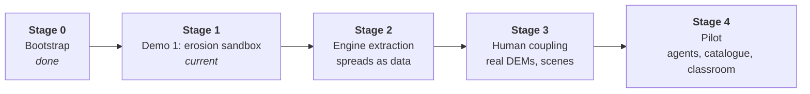

# Implementation plan: framework

How Uplift and Hachure get built: the work model, the rules that keep parallel agents from colliding, and
the stage map for the whole project. Only the **current stage** is planned in detail
([stage-1.md](stage-1.md)). Each later stage is planned when the previous one closes, using what that stage
taught us.

## The work model: stages → waves → sessions

```
Stage    a group-reviewed milestone with an exit gate                   (sequential)
 └ Wave  a step inside a stage; starts only when the previous wave has merged   (sequential)
    └ Session   one agent, one branch, one worktree, owned paths                (parallel)
```

| Unit        | Runs                             | Size                                           | Closed by                                                                                        |
| ----------- | -------------------------------- | ---------------------------------------------- | ------------------------------------------------------------------------------------------------ |
| **Stage**   | One after another                | Weeks; one roadmap phase                       | **Gate:** the group reviews the exit criteria, a retro is written, and the next stage is planned |
| **Wave**    | One after another inside a stage | 3–6 sessions                                   | **Wave close:** all PRs merged in order, main green, plan revised                                |
| **Session** | In parallel inside a wave        | S ≤ ½ day, M ≈ 1 day, L ≈ 2 days of agent work | **PR merged:** exit criteria met, handover note written                                          |

### Why this shape

- The handoff warns against **engine-first drift** and says facts will change after real implementation.
  Waves keep feedback loops short: each wave's results revise the briefs of the waves after it.
- **Parallel sessions** make the most of agent throughput, but only if they don't collide. Collisions are
  prevented by structure (contracts first, owned paths), not by after-the-fact merging.

## Rules that make parallel sessions safe

1. **Contracts before consumers.** If two sessions in a wave need a shared interface, it is merged in an
   _earlier_ wave. Within a wave, sessions depend only on what is already on `main`.
2. **Owned paths.** Every session brief lists the paths it may change. Two sessions in the same wave never own
   the same path. Touching an unowned path is allowed only for minimal glue (a re-export line, a registry
   entry), and the PR must say so.
3. **Fakes for unbuilt neighbours.** A consumer whose producer is built in the same wave codes against a fake
   from the contract package (`@hachure/terrain/fake` for browser fixtures;
   `@hachure/terrain/testing` also exports the Vitest contract suite). Fakes are test fixtures. They are
   never shown to readers as science.
4. **Hot files.**
   - `pnpm-lock.yaml`: never hand-merge. Take `main`'s version and rerun `pnpm install`.
   - `DECISIONS.md`: append only. On conflict, keep both entries.
   - Package `index.ts` entry points: add your export lines. On conflict, keep both.
5. **Merge order.** Each wave lists a merge order. When the lead merges a PR, the remaining PRs rebase on
   `main` and rerun `pnpm check` before they merge.
6. **Main is always green.** CI (`typecheck`, `lint`, `format:check`, `test`, `build`) must pass on every PR.
   A session that breaks `main` fixes it before anything else merges.
7. **Spikes are allowed to be throwaway.** Spike code lives in `spikes/<name>/`. A spike's deliverable is a
   decision record plus evidence (numbers, screenshots). It doesn't have to be production code.

## Roles

- **Lead (integrator):** a human or a lead agent session. Opens the sessions of a wave, merges PRs in order,
  runs the wave-close checklist, revises the plan, and prepares the stage gate. One per stage.
- **Session agent:** executes one session brief inside its worktree and opens one PR.
- **Domain expert:** signs off the scientific content (page text, parameter ranges, calibration, validation)
  at each stage gate. The handoff names this as a requirement, and the owner is an open question in
  `DECISIONS.md`.
- **Project lead:** settles the open decisions in `DECISIONS.md` by the stage that needs each one.

## Running a session

Branch: `s<stage>/w<wave>/<session-id>-<slug>`, for example `s1/w2/2a-cpu-solver`.
Worktree: a sibling folder, so worktrees never sit inside the repo.

```sh
# from the main checkout, on an up-to-date main
git fetch origin && git switch main && git pull --ff-only
git worktree add ../uplift-wt/2a-cpu-solver -b s1/w2/2a-cpu-solver main
cd ../uplift-wt/2a-cpu-solver
pnpm install                       # fast: pnpm's store is shared between worktrees
# start the agent in this folder with the session prompt below
```

Built-in worktree support in your agent tool works too (for example Claude Code's worktree mode), as long
as the branch name follows the convention.

When the PR has merged:

```sh
git worktree remove ../uplift-wt/2a-cpu-solver
git branch -d s1/w2/2a-cpu-solver
```

### Session prompt template

Paste this to start a session agent, with the placeholders filled in:

```text
You are running session {ID} ({title}) of Uplift, Stage {S}, Wave {W}.

1. Read AGENTS.md, docs/product-story.md, and docs/plan/stage-{S}.md, especially "Session {ID}".
2. You are on branch {branch} in your own worktree. Change only your owned paths:
   {owned paths}
3. Build the deliverables and meet every exit criterion in your brief. If the brief is wrong given what is
   now on main, follow the handoff's principles, record the deviation in DECISIONS.md, and say so in the PR.
4. Run `pnpm check`. Open a PR to main titled "S{S}·W{W}·{ID}: {title}" using the PR template. End the
   description with a handover note: done / not done / surprises / facts that should change the plan.
```

### Wave-close checklist (lead)

- [ ] Every session PR merged in the wave's merge order. `main` is green.
- [ ] Each session's exit criteria checked against what merged, not against what the PR claims.
- [ ] Handover notes read. Plan-changing facts folded into the briefs of later waves (edit `stage-N.md`
      and note the change in its changelog).
- [ ] New decisions and open questions in `DECISIONS.md` are reviewed.
- [ ] Worktrees and merged branches cleaned up.

### Stage-gate checklist (lead + group)

- [ ] Every exit criterion of the stage has linked evidence (test, recording, measurement, sign-off).
- [ ] Domain-expert sign-off recorded for the scientific content shipped in the stage.
- [ ] Retro written: `docs/plan/stage-N-retro.md` (what we learned, measured facts, what the next stage
      must change).
- [ ] Next stage planned in detail: `docs/plan/stage-(N+1).md`.

## Tracks

Sessions are tagged with a track so ownership stays legible across stages:

| Track                         | Owns                                                             | Packages                                    |
| ----------------------------- | ---------------------------------------------------------------- | ------------------------------------------- |
| **ENG** · Engine              | Simulation: state, solvers, tools, probes                        | `@hachure/terrain` (later `@hachure/human`) |
| **INK** · Render              | Ink look, contours, lift, colour channels, picking               | `@hachure/ink`                              |
| **RT** · Runtime and shell    | Spread schema, lifecycle, bindings, widgets, book shell          | `@hachure/runtime`, `@uplift/book`          |
| **SCI** · Content and science | Science briefs, page text, teacher notes, sources, validation    | `docs/science/`, `@uplift/spreads`          |
| **QA** · Quality and infra    | CI, end-to-end tests, performance, accessibility audits, release | repo-wide tooling                           |

Every brief also lists the **threads** it touches (rigour, page↔model, two levels, determinism, performance,
accessibility, separation, restraint). See [product-story.md](../product-story.md#threads-that-run-through-every-stage).

## Stage map

Stages follow the handoff's roadmap phases, so the group reviews one vocabulary. Stage 0 was repository
bootstrap. Stages 2–4 are **provisional outlines**. Each is planned in detail only at the previous gate.



### Stage 0 · Bootstrap (done, 2026-11-06)

Public repository, monorepo skeleton (`hachure/*`, `uplift/*`), licences (MIT code, CC BY 4.0 content),
CI, agent rules, decision log, product story, this plan.

### Stage 1 · Demo 1: "How a river carves a valley" (current)

**Goal.** Prove the three bets with one spread: a shared terrain engine, the ink-line-to-3D look, and the
two-level page.
**Exit gate.** Every Demo 1 acceptance criterion in the handoff is met with evidence, a domain expert has
signed off, and the group has reviewed the screen recording.
**Detailed plan:** [stage-1.md](stage-1.md). There are five waves: contracts and spikes → foundations →
end to end on the CPU → GPU, university layer and challenge → hardening and review.

### Stage 2 · Engine extraction (provisional)

**Goal.** Show that a new terrain spread can be built mostly as data.
**Likely scope.** Spread schema v1. Extract the primitives Demo 1 hard-coded. Build _Contours to terrain_
(GIS and cartography, physical law) and _Deltas and alluvial fans_ (process model) as data-first spreads.
Add a spread authoring guide and a minimal two-spread book with page turning.
**Exit gate.** A new spread whose spread-specific code stays under an agreed budget. If it can't, fix the
engine before adding content (handoff, Roadmap).
**Needs from the project lead.** Curriculum alignment, the language decision (before schema v1 freezes),
and a decision on publishing Hachure.

### Stage 3 · Human coupling and real data (provisional)

**Goal.** Bring people and real places into the terrain engine.
**Likely scope.** _Dam a river: the shrinking delta_ (dam tool, sediment trapping). _Runoff and flow
accumulation on a real DEM_ (Cloud-Optimised GeoTIFF reader, resampling to the grid). The _Map projections:
peeling the globe_ scene (first special scene on the shared render layer). University overlays generalised
across spreads.
**Exit gate.** A real DEM runs end to end.
**Needs from the project lead.** The DEM source and default region.

### Stage 4 · Pilot (provisional)

**Goal.** Put the book in a classroom.
**Likely scope.** `@hachure/human` (land-use grid, agents, seeded rule modules, terrain coupling). The _Von
Thünen land-use rings_ spread (stylised theory). A catalogue shell (course × level filter, contents,
progress). Teacher mode. If chosen, learning-outcome instrumentation. A classroom pilot.
**Exit gate.** The group has reviewed the pilot results.

## Status

| Stage                 | State                                               | Plan                     | Retro |
| --------------------- | --------------------------------------------------- | ------------------------ | ----- |
| 0 · Bootstrap         | Done                                                | —                        | —     |
| 1 · Demo 1            | **Wave 3 implementation landed; science gate open** | [stage-1.md](stage-1.md) | —     |
| 2 · Engine extraction | Outline only                                        | —                        | —     |
| 3 · Human coupling    | Outline only                                        | —                        | —     |
| 4 · Pilot             | Outline only                                        | —                        | —     |
