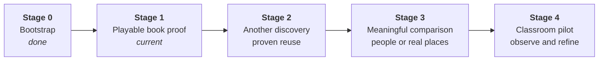

# Implementation plan: framework

How Uplift and Hachure get built: the work model, the rules that keep parallel agents from colliding, and
the stage map for the whole project. Only the **current stage** is planned in detail
([stage-1.md](stage-1.md)). Each later stage is planned when the previous one closes, using what that stage
taught us.

## Active priority — product realignment

The owner corrected the direction on 2026-11-09: Uplift is a playable 3D book with
bounded pages, immediate interaction, optional questions/reveals and page turning.
[Wave 5](stage-1-wave-5.md) revises the built app and delivers a new two-spread example;
[PB1–PB8](product-realignment.md#product-acceptance-gate) defines product acceptance.
Hardening moves to Wave 6. Existing engine work and evidence remain foundations;
implementation integration does not establish product acceptance. 5B–5F are now locally integrated on the review stack; main remains at 5A. See the [acceptance ledger](stage-1-acceptance.md) and [drift audit](../review/book-revision/acceptance/README.md#drift-audit-and-handover).
Read the updated [product story](../product-story.md) before starting a new session.

## The work model: stages → waves → sessions

```
Stage    a group-reviewed milestone with an exit gate                   (sequential)
 └ Wave  a step inside a stage; starts only when the previous wave has merged   (sequential)
    └ Session   one agent, one branch, one worktree, owned paths                (parallel)
```

| Unit        | Runs                             | Size                                           | Closed by                                                                                        |
| ----------- | -------------------------------- | ---------------------------------------------- | ------------------------------------------------------------------------------------------------ |
| **Stage**   | One after another                | Weeks; one roadmap phase                       | **Gate:** the group reviews the exit criteria, a retro is written, and the next stage is planned |
| **Wave**    | One after another inside a stage | 3–6 sessions                                   | **Wave close:** all PRs merged in order, main green, plan revised                                |
| **Session** | In parallel inside a wave        | S ≤ ½ day, M ≈ 1 day, L ≈ 2 days of agent work | **PR merged:** exit criteria met, handover note written                                          |

### Why this shape

- The handoff warns against **engine-first drift** and says facts will change after real implementation.
  Waves keep feedback loops short: each wave's results revise the briefs of the waves after it.
- **Parallel sessions** make the most of agent throughput, but only if they don't collide. Collisions are
  prevented by structure (contracts first, owned paths), not by after-the-fact merging.

## Rules that make parallel sessions safe

1. **Contracts before consumers.** Normally, if sessions in a wave need a shared interface, it is merged
   in an _earlier_ wave. The owner-requested Wave 5 revision uses explicitly gated groups: 5A contracts
   merge first, then 5B/5C/5D start from main, then 5E integration, then 5F acceptance. This exception
   is scoped in its wave plan. In every case a session consumes only dependencies already on `main`,
   never an unmerged peer branch. Ownership overlap is allowed only across these sequential groups.
2. **Owned paths.** Every session brief lists the paths it may change. Two sessions in the same wave never own
   the same path. Touching an unowned path is allowed only for minimal glue (a re-export line, a registry
   entry), and the PR must say so.
3. **Fakes for unbuilt neighbours.** A consumer whose producer is built in the same wave codes against a fake
   from the contract package (`@hachure/terrain/fake` for browser fixtures;
   `@hachure/terrain/testing` also exports the Vitest contract suite). Fakes are test fixtures. They are
   never shown to readers as science.
4. **Hot files.**
   - `pnpm-lock.yaml`: never hand-merge. Take `main`'s version and rerun `pnpm install`.
   - `DECISIONS.md`: append only. On conflict, keep both entries.
   - Package `index.ts` entry points: add your export lines. On conflict, keep both.
5. **Merge order.** Each wave lists a merge order. When the lead merges a PR, the remaining PRs rebase on
   `main` and rerun `pnpm check` before they merge.
6. **Main is always green.** CI (`typecheck`, `lint`, `format:check`, `test`, `build`) must pass on every PR.
   A session that breaks `main` fixes it before anything else merges.
7. **Spikes are allowed to be throwaway.** Spike code lives in `spikes/<name>/`. A spike's deliverable is a
   decision record plus evidence (numbers, screenshots). It doesn't have to be production code.

## Roles

- **Lead (integrator):** a human or a lead agent session. Opens the sessions of a wave, merges PRs in order,
  runs the wave-close checklist, revises the plan, and prepares the stage gate. One per stage.
- **Session agent:** executes one session brief inside its worktree and opens one PR.
- **Domain expert:** signs off the scientific content (page text, parameter ranges, calibration, validation)
  at each stage gate. The handoff names this as a requirement, and the owner is an open question in
  `DECISIONS.md`.
- **Project lead:** settles the open decisions in `DECISIONS.md` by the stage that needs each one.

## Running a session

Branch: `s<stage>/w<wave>/<session-id>-<slug>`, for example `s1/w2/2a-cpu-solver`.
Worktree: a sibling folder, so worktrees never sit inside the repo.

```sh
# from the main checkout, on an up-to-date main
git fetch origin && git switch main && git pull --ff-only
git worktree add ../uplift-wt/2a-cpu-solver -b s1/w2/2a-cpu-solver main
cd ../uplift-wt/2a-cpu-solver
pnpm install                       # fast: pnpm's store is shared between worktrees
# start the agent in this folder with the session prompt below
```

Built-in worktree support in your agent tool works too (for example Claude Code's worktree mode), as long
as the branch name follows the convention.

When the PR has merged:

```sh
git worktree remove ../uplift-wt/2a-cpu-solver
git branch -d s1/w2/2a-cpu-solver
```

### Session prompt template

Paste this to start a session agent, with the placeholders filled in:

```text
You are running session {ID} ({title}) of Uplift, Stage {S}, Wave {W}.

1. Read AGENTS.md, docs/product-story.md, and docs/plan/stage-{S}.md, especially "Session {ID}".
2. You are on branch {branch} in your own worktree. Change only your owned paths:
   {owned paths}
3. Read any linked current-wave brief. State the reader action/visible outcome, or the scientific/accessibility guarantee, that this session serves. Build the deliverables and meet every exit criterion in your brief. If the brief is wrong given what is
   now on main, follow the handoff's principles, record the deviation in DECISIONS.md, and say so in the PR.
4. Run `pnpm check`. Open a PR to main titled "S{S}·W{W}·{ID}: {title}" using the PR template. End the
   description with a handover note: done / not done / surprises / facts that should change the plan.
```

### Wave-close checklist (lead)

- [ ] Every session PR merged in the wave's merge order. `main` is green.
- [ ] Each session's exit criteria checked against what merged, not against what the PR claims.
- [ ] Handover notes read. Plan-changing facts folded into the briefs of later waves (edit `stage-N.md`
      and note the change in its changelog).
- [ ] The integrated default reader journey is demonstrated; isolated fixtures and green tests alone do not close product criteria.
- [ ] Every unfinished task names the playable lesson or correctness/accessibility guarantee it serves; deferred capability lists are not automatic implementation commitments.
- [ ] New decisions and open questions in `DECISIONS.md` are reviewed.
- [ ] Worktrees and merged branches cleaned up.

### Stage-gate checklist (lead + group)

- [ ] Every exit criterion of the stage has linked evidence (test, recording, measurement, sign-off).
- [ ] Domain-expert sign-off recorded for the scientific content shipped in the stage.
- [ ] Retro written: `docs/plan/stage-N-retro.md` (what we learned, measured facts, what the next stage
      must change).
- [ ] Next stage planned in detail: `docs/plan/stage-(N+1).md`.

## Tracks

Sessions are tagged with a track so ownership stays legible across stages:

| Track                         | Owns                                                             | Packages                                    |
| ----------------------------- | ---------------------------------------------------------------- | ------------------------------------------- |
| **ENG** · Engine              | Simulation: state, solvers, tools, probes                        | `@hachure/terrain` (later `@hachure/human`) |
| **INK** · Render              | Ink look, contours, lift, colour channels, picking               | `@hachure/ink`                              |
| **RT** · Runtime and shell    | Spread schema, lifecycle, bindings, widgets, book shell          | `@hachure/runtime`, `@uplift/book`          |
| **SCI** · Content and science | Science briefs, page text, teacher notes, sources, validation    | `docs/science/`, `@uplift/spreads`          |
| **QA** · Quality and infra    | CI, end-to-end tests, performance, accessibility audits, release | repo-wide tooling                           |

Every brief also lists the **threads** it touches (rigour, page↔model, two levels, determinism, performance,
accessibility, separation, restraint). See [product-story.md](../product-story.md#threads-that-run-through-every-stage).

## Stage map

Stages follow the handoff's roadmap phases, so the group reviews one vocabulary. Stage 0 was repository
bootstrap. Stages 2–4 are **provisional outlines**. Each is planned in detail only at the previous gate.



### Stage 0 · Bootstrap (done, 2026-11-06)

Public repository, monorepo skeleton (`hachure/*`, `uplift/*`), licences (MIT code, CC BY 4.0 content),
CI, agent rules, decision log, product story, this plan.

### Stage 1 · Playable book proof (current)

**Goal.** Use the existing Hachure foundation to prove two small interactive discoveries in a
recognisable book, with direct manipulation and page turning.
**Exit gate.** Product criteria PB1–PB8, applicable scientific and technical checks, expert review of
the shipped lessons, and an honest record of pending human/hardware checks.
**Detailed plan:** [stage-1.md](stage-1.md). Waves 1–4 record the engine and research-example work.
The active [Wave 5 revision](stage-1-wave-5.md) replaces the coarse P1/P2 outline.
Wave 6 hardens the resulting book; it does not harden the old worksheet as the product.

### Stage 2 · Grow the book and extract proven reuse (provisional)

**Goal.** Add one further small discovery that readers can play and understand, using
shared capabilities demonstrated by the first two spreads.
**Likely scope.** Refine the schema from authored examples; extract a primitive only
where a real next lesson repeats or needs it; write a short authoring guide. Deltas/fans
remain candidates, conditional on a prompt, visible and supported process outcome.
Contours and page turning are already Stage 1 obligations.
**Exit gate.** A new spread passes the same product/science/accessibility criteria, works
inside the existing book and reuses the engine without heavy bespoke spread code.
Engine modularity alone cannot close the stage.
**Needs from the lead.** Lesson selection from Stage 1 observations, curriculum/language
decisions only where required for that lesson, and any independently justified engine
publication choice. No catalogue or general schema programme before another lesson works.

### Stage 3 · A meaningful human or real-place comparison (provisional)

**Goal.** Let a reader discover one meaningful relationship involving a human intervention
or a real place, through direct interaction in the same book.
**Candidate scope.** Choose one validated lesson: a dam intervention, a real-watershed
experiment or a projection scene. These are alternatives to evaluate, not three automatic
parallel projects. Add data loading or model coupling only when the selected interaction
needs it; preserve sources, data rights, stated resolution/limits and accessible fallback.
**Exit gate.** The selected action produces a visible, scientifically supported comparison
inside a readable spread. A DEM loading successfully or a new engine running is necessary
in some candidates, but never sufficient product evidence.
**Needs from the lead.** A selected claim and scope; if real data is used, its source,
licence and region. No data pipeline without a lesson it enables.

### Stage 4 · Classroom pilot of the working book (provisional)

**Goal.** Learn whether readers discover the controls, understand the small ideas and
want to continue, and whether teachers can use the book accessibly and reliably.
**Likely scope.** Pilot the supported sequence; refine onboarding, reading rhythm,
teacher notes and accessibility from observed problems. Add contents/course navigation
only when book size warrants it. A human/agent engine and Von Thünen lesson are optional
future candidates, not pilot prerequisites.
**Evidence.** A reviewed protocol and genuine observations. Existing local instrumentation
is limited to its recorded-rain scope; a broader study needs an explicit versioned design,
consent/privacy review and validation. Do not rebuild or silently extend analytics already
delivered in Wave 4, or equate page completion with learning.
**Exit gate.** The group reviews usability/accessibility and any actual learning evidence,
records limitations, and selects improvements rather than merely counting features.

## Status

| Stage                     | State                                                       | Plan                     | Retro |
| ------------------------- | ----------------------------------------------------------- | ------------------------ | ----- |
| 0 · Bootstrap             | Done                                                        | —                        | —     |
| 1 · Demo 1                | **W5 local review integrated; human/release gates pending** | [stage-1.md](stage-1.md) | —     |
| 2 · Book growth and reuse | Outline only                                                | —                        | —     |
| 3 · Meaningful comparison | Outline only                                                | —                        | —     |
| 4 · Pilot                 | Outline only                                                | —                        | —     |

### Next-stage selection after 5F

The [5F drift audit](../review/book-revision/acceptance/README.md#drift-audit-and-handover)
requires each candidate to name action, visible consequence, evidence and shared
primitive. Stage 2 chooses one further discovery after reader observations; Stage 3
chooses one intervention/place comparison before data or engine expansion; Stage 4
pilots the reviewed book without silently expanding the rain-only event schema.
No later-stage capability list authorizes implementation before that choice.
