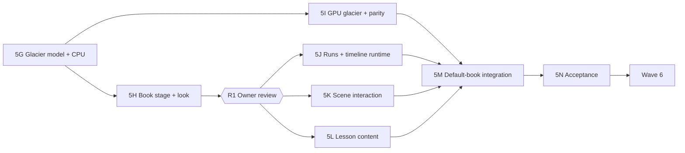

# Wave 5 extension · From V to U · sessions 5G–5N

**Status:** 5G, 5G2, 5H, 5I and R1 done (R1 2026-11-11, D-W5-R1: the R1/R2 book and camera
refinements are frozen decisions; D-W5-R1a amends it). 5J (#35), 5K (#36) and 5L (#34) merged
2026-11-12. 5M merged (#37). 5M2 (2026-11-13, D-W5-5M2) removed the contour lesson: the book is
_From V to U_ then water, and the live run opens at model time 0 on the authored V (no pre-run).
5N (2026-11-14, D-W5-5N) ran the registered protocol on production code and walked PB1–PB9/GV1–GV9:
[ledger](../review/glacial/acceptance/README.md); owner scene review, expert, human and hardware checks
pending. Rewritten 2026-11-09 after the owner settled the condition,
comparison, book presentation and GPU questions. This file is the **single source** for the
first lesson. Other plan files only point here. If they disagree with this file, this file wins.

Base and PR target: **s1/w5/integration** (see [workflow](../review/wave-5-integration/README.md)).
A–F stay as foundations: runtime lifecycle, reader shell, paging, bindings, accessibility, routes.

Read in this order: **the page we are building** → **owner decisions** → your session brief.
The guardrails are a short checklist at the end of the decisions, not the main text.

---

## 1 · The page we are building

The reference is the Every Joule book (saved in [owner references](../references/owner-2026-11-09/README.md)):
a real-looking book on a desk, a line drawing on the page, a short transition, then a shaded
object standing **on and above the paper**, casting shadows on it, with the figure's controls
next to it. For geography, the object is a small, colourful piece of landscape, like the
[water-cycle poster](../references/owner-2026-11-09/04-water-cycle-illustration.png) brought into 3D:
illustrative, not photographic, with natural colours.

### The spread

**Left page (text, DOM):** "Lesson 1", title _From V to U_, two or three short sentences,
key words (glacier, V-shaped valley, U-shaped valley, glacial erosion, rock type), an optional
prediction with a lift-the-flap answer, and an optional challenge in the margin. Handwritten
**margin notes** show live, bound numbers: valley floor width and depth at the cut, model time,
and the same numbers for a compared run.

**Right page (figure):** _Fig. 1_, a textbook block diagram of a mountain valley with a glacier,
with a caption. Below it sit a small **tray of rock specimens** (two or three rock types, each with
its own colour and textbook lithology pattern) and quiet play/pause and timeline controls.

### What the reader experiences

| Moment             | What happens                                                                                                                                                                                                                                                                                                                                                              |
| ------------------ | ------------------------------------------------------------------------------------------------------------------------------------------------------------------------------------------------------------------------------------------------------------------------------------------------------------------------------------------------------------------------- |
| Open the spread    | The book lies slightly tilted on a desk. The figure is a clean line drawing that reads on its own. It is also the static fallback.                                                                                                                                                                                                                                        |
| Scene ready (~3 s) | **Transition:** the drawing's lines go sketchy, and the block rises off the paper drawn in Hachure ink. Then colour and shading wash in: rock layers on the block sides, snowy peaks, a pale-blue glacier, dark-green forest lower down, a blue meltwater river below the glacier's snout. A contact shadow falls on the paper. The scene may rise past the figure frame. |
| Pick a rock        | The reader drags a specimen onto the block (or uses the rock selector on the page). The block's sides take on that rock's colour and pattern. A run starts from the same starting V-shaped valley.                                                                                                                                                                        |
| Play               | Ice flows down the valley, and flow marks follow the modelled ice velocity. Under the ice the valley widens and deepens; below the snout it stays V-shaped. The block's **front face is the cross-section**: rock with its pattern, ice in section, and the starting V drawn as a dashed ink line.                                                                        |
| Inspect            | Pause and drag the timeline back; the scene shows that recorded moment, labelled as earlier. Slide the front face along the valley to compare V below the snout with U under the ice. "See under the ice" hides the ice (an X-ray view, not melting).                                                                                                                     |
| Compare            | Pick another rock, and a new run starts while the first is kept. The front face shows the kept run's profile at the same model time as a ghost line labelled with its rock. The margin notes put both runs' widths and depths side by side.                                                                                                                               |
| Go deeper          | The university level adds the equations, graphs of width and depth over model time for each run, and bound parameter values. The model and runs are unchanged.                                                                                                                                                                                                            |

Turn the page and the water lesson follows as spread 2.

---

## 2 · Owner decisions (settled 2026-11-09; do not reopen)

1. **Subject:** formation of U-shaped valleys by glaciers.
2. **Pipeline:** textbook line drawing → artistic transition → complete 3D scene. The transition is
   a visual effect: morph, fade or reveal; no geometric correspondence proof. Contours are optional.
3. **Colour:** the book chrome stays simple. The illustration and scene use natural material colours.
   Data encodings still get a legend and a non-colour cue.
4. **Condition: rock type.** The reader chooses what the valley is cut into: two or three rock types
   (hardness/composition), shown as distinct colours plus textbook lithology patterns. The control
   works both from the page and by dragging a specimen onto the 3D block. Both send the same command.
5. **Runs:** a rock choice applies to a **whole run**. Rock cannot change under a moving glacier, so
   choosing a rock while a run exists starts a **new run** from the same authored starting valley,
   keeping the earlier run. There are no mid-run condition changes.
6. **Comparison: separate runs, not paired runs.** Comparison uses kept earlier runs, looked up at
   the same model time. There is no lockstep A/B simulation and no side-by-side canvases. Within a
   single run, the full valley also shows V (below the snout) against U (under the ice).
7. **Scene:** a full valley reach with a glacier flowing from a cirque to a snout. An idealised
   uniform reach is only the fallback if the plan-view model fails feasibility (see 5G).
8. **Book presentation:** a tilted 3D book on a desk, with the diorama standing on and above the
   right page. Phones, reduced motion and large zoom fall back to a flat page with the scene inside
   the figure.
9. **GPU ships too.** Build the GPU glacier in this wave and find out how far it actually gets.
   It is used where it passes the registered CPU/GPU comparison. CPU is always the fallback.
   Report honestly what reached parity.
10. **References:** the four saved owner images; the water-cycle illustration replaces the earlier
    geography image.

### Guardrails (checklist; every PR answers each)

- [ ] The valley shape comes from the simulated ice flow and erosion. No target-U interpolation,
      scripted mask, progress tween, or hydraulic water renamed as ice.
- [ ] Every number on the page, caption, margin note or gauge is bound to model state or config.
- [ ] Level, camera, cut position and the ice view are view-only. A rock choice never edits an
      existing run.
- [ ] Fixed time step and seeded randomness. The same rock, config and backend reproduce the same run.
- [ ] New CPU or GPU glacier code comes with the comparison suite updated.
- [ ] Every interaction has a keyboard equivalent and a text alternative; reduced motion works;
      lithology patterns back up the colours.
- [ ] Hachure never imports Uplift. Heavy scene code goes into an engine primitive.
- [ ] Scientific text is marked `<!-- expert-review -->` with sources. A failed attempt stays recorded
      as failed.
- [ ] The page carries **at most one** short limitation line (for example "Simplified model; time is
      compressed"). Technical detail lives in the deeper level or the sources.

---

## 3 · The model: 5G's starting point

<!-- expert-review -->

Starting point, to be verified in 5G against the full texts. The citations below are leads, not
adopted equations or parameter values.

- **Ice:** vertically integrated ice thickness on the bed heightfield, flowing by the shallow ice
  approximation (Glen's law, n = 3) plus basal sliding (Cuffey & Paterson, _The Physics of Glaciers_,
  4th ed., 2010). Snowfall and melt come from a **fixed, authored snowline altitude**. This is not a
  reader control; the deeper level shows its bound value.
- **Erosion:** bed lowering proportional to a power of basal sliding speed, with a coefficient set
  by rock type (Hallet 1979; Harbor, Hallet & Raymond 1988, _Nature_ 333, the classic V→U
  cross-section result; Herman et al. 2015, _Science_ 350).
- **Rock type:** erodibility, and if needed a rock-dependent stable wall slope, so that hard rock can
  hold steep walls. Rock-mass strength and fracture spacing affect glacial valley form (Augustinus
  1992; Dühnforth et al. 2010). Whether rock type changes the **shape** at matched times, or only the
  **rate**, is a 5G finding, not a promise.
- **Known risk:** the plain shallow ice approximation ignores lateral drag and is weak in steep,
  narrow valleys (the reason for Nye's 1965 shape factor and for iSOSIA, Egholm et al. 2011; see also
  [Seddik et al. 2009](https://arxiv.org/abs/0901.1177)). If the trough deepens without widening, try
  a shape-factor or higher-order correction. If that also fails, switch to the idealised-reach
  fallback: a cross-section ice-flow model in the Harbor 1988 style, extended along a uniform reach and
  labelled as idealised.
- **Starting state:** one authored V-shaped river valley, the same for every run, labelled as the
  starting point. The model time is "simplified, time compressed" unless calibration is justified.
- **Grid:** page-sized, around 128 × 96 cells. A CPU worker is expected to be fast enough; 5G measures it.

Claim for 5G to test and register: _after the same model time, the valley in softer rock is wider and
deeper, and in harder rock it keeps steeper walls and changes more slowly._ Teach only the parts that
hold up.

---

## 4 · Runs, time and comparison

| Reader action                                 | Meaning                                                                                                                                                                                                                                                 |
| --------------------------------------------- | ------------------------------------------------------------------------------------------------------------------------------------------------------------------------------------------------------------------------------------------------------- |
| Choose a rock (page selector or specimen)     | Before any run: sets the rock. If a run exists: starts a new run from the authored start with that rock, and the previous run becomes a kept run. Never alters a run.                                                                                   |
| Play / pause / step / speed                   | Controls real model advancement. Speed changes scheduling only, never the time step or the results.                                                                                                                                                     |
| Scrub the timeline                            | Pauses, then shows a recorded snapshot of the live run or of a kept run, labelled "earlier · model time t". Play first returns to the live run's latest state. There is no branching from the past.                                                     |
| Compare                                       | Pick a kept run. The front face shows its profile at the nearest recorded time to the current one (labelled with that actual time), and the margin notes show both runs' numbers. An optional flip shows the whole scene of the other run at that time. |
| Cut face / see under the ice / camera / level | View-only.                                                                                                                                                                                                                                              |
| Reset                                         | An explicit action with an inline confirm when kept runs exist. Returns to the authored defaults with no runs.                                                                                                                                          |
| Leave / return                                | Pause on leave and keep everything. No hidden advance or catch-up on return.                                                                                                                                                                            |

Keep **the live run plus up to two kept runs**. Dropping the oldest kept run shows a visible note.
Each run records bed and ice snapshots at a fixed model-time interval; these are view data, not
resumable checkpoints. 5G proposes the interval and memory budget (around 32 MB total) and 5J
enforces them. No general experiment manager, command log or replay-to-any-time is needed.

---

## 5 · Sessions

| Session | Outcome                                                                                   | Starts after                                     | Size |
| ------- | ----------------------------------------------------------------------------------------- | ------------------------------------------------ | ---- |
| 5G      | Glacier model in `@hachure/glacier`: CPU, rock types, feasibility evidence, captured runs | Verified s1/w5/integration                       | L    |
| 5H      | Book stage, scene look and drawing→ink→colour transition, shown on 5G's real captures     | Starts with 5G; finishes on merged 5G            | L    |
| R1      | **Done 2026-11-11 (D-W5-R1).** Owner review of the build; contracts frozen.               | 5H merged                                        | —    |
| 5I      | GPU glacier and CPU/GPU comparison suite                                                  | 5G merged (does not wait for R1)                 | L    |
| 5J      | Runs, snapshots, timeline, comparison lookup and backend selection in the runtime         | R1                                               | M    |
| 5K      | Production scene: specimen gesture, cut face, ice view, dressing, ghosts, accessibility   | R1                                               | L    |
| 5L      | Lesson copy, margin notes, flap, deeper level, sources, teacher notes                     | R1                                               | M    |
| 5M      | Default first spread in the tilted book, chrome restyle, water lesson as spread 2         | 5J, 5K, 5L merged; 5I merged or its gap recorded | L    |
| 5N      | Registered acceptance runs, journey walk-through, owner and expert review packet          | 5M merged                                        | M    |

**Merge order:** G → H → (R1) → I, J, K, L in whatever order they are ready → M → N. Rebase onto
s1/w5/integration and run `pnpm check` before every merge. Consume only merged work, never a
sibling's WIP. Branches are `s1/w5/5g-glacier-model` … `s1/w5/5n-glacial-acceptance`, each in its own
worktree. The lead owns the workspace config, lockfile, shared exports and harness glue. Small
cross-owned edits are listed in the PR.

Every PR names: the **reader action** it serves, the **visible outcome**, the **evidence** (capture,
video or test), and the GV row(s) it advances.

### 5G · Glacier model and CPU module — SCI/ENG · L

**Owned:** `hachure/glacier/**` (package.json, `src/contract/**`, `src/cpu/**`, `src/presets/**`,
`src/testing/**`); `docs/science/glacial/**`; `docs/review/glacial/model/**`.

Build real, tested code, not a throwaway spike.

1. Read the sources in §3 in full. Write a short model note covering the equations, units,
   boundaries, mass balance, erosion law, the rock-type table (two or three types with plain names,
   relative properties and their source basis), omissions and the known deficiency.
2. Implement the typed config (units in the names), state (bed, ice thickness, rock id, model time),
   probes (ice volume, floor width/depth at a section, eroded volume, max sliding speed) and a CPU
   solver, with a stable time step and seeded determinism. Include the authored starting V-valley preset.
3. **Feasibility:** run the baseline and each rock type, plus controls (no ice; no erosion). Show
   plain page-size surface and section images over time. Measure width, depth and the
   wall-steepness change. If the trough fails to widen, apply the §3 corrections; if those fail,
   build the idealised-reach fallback. Record every attempt.
4. Register the acceptance protocol: rock arms, horizon, matched times, section positions,
   width/depth/shape measures, tolerances, and rate-versus-shape criteria.
5. Export **captured runs** (snapshot series for each rock) as fixtures for 5H and 5K. Measure the
   CPU cost per model year on the reference grid.

**Exit:** the model forms a trough from a V under the ice, the rock types differ in a registered,
measured way, and the runs are deterministic and tested. Config, state and probe contracts are
frozen; presentation stays open until R1. If no bounded model works, report the specific scientific
blocker and stop. Do not substitute a morph.

### 5H · Book stage, scene look and transition — INK/design · L

**Owned:** `hachure/ink/src/stage/**` (new: a scene anchored to a DOM page under CSS 3D, with a
matched camera, a paper shadow-catcher and overflow above the page frame);
`hachure/ink/src/materials/natural/**` (illustrative rock, lithology pattern, snow, ice, forest,
water and soil materials, cel-style shading with ink outlines); `hachure/ink/src/transition/**`
(drawing → ink → colour reveal); `uplift/book/src/scenes/glacial/**` (the authored textbook drawing
and the review-build composition); `docs/review/glacial/stage/**`. Adds one bounded review route
entry, listed in the PR.

1. **Tilted book stage:** the existing reader pages under a CSS 3D tilt on a desk surface, and one
   WebGL canvas whose camera matches the page, so the diorama stands on the right page, casts a
   contact shadow on the paper and may rise past the figure frame. Text stays DOM. Provide the flat
   fallback for phones, reduced motion and large zoom.
2. **The textbook drawing:** an authored line-art block diagram of a glaciated valley that reads
   well on its own and doubles as the static fallback.
3. **Transition:** the drawing fades or sketches out, the block rises drawn in ink (Hachure
   edges/hachures on the real geometry), then colour and shading wash in. About 2–4 s, replayable,
   with a crossfade under reduced motion. No correspondence proof.
4. **Look:** block sides showing rock layers with lithology patterns; snow; pale-blue ice with flow
   lines; stylised conifers; meltwater river; meadow and soil. Illustrative and naturally coloured,
   no glow or photorealism. Develop it against a static authored heightfield fixture (marked as a
   fixture), then **finish on 5G's merged captured runs**.
5. Produce the **R1 review build:** desktop and phone captures at the actual page size, plus a video
   of open → transition → a captured run playing → the front face showing V against U.

**Exit:** the review build exists on real 5G data and the owner has the R1 packet. No glacier physics
lives in Ink or the book.

### R1 · Owner review gate

The owner reviews the 5H build and the 5G evidence. They approve or adjust the look, the
transition, the rock set and its names, the specimen gesture, the front-face section and the page
layout. The decisions are appended to `DECISIONS.md`, then presentation and gesture contracts freeze
for 5J, 5K and 5L. Changes requested here are made **before** dependent sessions start, not deferred
to hardening.

### 5I · GPU glacier and parity — ENG · L

**Owned:** `hachure/glacier/src/gpu/**`; `hachure/glacier/test/browser/**`;
`docs/review/glacial/gpu/**`. Test-command glue goes through the lead.

Implement the frozen 5G model as WebGPU compute. Compare CPU and GPU on every shipped rock type over
the registered horizons: fields, section profiles, probes and budgets, with tolerances declared from
5G. Document float precision; do not claim bitwise equality across devices. Measure speed against
the CPU. A capability or device failure falls back to CPU through a tested, labelled path, never a
silent reinterpretation of a run.

**Exit:** a passing comparison suite and a recommended default backend, **or** an honest record of
where parity or speed fell short. In that case 5M ships CPU with GPU disabled. Existing water CPU/GPU
checks stay green.

### 5J · Runs, timeline and comparison runtime — RT · M

**Owned:** `hachure/runtime/src/glacial-host/**`; `hachure/runtime/src/runs/**`;
`e2e/glacial-runtime.spec.ts`; `e2e/fixtures/glacial-runtime*`; `docs/review/glacial/runtime/**`.

Implement §4 on the existing settlement lifecycle:

- the glacier in a worker, with backend selection (CPU now, GPU once 5I has merged);
- rock choice → new run;
- play, pause, step and speed;
- snapshot recording within the memory budget;
- scrubbing with a labelled past view and return to live;
- nearest-time lookup across kept runs;
- reset;
- leave and return.

The page control and the 3D specimen gesture call one command. Test rock choice while running and
while paused, scrubbing, eviction of the oldest kept run, leaving mid-run, backend fallback and
determinism.

**Exit:** unit and browser tests prove §4. Level and view changes never touch runs.

### 5K · Production scene and direct interaction — INK/design · L

**Owned:** `hachure/ink/src/glacial/**`; `uplift/book/src/scenes/glacial/**`;
`e2e/glacial-scene.spec.ts`; `e2e/fixtures/glacial-scene*`; `docs/review/glacial/scene/**`.
Additions to the 5H stage and materials keep old callers working.

Turn the R1-approved look into production:

- **Dressing derived from model state:** ice surface from ice thickness; snow on ice-free ground above
  the fixed snowline; trees on ice-free, gentle, low slopes; the river path from steepest-descent
  routing below the snout; flow marks from modelled surface velocity.
- **The front face as a live cross-section:** rock pattern, ice, the dashed starting V and the
  kept-run ghost.
- **Gestures with UI equivalents:** dragging a specimen onto the block (matching the page selector),
  dragging the cut along the valley (slider or arrow keys), "see under the ice", and a limited
  turntable camera.

Provide keyboard paths and text alternatives that describe the current profile, plus reduced motion,
phone and a labelled static fallback. Develop on 5G captures until 5M joins the live runtime.

**Exit:** the real morphology change is clearly visible at page size, every gesture has a keyboard
equivalent, and no simulated erosion lives in a shader or in dressing logic.

### 5L · Lesson content — SCI · M

**Owned:** `uplift/spreads/geomorph.u-valley/**`; `docs/science/glacial/lesson/**`;
`docs/review/glacial/content/**`.

Write the left page in the reference's editorial form:

- lesson number, title, two or three sentences, key words;
- the optional prediction and its flap answer;
- an optional challenge;
- the figure caption and rock names/help;
- bound margin-note templates.

Also write the deeper level (equations, run graphs, bound parameters), teacher notes, sources, and
text alternatives. Keep the single limitation line; the fuller limits go in the sources. Comparison
text says "a separate run with another rock". Everything is marked expert-review and checked against
5G's registered claim.

**Exit:** schema and binding checks pass, the claim/source register is complete, and the copy fits
the R1 layout at desktop and phone sizes.

### 5M · Default-book integration and chrome — lead/RT · L

**Owned:** `uplift/book/src/app/**`; `uplift/book/src/reader/**`; `uplift/book/src/scenes/entries.ts`,
`index.ts`; `uplift/book/src/main.ts`; `uplift/spreads/index.ts`; `e2e/glacial-book.spec.ts`;
`docs/review/glacial/integration/**`; shared exports and harness glue.

Make _From V to U_ the default first spread in the tilted book stage, joining the live runtime
(GPU only where 5I passed), the 5K scene and the 5L content. Restyle the chrome toward the reference:
a quiet bottom navigation bar (contents, previous, title, next, contrast, reading level), page
numbers and running heads, and no form-like buttons or top select. The water lesson becomes spread 2;
the research route stays. Consolidate the duplicate scope and limitation text.

Walk the full journey: open → transition → pick rock → play → scrub back → return to live → slide the
cut → see under the ice → second rock → compare → change level → turn the page and back → reset.

**Exit:** `pnpm check`, build, bundle budget and the browser regression suite pass on the default
route, including phone flow, reduced motion and navigation while running. A spike URL cannot close
this session.

### 5N · Acceptance — QA/SCI/lead · M

**Owned:** `docs/science/validation/glacial-valley/**`; `docs/review/glacial/acceptance/**`;
`e2e/glacial-acceptance.spec.ts`; `docs/plan/stage-1-acceptance.md`; minimal status reconciliation.

Run the registered protocol on production code and keep every arm and failure. Walk PB1–PB9 and
GV1–GV9 on the default app. Record the SHA, the backend and the device. Prepare the owner scene
review and the expert-review packet. Human listening, first-time-reader and hardware checks stay
pending until actually done.

**Exit:** an evidence-linked ledger. Code, science and product defects are fixed here, not passed
to Wave 6.

---

## 6 · Acceptance rows

| ID  | Required result                                                                                                         | Evidence owners  |
| --- | ----------------------------------------------------------------------------------------------------------------------- | ---------------- |
| GV1 | Choosing a rock (page selector or specimen dropped on the block) starts a new run whose evolution reflects that rock    | 5G, 5J, 5K, 5M/N |
| GV2 | Play/pause/step, scrubbing recorded past and return to live; comparison with kept separate runs at matched model time   | 5J, 5M/N         |
| GV3 | A U-shaped trough forms from ice flow and erosion; rock-type differences are confirmed by the registered protocol       | 5G, 5I, 5N       |
| GV4 | Drawing → ink → colour transition into a complete, naturally coloured diorama standing on a tilted book page            | 5H, R1, 5K, 5M/N |
| GV5 | Margin notes, caption, front face, ghost and explanation all refer to the same run, time and config                     | 5J, 5L, 5M       |
| GV6 | Keyboard equivalents for every gesture, text alternatives, reduced motion, lithology patterns as non-colour cue, reflow | 5J, 5K, 5M, 5N   |
| GV7 | Default book, water spread, research route and privacy safeguards retained                                              | 5M, 5N           |
| GV8 | Sources, failed attempts, human/expert/hardware status and original owner references stay explicit                      | 5G, 5L, 5N       |
| GV9 | CPU and GPU glacier agree within registered tolerances for every shipped rock, or the GPU gap is recorded and CPU ships | 5I, 5M, 5N       |

Changing the subject, removing rock choice or time inspection, returning to paired runs,
scripting formation or dropping the tilted-book presentation needs an explicit owner decision.
Technical choices inside this plan belong to the session.

## Planning handover

Done: plan rewritten around the page, with owner decisions 4–10 recorded. Not done: no session has
started. What changed from the previous 5G–5N plan:

- The experience is reviewed early (5H + R1) instead of last.
- Rock type replaces the open "condition" question, and runs replace mid-run commands.
- Separate kept runs replace paired A/B runs, checkpoint replay and command logs.
- GPU starts right after 5G instead of blocking the middle group.
- The tilted book stage is an explicit deliverable.

The superseded version is in git history at `d62bb19:docs/plan/stage-1-wave-5-glacial.md`.
