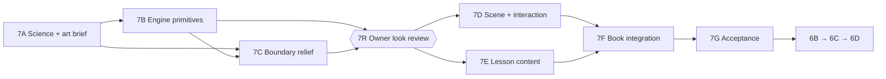

# Wave 7 · Lesson 2 · Where plates meet · sessions 7A–7G

**Status:** planned 2026-11-14, not started. Owner decisions are in D-L2-1 (`DECISIONS.md`).
This file is the **single source** for the second lesson. Other plan files only point here. If
they disagree with this file, this file wins.

**Order in Stage 1.** Wave 6 is split: 6A (and its follow-up 6A2) finishes first, then Wave 7,
then 6B → 6C → 6D audit, review and retro the two-lesson book. 6B–6D keep their IDs and briefs; only
their entry moves (D-L2-1, decision 10).

**Base and PR target:** `main`, the default for waves other than Wave 5. The lead may open an
integration branch for this wave; if so, record it here and in `AGENTS.md` before the first session.

Read in this order: **the page we are building** → **owner decisions** → your session brief.

---

## 1 · The page we are building

The second lesson sits on the same tilted book on a desk as _From V to U_ and reuses its stage:
a textbook line drawing on the page, an artistic transition, then a small, naturally coloured
block of landscape standing on and above the paper.

### The spread

**Left page (text, DOM):** "Lesson 2", working title _Where plates meet_ (7E finalizes it), two or three
short sentences, key words (plate, plate boundary, convergent, divergent, transform, crust), an optional
prediction with a lift-the-flap answer, and the one label line: _Illustration: shapes drawn from real
examples_.

**Right page (figure):** _Fig. 2_, a textbook block diagram of two continental plates meeting along a
boundary that runs from the back of the block to the front. Each plate carries an arrow. Below the figure
sit a three-way boundary picker (convergent, divergent, transform), each with its own arrow glyph, and
quiet play/pause and a "stage of formation" scrubber.

### What the reader experiences

| Moment          | What happens                                                                                                                                                                                                                                                                                                                                                                                   |
| --------------- | ---------------------------------------------------------------------------------------------------------------------------------------------------------------------------------------------------------------------------------------------------------------------------------------------------------------------------------------------------------------------------------------------- |
| Open the spread | The figure is a clean line drawing of the block and its two plates. It reads on its own and is the static fallback.                                                                                                                                                                                                                                                                            |
| Scene ready     | The same transition as lesson 1: the lines go sketchy, the block rises in Hachure ink, then colour washes in. Rolling lowland with low ridges and streams that cross the boundary at right angles; rock layers on the sides; the crust drawn as a band on the front face.                                                                                                                      |
| Pick a boundary | The reader drags a plate's arrow on the block (towards, away from or along the boundary) or uses the page picker. Both send one command. The block returns to the shared starting landscape and that boundary's sequence is ready at stage 0.                                                                                                                                                  |
| Play            | **Convergent:** a mountain range rises along the boundary, with snow on its high ground; on the front face the crust thickens into a deep root. **Divergent:** the land sinks into a rift valley between stepped fault scarps with raised shoulders; the crust thins. **Transform:** the ridges and streams that cross the boundary are dragged sideways and offset; the crust stays the same. |
| Inspect         | Pause and scrub the stage back and forth. Slide the front face along the boundary. Turn the block with the limited turntable camera.                                                                                                                                                                                                                                                           |
| Compare         | Boundaries already viewed appear as ghost profiles on the front face at the same stage, each labelled with its name and glyph, so the reader sees the range rise where the rift sinks.                                                                                                                                                                                                         |
| Go deeper       | The university level adds a fuller explanation, cited real examples (the Himalaya and Tibet, the East African Rift, the San Andreas at Wallace Creek) and cited crust thicknesses. The scene is unchanged.                                                                                                                                                                                     |
| Turn the page   | Previous returns to _From V to U_ with its runs, kept runs and model time exactly as left.                                                                                                                                                                                                                                                                                                     |

---

## 2 · Owner decisions (settled 2026-11-14; do not reopen)

1. **Subject:** plate tectonics, focused on the three plate boundaries and the topography each one makes.
   The lesson leans towards the visual effect rather than scientific depth.
2. **Authored relief.** The boundary topography is authored, not simulated. This is a scoped owner
   exception to "process-based simulation only" (`AGENTS.md`), for this lesson only. The scene is named
   an illustration and never claimed to be simulated.
3. **Scope: continental settings only.** Collision range, rift valley, transform offset. Mid-ocean
   ridges, trenches, subduction and volcanoes are out of scope.
4. **Gesture: pick one of three boundaries,** on the page or by dragging a plate arrow on the block. Both
   send one command.
5. **No erosion.** Tectonic relief only. Erosion may return later as an optional "Try this", with its own
   decision.
6. **Stage 1's second discovery.** PB7 returns to its original form: two working interactive spreads
   and a genuine page turn.
7. **The front face shows the crust:** a root under the range, thinning under the rift, no change at the
   transform. Authored and cited like the surface.
8. **Reader loop without a model.** Each boundary is an authored formation sequence driven by a stage
   parameter, not a simulated run. There are no runs, kept runs or model time in this lesson: pick, play
   or scrub the stage, and compare with ghost profiles of boundaries already viewed at the same stage.
9. **Procedural height fields, not hand-modelled meshes.** Each boundary is `relief(stage ∈ [0, 1])`
   over one seeded starting landscape, producing the same `LandscapeSnapshot` seam lesson 1's stage
   already draws.
10. **Planned as its own wave, before 6B–6D.**

### Guardrails (checklist; every PR answers each)

- [ ] The scene is labelled an illustration. No copy, caption, alternative text or deeper-level text says
      or implies that the landforms form in the scene, are computed or are simulated.
- [ ] The page uses no "run", "model time", years or gauge that implies a computed result. The stage
      scrubber shows only "early → late".
- [ ] Every figure on the page (heights, widths, thicknesses, offsets, plate speeds) is a cited real-world
      fact. Scale and vertical exaggeration are bound to the scene config, never typed.
- [ ] The shapes follow the 7A parameter table; every parameter cites its source.
- [ ] Relief generation is deterministic: the same seed, boundary and stage give the same field. No
      `Math.random()`.
- [ ] Level, camera, cut position and ghosts are view-only. Lesson 1's state is never touched.
- [ ] Every interaction has a keyboard equivalent and a text alternative; reduced motion works;
      boundary types carry arrow glyphs and patterns as well as colours.
- [ ] Hachure never imports Uplift. Generic stage and runtime additions go into Hachure; boundary shapes
      stay lesson content.
- [ ] Scientific text is marked `<!-- expert-review -->` with sources.
- [ ] The page carries **one** label line. Fuller limits go in "What this shows / ignores" and the sources.

---

## 3 · The authored sequence

**Starting landscape.** One seeded continental block shared by all three boundaries: rolling lowland,
low ridges and stream valleys running left to right across the boundary, rock layers, and a crust band of
uniform thickness on the front face. The boundary runs from back to front through the middle, so the front
face cuts across it.

**Per boundary, as the stage goes from 0 to 1:**

| Boundary   | Surface                                                                                          | Crust on the front face                |
| ---------- | ------------------------------------------------------------------------------------------------ | -------------------------------------- |
| Convergent | A range rises along the boundary, widening as it grows; detail from seeded noise                 | Thickens into a root beneath the range |
| Divergent  | A rift sinks between stepped normal-fault scarps; the shoulders rise slightly                    | Thins beneath the rift                 |
| Transform  | The two sides move in opposite directions along the boundary; crossing ridges and streams offset | Unchanged                              |

The surface and the crust come from the same generator, so the front face always agrees with the top.
Root depth may follow the cited Airy proportion to the range's height. It is an authored relation with a
source, not a computation presented as a result. Stage 0 is the starting landscape for every boundary.
The sequence is continuous in the stage, with no jumps.

**Dressing** follows lesson 1 and is derived from the field: snow above a fixed snowline, vegetation on
gentle low slopes, streams by steepest descent, and optionally a lake on a closed rift floor.

**Playback.** Play advances the stage at a fixed rate on the view clock (reduced motion: step through
three to five stages). Scrubbing sets the stage directly. Leaving the page pauses; returning keeps the
boundary, stage and ghosts. Reset returns to no boundary chosen and clears the ghosts.

---

## 4 · Sessions

| Session | Outcome                                                                                       | Starts after            | Size |
| ------- | --------------------------------------------------------------------------------------------- | ----------------------- | ---- |
| 7A      | Reference landforms, cited parameter table, crust geometry, storyboard, claim register        | This plan on main       | S    |
| 7B      | Authored-sequence source and crust band on the stage, in Hachure                              | With 7A; contract first | M    |
| 7C      | Starting landscape and three boundary relief generators                                       | 7A merged; 7B contract  | M    |
| 7R      | **Owner review** of the look on the real block; presentation freezes                          | 7B, 7C merged           | —    |
| 7D      | Production scene: plate-arrow gesture, picker, scrubber, ghosts, cut, dressing, accessibility | 7R                      | L    |
| 7E      | Lesson copy, flap, deeper level, "What this shows / ignores", sources, teacher notes          | 7R                      | M    |
| 7F      | Lesson 2 as spread 2 in the default book; page turn, contents, deep links, bounded perf check | 7D, 7E merged           | M    |
| 7G      | Acceptance: PB1–PB9 for the two-lesson book and PL1–PL9; owner and expert packets             | 7F merged               | M    |

**Merge order:** A → B → C → (7R) → D, E as ready → F → G. Rebase and run `pnpm check` before every
merge. Consume only merged work. Branches are `s1/w7/7a-plates-brief` … `s1/w7/7g-plates-acceptance`, each
in its own worktree. The lead owns workspace config, lockfile, shared exports and harness glue.

Every PR names the **reader action** it serves, the **visible outcome**, the **evidence** (capture,
video or test) and the PL row(s) it advances.

### 7A · Science and art brief — SCI/design · S

**Owned:** `docs/science/plates/**`; `docs/review/plates/brief/**`.

- One reference landform per boundary with sources (USGS _This Dynamic Earth_ or equivalent): a
  continental collision range (Himalaya and Tibet), a continental rift (East African Rift), and a
  transform offset (San Andreas, Wallace Creek).
- A **parameter table** for 7C: range width and relief, rift width, scarp count and shoulder height,
  transform offset, normal and thickened crust thickness, the Airy proportion, block size, vertical
  exaggeration and snowline. Every row has a cited value or range, and any artistic choice (vertical
  exaggeration, compressed offset) is labelled as one.
- The starting landscape description, and storyboard frames at stage 0, 0.5 and 1 for each boundary,
  including the front face.
- A claim register for 7E, marked expert-review, and the draft "What this shows / ignores" list.

**Exit:** every 7C parameter has a source or an explicit artistic label, and the owner has seen the
storyboard.

### 7B · Engine primitives — ENG/INK · M

**Owned:** `hachure/runtime/src/sequence/**` (new); additions to `hachure/ink/src/stage/**`; their tests
and exports. Raise both primitives in `DECISIONS.md` before dependent work.

- **Authored-sequence source.** It turns a generator `(stage) → LandscapeSnapshot` into the stage's
  snapshot feed: play at a fixed view-clock rate, pause, set the stage, reduced-motion stepping, pause on
  leave, and ghost lookup of other generators at the same stage. It uses the same seam as the solver feed
  and holds no model time.
- **Crust band.** An optional crust-base field on `LandscapeSnapshot`, drawn as a band with its own
  pattern on the front face and in the section lens, with ghost profiles for it too.

Old callers keep working unchanged: the glacial stage, runtime and acceptance suites pass without edits.

**Exit:** unit tests for the source (determinism, continuity, pause/leave, ghost lookup) and the band
(geometry with and without the field); glacial suites unchanged and green.

### 7C · Boundary relief — SCI/INK · M

**Owned:** `uplift/book/src/scenes/plates/relief/**`; `docs/review/plates/relief/**`.

- The seeded starting landscape (§3) and `relief(boundary, stage)` for the three boundaries, producing
  bed elevation, rock id and crust base, parameterized from the 7A table with source comments.
- Tests: the same seed, boundary and stage give the same field; stage 0 is identical for all three;
  continuity in the stage; convergent relief and root grow monotonically; the rift deepens monotonically;
  the transform offset grows and leaves relief and crust unchanged.
- A review build for 7R: the three boundaries on the real block at stage 0, 0.5 and 1, with the front face.

**Exit:** tests pass, and the review build exists on the 7B stage.

### 7R · Owner look review

The owner reviews the 7C build: recognisable landforms at page size, front face and crust band, colours,
vertical exaggeration and the starting landscape. Decisions are recorded in `DECISIONS.md` and freeze the
presentation for 7D and 7E.

### 7D · Production scene and interaction — INK/design · L

**Owned:** `uplift/book/src/scenes/plates/**` (except `relief/**`); `hachure/ink/src/plates/**` (new, only
for generic pieces such as plate arrows); `e2e/plates-scene.spec.ts`; `e2e/fixtures/plates-scene*`;
`docs/review/plates/scene/**`.

- The flat ink figure and the transition, reusing lesson 1's stage.
- Dressing derived from the field (§3).
- **Plate-arrow gesture** on the block, matching the page picker through one command.
- Stage play/pause and scrubber, cut slider, limited turntable camera, and labelled ghost profiles.
- Keyboard paths; a text alternative that describes the current boundary, stage and profile; reduced
  motion; phone; the labelled static fallback. Glyphs and patterns back up the boundary colours.

**Exit:** each landform is clearly recognisable at page size, every gesture has a keyboard equivalent,
and no relief logic lives in shaders or dressing.

### 7E · Lesson content — SCI · M

**Owned:** `uplift/spreads/tectonics.plate-boundaries/**`; `docs/science/plates/lesson/**`;
`docs/review/plates/content/**`.

- The left page: lesson number, final title, two or three sentences, key words, the optional prediction
  and its flap answer, the one label line, the figure caption and the boundary names and help.
- The deeper level, "What this shows / ignores" (it states that the shapes are authored), teacher notes,
  sources and text alternatives.
- Everything marked expert-review and checked against the 7A claim register. No copy says "run",
  "simulation" or "model time".

**Exit:** schema and binding checks pass, the claim/source register is complete, and the copy fits the
7R layout at desktop and phone sizes.

### 7F · Book integration — lead/RT · M

**Owned:** `uplift/book/src/app/**`; `uplift/book/src/reader/**`; `uplift/book/src/scenes/entries.ts`,
`index.ts`; `uplift/book/src/main.ts`; `uplift/spreads/index.ts`; `e2e/plates-book.spec.ts`;
`docs/review/plates/integration/**`; `docs/perf/plates/**`; shared exports and harness glue.

Make _Where plates meet_ spread 2 of the default book. Restore the real page turn between the two
lessons, the contents list and deep links. The research route stays. Lesson 1's runs, kept runs and model
time survive turning away mid-play and back, with no hidden advance.

Walk the journey: open lesson 1 → play → turn the page → transition → pick convergent → play → scrub →
pick divergent → compare ghosts → transform by dragging an arrow → change level → turn back to lesson 1
(state intact) → reset.

Run a bounded performance check of the new spread and the page turn with the 6A harness on the same
target laptop: no regression in lesson 1's measured journey.

**Exit:** `pnpm check`, build, bundle budget and the browser regression suite pass on the default route,
including phone, reduced motion and navigation while lesson 1 is running.

### 7G · Acceptance — QA/lead · M

**Owned:** `docs/review/plates/acceptance/**`; `e2e/plates-acceptance.spec.ts`;
`docs/plan/stage-1-acceptance.md`; minimal status reconciliation.

Walk PB1–PB9 for the two-lesson book (PB7 in its original form) and PL1–PL9 on the default app. Record the
SHA and the device. Prepare the owner scene review and the expert-review packet. Human listening,
first-time-reader and hardware checks stay pending until actually done; 6B–6D take them over.

**Exit:** an evidence-linked ledger. Code, science and product defects are fixed here, not passed to 6B.

---

## 5 · Acceptance rows

| ID  | Required result                                                                                                              | Evidence owners |
| --- | ---------------------------------------------------------------------------------------------------------------------------- | --------------- |
| PL1 | Choosing a boundary (page picker or plate arrow dragged on the block) shows that boundary's sequence from the shared start   | 7B, 7D, 7F/G    |
| PL2 | Play, pause and scrub a "stage of formation" with no model time or years; viewed boundaries as labelled ghosts at that stage | 7B, 7D, 7F/G    |
| PL3 | Collision range, rift valley with fault scarps, and transform offset are recognisable at page size and follow the 7A table   | 7A, 7C, 7R, 7G  |
| PL4 | The front face shows the crust: a root under the range, thinning under the rift, no change at the transform                  | 7A, 7B, 7C, 7D  |
| PL5 | Honesty: the illustration label, authored-shapes disclosure, no computed-looking numbers, cited figures, expert-review marks | 7A, 7E, 7G      |
| PL6 | Drawing → ink → colour transition into a naturally coloured block on the tilted book page, reusing lesson 1's stage          | 7D, 7R, 7F/G    |
| PL7 | Keyboard equivalents, text alternatives, reduced motion, glyph and pattern cues for boundary types, reflow and phone         | 7D, 7E, 7F, 7G  |
| PL8 | Two-lesson book: real page turn, contents, deep links; lesson 1 state preserved across turns; research route retained        | 7F, 7G          |
| PL9 | Reuse: no heavy spread code; lesson 1 and engine behaviour unchanged; new primitives recorded in `DECISIONS.md`              | 7B, 7F, 7G      |

Changing the subject, adding ocean settings or erosion, claiming that the landforms are simulated, or
dropping the tilted-book presentation needs an explicit owner decision. Technical choices inside this
plan belong to the session.

## Planning handover

Done: owner decisions 1–10 recorded (D-L2-1), and the wave planned around the page. Not done: no session
has started; the title is a working title; the base branch is `main` unless the lead opens an integration
branch. Plan-changing facts: PB7 returns to its original form; 6B–6D move after this wave.
