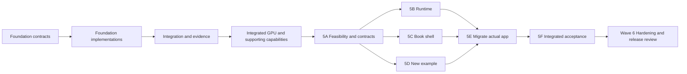

# Stage 1 · Playable book proof on the Hachure foundations

## Latest owner review · 2026-11-09

Remote review head e7e7f0a contains B/C/D, E (39ab5fb) and F. Main remains at 5A
(8069a7f). Their implementation is real and retained; prior wording saying these
sessions had not started or could not start is stale. The corrected product is not
yet accepted: see the [current branch audit](../review/book-revision/current-direction-review.md).

The preferred opening is U-shaped valley formation. Contours are optional. The
2D-to-3D entrance is an artistic effect, without exact geometric mapping; scenes
may use natural colours. Discuss the concrete glacier scene before writing the
replacement implementation plan. Existing contour/water selection and the automatic
cartography fallback below describe the old wave, not the new lesson choice.
Glacial process scope is reopened for this lesson; the old no-ice/no-new-physics
rule cannot silently force a different subject. Do not claim a glacier model exists.

Detailed plan for the current stage. The work model and rules are in [README.md](README.md). The product
reasoning and the brief's internal tensions (referred to below as **T1–T9**) are in
[product-story.md](../product-story.md#tensions-in-the-brief-and-how-the-plan-resolves-them). The source of
truth for requirements is the handoff's
["Demo 1 spec"](../handoff.md#demo-1-spec-the-erosion-sandbox-spread).

## Active correction — product before further engine scope

The owner's 2026-11-09 request changes the next milestone to a bounded, playable book:
drawings lift into directly manipulable 3D, questions and answer flaps are optional,
and page turning connects small discoveries. The direction commit is merged to main.
Read [Wave 5](stage-1-wave-5.md) for the complete revision-wave briefs and owned paths;
[PB1–PB8](product-realignment.md#product-acceptance-gate) defines product acceptance.
The old P1/P2 outline is superseded. 5B–5F are integrated on the local review stack; main remains at 5A. See the [acceptance ledger](stage-1-acceptance.md) for evidence and pending release gates.

The Wave 1–4 briefs below retain the record of how the foundations were built. Their
mandatory prediction/endpoint gates, mandatory challenge/stamp flow and page-turn
exclusion are superseded for the ordinary reader experience. Rewrite affected
behavior tests during Wave 5 while preserving scientific safeguards and model state.
Failed morphology experiments remain failed; pending challenge science remains pending.
Those particular lessons cannot be shipped as successful outcomes. They do not require
an unrelated contour lesson to wait for a waterfall result.

## Goal and exit gate

**Owner clarification, 2026-11-09:** interpret the process-model science gates under
[education-policy.md](../science/education-policy.md). Prioritize visible cause and
effect and robust relative comparisons; accurate field magnitudes and geological
time calibration are conditional on making those claims. Legacy quantitative
experiments retain their original classifications. The completed
[rain comparison](../science/validation/rain-comparison/README.md) supplies Wave 3's
supported, visually legible teaching relationship and matching question.
This note supersedes conflicting mandatory-calibration and absolute-margin wording
in the session briefs below. Register model-time challenge persistence before
implementing it; do not enable the existing pending challenge automatically.

**Goal.** Two small interactive spreads in a recognisable book. Prove immediate play, a readable
same-scene consequence, optional reflection and a genuine page turn, using the existing engine.

**Exit gate.** PB1–PB8 and applicable foundation checks have linked evidence. The shipped lessons have
domain-expert review. Human reader/listening and hardware checks are reported honestly; missing checks
remain open. The group reviews the working book and a short recording; the stage retro is written.
Historical AC3 morphology and waterfall success are not prerequisites for an unrelated replacement
lesson, and are never relabelled as passes. Each new lesson must validate its own taught claim.

**Out of scope** (from the earlier handoff; ice reopened for the owner-selected U-shaped-valley lesson). Waves, vegetation simulation, real DEM input, the human/agent engine,
catalogue and accounts. Page turning between two interactive spreads is now required.

## Shape of the stage

Waves 1–4 below record the foundation work. Wave 5 is the next implementation wave;
Wave 6 is revised hardening. Historical technical dependencies remain in their briefs.

| Wave   | Theme                                         | Sessions                                                                             | Status / purpose                                                         |
| ------ | --------------------------------------------- | ------------------------------------------------------------------------------------ | ------------------------------------------------------------------------ |
| W1     | Contracts and spikes                          | 1A–1E                                                                                | Foundation history; contracts and initial risks                          |
| W2     | Foundations                                   | 2A–2F                                                                                | CPU, rendering, runtime, shell and probes                                |
| W3     | Integration and science                       | 3A–3F                                                                                | CPU integration, actual science results and recorded comparison          |
| W4     | GPU, depth and supporting capabilities        | 4A–4F                                                                                | Implementations integrated; human/science acceptance accurately retained |
| **W5** | **Revise the book and build the new example** | **5A contracts → 5B runtime / 5C shell / 5D example → 5E migration → 5F acceptance** | **Next; complete playable default app and revised research route**       |
| W6     | Hardening and review                          | 6A performance → 6B audit → 6C review → 6D retro                                     | Finish current book's release gates and lesson-led next plan             |

**Current critical path:** direction on main → 5A feasibility/contracts → 5B/5C/5D runtime,
shell and example → 5E migrate the built app → 5F integrated acceptance → Wave 6 hardening/review.
The historical solver chain explains the foundations, not the current product priority.
Historical references to the former hardening sessions 5A–5D now map to 6A–6D.

## Acceptance traceability

The table below preserves the original erosion-demo criteria and their delivery sessions.
The current product gate is [PB1–PB8](product-realignment.md#product-acceptance-gate).
AC1/2/4/6/8/9 remain applicable foundation checks. AC5 applies to each new diagram/scene;
AC7 follows the updated compact scope/scale/time and limitation disclosure policy;
AC10 applies to each shipped lesson. AC3 is historical morphology evidence, not a claim
supported by the recorded gross-erosion comparison or a requirement to teach that outcome.

| #    | Acceptance criterion                                                                                                              | Built by           | Evidence at the gate                                                                        |
| ---- | --------------------------------------------------------------------------------------------------------------------------------- | ------------------ | ------------------------------------------------------------------------------------------- |
| AC1  | 30 fps at 256² on an integrated GPU with WebGPU; WebGL2 fallback at 128²                                                          | 1B, 3C, 4A, 6A     | `docs/perf/stage-1.md` with device, browser, fps and ms per step; debug overlay screenshot  |
| AC2  | Same seed and inputs give the same terrain after N steps                                                                          | 1A, 2A, 2B, 4A     | `determinism.test.ts` (CPU, same JavaScript engine); same-device/driver GPU test in browser |
| AC3  | Qualitative tests: more rain → more incision; hard band → knickpoint upstream and narrower channel; lower slope → more deposition | 1E, 2F, 3B         | `qualitative/*.test.ts` passing; plots in `docs/science/validation/`                        |
| AC4  | Mass conserved within 1% (closed boundaries except outlet)                                                                        | 2A, 4A             | `mass-budget.test.ts` on CPU and GPU                                                        |
| AC5  | Flat drawing generated from the heightfield; lift animates from it                                                                | 1C, 2C, 3A         | Contour extraction tests; recording of the lift                                             |
| AC6  | Every number on the page comes from a binding                                                                                     | 1A, 2D, 3D         | `no-typed-numbers.test.ts` over all page text, including question text (T3)                 |
| AC7  | Time-scale label, scale bar, tier badge and "ignores" box visible                                                                 | 2E, 3D             | End-to-end visibility assertions (4E)                                                       |
| AC8  | Level toggle switches text and controls without resetting or changing the simulation                                              | 2D, 4B, 4E         | End-to-end test: state hash equal before and after toggling (T7)                            |
| AC9  | Controls clamped and keyboard operable; reduced motion pauses autoplay                                                            | 1E, 2B, 2E, 3E, 4D | Clamp unit tests; keyboard-only end-to-end run; reduced-motion end-to-end run               |
| AC10 | Source links and a one-page teacher note                                                                                          | 1E, 3D, 6C         | `teacher-notes.md`, `sources.md`, rendered in the book                                      |

Also required at the current gate: CPU/GPU agreement (3C, 4A), run/build/test instructions (6C),
and a short recording of the playable sequence. Advanced theory and diagnostics are optional
reader disclosures. The former required waterfall stamp and live stream-power K are not product
requirements: the challenge remains unvalidated, and no dimensional mapping to that K is established.
Preserve these research limitations rather than promising them in the new book.

---

## Wave 1 · Contracts and spikes

**Entry:** Stage 0 merged (this plan on `main`).
**Merge order:** 1E → 1A → 1B, 1C, 1D (any order).
**Exit:** contracts on `main`; three spike decision records in `DECISIONS.md`; science brief merged; the
lead has revised the W2 briefs in this file based on spike results.

**Wave 1 handover (2026-11-07).** Science and contracts agree on field names and the proposed capacity/evaporation defaults. The science files remain expert-review drafts; original M07 full-text inspection, real-solver validation and calibration approval remain open. Fixture evidence does not close AC1 or scientific acceptance. Human screen-reader listening and physical projector checks remain pending; carry them into 2E/4D and 5A. See the three spike reports and D-007, D-008, D-009, D-S1-1B, D-1C and D-010.

### 1A · Contracts: terrain state, solver interface, spread schema v0 — ENG/RT · M

_Threads:_ determinism, page↔model, separation. _Depends on:_ nothing on `main`. Read 1E's draft branch
for parameter names if it is available.

**Owned paths.** `hachure/terrain/src/contract/**`, `hachure/terrain/src/testing/**`,
`hachure/runtime/src/schema/**`, and the export lines in the `index.ts` of both packages plus the
`"./testing"` export in `hachure/terrain/package.json`.

**Deliverables.**

- `TerrainConfig`: one typed config with units in the names, for example `gridSize`, `metresPerCell`,
  `rainMmPerHr`, `gravityMPerS2`, `dtSimSeconds`, `talusAngleDeg`, `evaporationFractionPerStep`,
  `capacityCoefficient`, `erosionRatePerS`, `depositionRatePerS`, `hardnessRange`, `seed`. Defaults and
  clamps are left as `TODO(1E)` until 1E's table lands. Include `simYearsPerStep` as a derived value, so
  that time labels can be bound (T4).
- `TerrainState`: a struct-of-arrays layout, one `Float32Array` per layer (bedrock, sediment, hardness,
  water, flux ×4, velocity ×2, suspended sediment), with row-major indexing helpers. `BudgetCounters` (use
  float64 on the CPU) covers eroded, deposited, suspended, exported, rained, evaporated and outflowed water.
- `TerrainSolver` interface: `step(n)`, `applyTool(op)`, `snapshot(): Promise<StateSnapshot>`,
  `budget()`, `hash(): Promise<string>`, `reset(preset, seed)`, `dispose()`. It is async-capable, so GPU
  readback fits behind the same interface.
- The `ToolOp` union (raise, dig, smooth, harden, rain source, spring) and probe request and result types
  (point flux, long profile along a polyline, budget, cross-section).
- Spread schema v0 in `@hachure/runtime`, refined from the handoff draft. Bindable namespaces are
  `probe.*`, `scene.*` (time scale, duration labels, scale bar) and `control.*` (T3). `LevelText`, `Control`
  (with clamp, step, unit and level visibility), `Probe`, `ChallengeCheck`, and a runtime validator.
- `@hachure/terrain/testing`: a **fake solver** (an analytic tilted plane with a slowly deepening channel)
  that implements `TerrainSolver`, for W2 consumers. Its doc comment says it is a fixture and never science.

**Exit criteria.** Types compile. Validator tests cover a valid spread and the common invalid ones. The fake
solver passes a contract test suite (`contract.test.ts`), which later solvers must also pass. Each layer
and config field has a doc comment that states its unit.

### 1B · Spike: GPU compute path and fallback — ENG · M

_Threads:_ performance, determinism. _Depends on:_ nothing.

**Owned paths.** `spikes/gpu-compute/**`, `docs/spikes/1B-gpu-compute.md`.

**Questions to answer, with numbers.**

1. TSL compute or raw WGSL through `WebGPURenderer` (three r187)? Compare developer ergonomics,
   performance, and ease of keeping in step with the CPU code.
2. Milliseconds per step at 256² and 512² for a representative pipeline: five kernels with ping-pong
   storage buffers (a pipe-model stand-in), on an integrated GPU, in Chrome stable.
3. The cost of reading back the full state and a small probe region. What readback cadence the
   probes can afford (for example 2–4 Hz)?
4. What three's WebGL2 backend can do for compute. Test the hypothesis for T2: _the fallback is the CPU
   solver in a Web Worker at 128², with WebGL2 rendering_. Measure CPU steps per second at 128² for a
   comparable kernel set.
5. Determinism: is the same device bitwise-stable across runs? How do we do fixed-order reductions for the
   budget counters (T5)?

**Exit criteria.** A runnable benchmark page. A results table in the spike doc. A `DECISIONS.md` entry
covering the shader language, readback strategy, fallback chain and grid size per tier. Brief corrections
for 3C and 4A, if any.

### 1C · Spike: the ink look and the lift — INK · M

_Threads:_ restraint, page↔model, accessibility. _Depends on:_ nothing.

**Owned paths.** `spikes/ink-look/**`, `docs/spikes/1C-ink-look.md`.

**Questions to answer.**

1. Contours: shader isolines (`fract(h / interval)` with screen-space anti-aliasing) or geometry
   contours (marching squares to lines)? Judge line quality at every exaggeration from 0 to 1, cost, and
   index-contour styling.
2. Hachures, the engine's namesake: short strokes along the slope direction with density by steepness. Test
   these against plain slope hatching for readability and cost.
3. **The handoff from the flat page to 3D** (T8): the DOM page paints a CPU-generated SVG contour drawing
   first. Can the 3D view at exaggeration 0 match it closely enough to crossfade without a visible jump?
4. Colour channels: water (blue) and sediment (ochre) as translucent overlays over ink. Use a colour-blind-
   safe pair and check it with a simulator. Add the legend swatches.
5. Paper and ink: palette tokens, line weights, and how all of this looks on a projector.

**Exit criteria.** A spike page with a slider from 0 to 1 for exaggeration. Screenshots at 0, 0.5 and 1. A
decision entry for the contour and hachure method and the crossfade approach. A palette token list for 2C
and 2E.

### 1D · Spike: book shell and page technology — RT · S

_Threads:_ accessibility, two levels, performance. _Depends on:_ nothing.

**Owned paths.** `spikes/book-shell/**`, `docs/spikes/1D-book-shell.md`.

**Question.** DOM pages or a canvas page texture? The working hypothesis is **DOM pages**: they give
screen readers, text selection, KaTeX, focus order and a fast first paint. The 3D canvas sits in the
right-hand page, and the book-on-desk look comes from CSS perspective. Check the hypothesis against the
visual goal (an open book on a desk) and against layouts at laptop, projector (1280×720) and tablet widths.

**Exit criteria.** A prototype with two pages, a level toggle, a KaTeX formula and an embedded canvas. A
keyboard and screen-reader smoke check is noted. A decision entry closes the open question in
`DECISIONS.md`. A layout and token note for 2E.

### 1E · Science brief: model, parameters, calibration, test definitions — SCI · M

_Threads:_ rigour. _Depends on:_ nothing. **All output is marked `<!-- expert-review -->`.**

**Owned paths.** `docs/science/**`.

**Deliverables.**

- `docs/science/model.md`: the update equations in implementation order, each with its source. The order
  is rain → virtual pipes → velocity → capacity-based erode or deposit (with hardness) → **flux-form
  sediment transport** (T1) → thermal slumping → evaporation, where evaporation deposits stranded
  sediment. State the stability (CFL) condition for the time step.
- `docs/science/parameters.md`: every `TerrainConfig` field with units, a default, a plausible range, the
  **clamp limits** for reader controls (rain, hardness, brush depth and height, slope), and a citation for
  each.
- `docs/science/time-scale.md`: a calibration proposal (T4) that maps model incision to literature erosion
  rates, giving `simYearsPerStep` and the wording of the "≈" label.
- `docs/science/validation-spec.md`: measurable definitions for each qualitative test. For example,
  _incision_ is the minimum-elevation drop along a fixed cross-section. _Channel width_ is the width at
  half depth. A _knickpoint_ is a local slope ratio above X that persists more than Y simulated years.
  Each definition gives its setup, metric and pass condition. Include a test that backs the predict answer
  (T6).
- `docs/science/ignores.md`: a draft "What this model ignores" list at high-school and university depth.
- `docs/science/sources.md`: verified references. The handoff says its references, other than Every Joule,
  were cited from memory, so check each one and record the DOI or URL.

**Exit criteria.** All six files are merged and flagged for expert review. The parameter names match 1A's
`TerrainConfig` (coordinate through `DECISIONS.md` if they diverge).

---

## Wave 2 · Foundations

**Entry:** W1 merged; W2 briefs revised by the lead after the spikes.
**Merge order:** 2B → 2F → 2A → 2C → 2D → 2E.
**Exit:** each block is on `main` with tests. The CPU solver passes determinism and mass-budget tests. The
renderer and the page run against the fake solver.

### 2A · CPU reference solver — ENG · L

_Threads:_ rigour, determinism, performance. _Depends on:_ 1A, 1E.

**Owned paths.** `hachure/terrain/src/cpu/**`.

**Deliverables.** `createCpuSolver(config)` implementing `TerrainSolver` as specified in 1E's `model.md`.
It has spatially variable hardness, a single outlet with every other boundary closed, and explicit budget
accounting. It uses no allocation inside `step()`, and its inner loops are written so they can run in a
Worker (no DOM).

**Exit criteria.**

- Passes 1A's `contract.test.ts`. Enforce the proposed parameter ranges and joint stability guards in `docs/science/parameters.md` and `model.md`; contract sanity bounds alone are insufficient. `morphAccelerationFactor` maps the display clock only and never multiplies hydraulic or erosion updates.
- `determinism.test.ts`: same seed and the same tool and input log give a bitwise-identical `hash()` after
  N steps.
- `mass-budget.test.ts`: |Δ(rock + sediment) + exported| / total moved < 1% over a long run (AC4). Water
  budget closes as well.
- Stability: no NaN or Inf across the clamp extremes from `parameters.md`.
- A benchmark (`vitest bench`) reports steps per second at 64² and 128². The number is recorded in the PR.

### 2B · Presets, tools and seeded RNG — ENG · M

_Threads:_ determinism, rigour (clamps). _Depends on:_ 1A, 1E.

**Owned paths.** `hachure/terrain/src/presets/**`, `hachure/terrain/src/tools/**`,
`hachure/terrain/src/rng/**`.

**Deliverables.** A seeded PRNG (for example xoshiro128\*\*), with `Math.random` banned in `hachure/terrain`
by an ESLint rule. The `tilted-plateau` preset at any grid size: seeded noise, marked river source,
outlet, and a default hardness field. It is also resampled to 128² and 256² so the same landscape appears at
both tiers. Brush operations (raise, dig, smooth, harden) on CPU state, with clamps from `parameters.md`
(maximum depth and height, maximum resulting slope) and a report of whether the clamp engaged. The page uses
that report to acknowledge limits (handoff, "Input clamping").

**Exit criteria.** The same seed gives an identical preset. Each tool is conservative where it should be
(smooth conserves volume). Clamp tests pass. Presets implement `TerrainPreset.create(config)`; the preset id is independent of grid size.

### 2C · Ink renderer v0 — INK · L

_Threads:_ restraint, page↔model, performance. _Depends on:_ 1A, 1C.

**Owned paths.** `hachure/ink/src/**`.

**Deliverables.**

- `extractContours(heightfield, interval)`: marching squares to polylines, as a pure function with tests,
  plus `toSvg()` for the flat page drawing (AC5). Share triangle topology/diagonal and saddle decisions with the mesh, and test agreement at saddles; triangle-consistent contour extraction is acceptable. Share the flat orthographic projection, crossfade at zero exaggeration with overlays/hachures hidden, then lift.
- The terrain mesh and ink material, using the method chosen in 1C, with an `exaggeration` uniform from 0
  to 1, contours, hachures and paper.
- Water and sediment colour channels driven by state textures, with legend tokens.
- `InkView` API: `mount(canvas)`, `setState(snapshot | gpuBuffers)`, `setExaggeration(t)`,
  `setCamera(pose)`, `dispose()`. It runs on WebGPU and on the WebGL2 fallback.
- A dev page in `hachure/ink/dev/` that drives everything from the fake solver.

**Exit criteria.** Contour extraction tests (closed rings, saddles, edges). The dev page renders at 256²
from the fake solver. Screenshots at exaggeration 0, 0.5 and 1 are in the PR.

### 2D · Spread runtime core (headless) — RT · M

_Threads:_ page↔model, two levels, separation. _Depends on:_ 1A.

**Owned paths.** `hachure/runtime/src/core/**`, `hachure/runtime/src/bindings/**`.

**Deliverables.**

- A lifecycle state machine: `flat → predicting → lifting → interactive → explained → challenged`. The
  predict step gates the key control.
- A binding engine: parse `{{probe.x}}`, `{{scene.timeScaleLabel}}` and `{{control.rain}}`, format numbers
  with units and sensible precision, and update reactively at the probe cadence.
- A level state that changes only the view model, never the solver (AC8).
- `assertNoTypedNumbers(levelText)`, which 3D's content test uses (AC6, T3).

**Exit criteria.** Unit tests for transitions, binding parse and format, and the no-typed-numbers checker
(including false-positive cases such as "V-shaped" and ordinals). A test that toggling the level never
calls a solver method. Reuse the schema's `findTypedNumbers` and build the terrain `EngineCatalogue` from public contracts.

### 2E · Page widgets and book shell v0 — RT · L

_Threads:_ accessibility, restraint, two levels. _Depends on:_ 1A, 1D. It codes against 2D's interfaces as
specified in 1A. If 2D is not merged yet, it uses a thin local adapter.

**Owned paths.** `hachure/runtime/src/widgets/**`, `uplift/book/src/**` (except `src/app/`, which 3A owns
later).

**Deliverables.** A DOM book shell following 1D: desk, two pages, right-page canvas slot, level toggle.
Widgets: predict (2–4 options, commit), flap (reveal), tier badge, time-scale label, scale bar, "What this
model ignores" box, key words, colour legend, slider and toggle controls (clamped, keyboard operable, with
labels and units), play, pause and speed, reset. A KaTeX display formula component. All of this works
against a mock spread and the fake solver.

**Exit criteria.** Every widget is keyboard operable and has an accessible name. The shell renders in
`pnpm dev` with the mock spread. A visual check at projector width is in the PR. Preserve semantic DOM text and KaTeX MathML, allow vertical scrolling at projector height, and perform a human screen-reader listening smoke check; an accessibility-tree snapshot alone is insufficient. Reconcile the provisional 1C/1D palette tokens into one accessible set with labelled legends.

### 2F · Probes and analysis — ENG · M

_Threads:_ rigour, page↔model. _Depends on:_ 1A, 1E.

**Owned paths.** `hachure/terrain/src/probes/**`.

**Deliverables.** Pure functions `(snapshot, request) => result` over `StateSnapshot`, using the public contract request/result types and the shared metric definitions in `docs/science/validation-spec.md`:

- Channel extraction from the source (steepest descent, D8 flow accumulation as a fallback).
- Long profile along a polyline.
- A knickpoint detector following 1E's definition.
- Cross-section width at half depth.
- A sediment budget aggregate.
- Point water and sediment flux.

**Exit criteria.** Tests on synthetic fields with known answers: a planar slope, a V-channel, a stepped
profile with a known knickpoint position, and a budget fixture.

---

## Wave 3 · End to end on the CPU

**Current status (2026-11-09):** Wave 3's implementation and revised educational
exit are complete. The matched rain replay makes the supported gross-erosion
relationship visible and supplies the scored question. Legacy AC3a/AC3b/AC3c
remain failed and the old T6 inconclusive; no geological calibration is claimed.
See [the evidence and handover](stage-1-wave-3.md). Wave 4 has not started.

**Entry:** the six W2 foundation PRs merged. The hydraulic correction below must merge before
3B or 3C starts; other independent W3 work may proceed.
**Merge order:** 3D → 3B → 3E → 3A → 3C.
**Exit:** a reader can run the whole loop in the book on the CPU solver at 128². Qualitative tests pass on
the real model. The GPU water stage agrees with the CPU solver.

The revised educational exit applies to the claim actually taught: matched rain
inputs and cumulative gross erosion, supported on every seed and visibly compared
on a shared scale. The legacy morphology gates remain diagnostics; Stage 1 expert
review and any future morphology/challenge claims still need their own evidence.

### Required prerequisite · Hydraulic resistance correction — ENG/SCI

Separate serial PR before 3B/3C, owned by the lead's solver/science session. Owned paths:
`hachure/terrain/src/contract/**`, `hachure/terrain/src/cpu/**`, `docs/science/**`, plus
minimal public exports and the append-only decision log. This is follow-up implementation,
not part of the completed six foundation PRs.

Implement and document the Manning-style resistance direction in D-W2-001. Derive the
pipe-discharge update, velocity and hydraulic-radius convention consistently; add a typed
roughness parameter with units and sourced provisional bounds. Do not transplant a shallow-water
formula without deriving its mapping to these pipes. Preserve fixed steps, donor limiting,
mass budgets and dry guards. Test equal hydraulic durations at successively refined fixed steps,
including the 2A counterexample, and report velocity, incision and export convergence. Resolve
the wave-guard policy from evidence; do not silently make `report` an accepted scientific guard.
Record expert-review status. Update the CPU comparison fixtures; 3C must implement the same
corrected update and run the browser CPU–GPU comparisons before its merge.

### 3A · Integration: sim host and first complete spread — RT · L

_Threads:_ all. _Depends on:_ 2A–2E. **This is the critical integration session.**

**Owned paths.** `hachure/runtime/src/sim-host/**`, `uplift/book/src/app/**`,
`uplift/spreads/geomorph.v-valley/spread.ts`, and `uplift/spreads/index.ts` (registry). Minimal CPU
brush/preset wiring and its integration tests in `hachure/terrain/src/cpu/**` are also owned by 3A;
coordinate after the serial hydraulic correction to avoid overlapping solver edits.

**Deliverables.**

- A sim host: a fixed-step accumulator, pause and speed, and the CPU solver running in a Worker with
  transferable snapshots. The measured 128² full solver is about 2 ms/step on the development
  machine, not the 0.5 ms spike fixture; budget and measure Worker batches on target hardware.
  `InkView.setState` costs about 25–50 ms CPU at 256²: publish view snapshots at 2–4 Hz,
  or move pure contour/hachure extraction into the Worker. Keep camera/lift animation separate
  from state extraction. Start probes at 2 Hz with at most one asynchronous readback in flight; drop stale samples, keep full-state GPU readback off the frame loop, and measure Worker transfer separately from fallback drawing cadence.
- `geomorph.v-valley/spread.ts`, which wires the preset, camera, time scale, controls, probes and the page
  text files that 3D writes. The file names are fixed here: `page.hs.md`, `page.uni.md`, `predict.ts`,
  `flap.hs.md`, `flap.uni.md`, `ignores.ts`, `keywords.ts`, `teacher-notes.md` and `sources.md`.
- Use the real 2B preset and replace 2A's placeholder brushes with `applyBrush`. Synchronise
  the float32 tool mirror, copy only edited cells back to authoritative float64 state, and preserve
  the exact tool-volume ledger. Use `layout()` for the outlet/base level, verify its face convention,
  and reapply `layout().source` after reset. Add integration tests for this wiring.
- Keep baseline/current channel paths distinct. Feed bindings complete atomic host samples and
  explicit path-completeness/calibration metadata; do not infer approval from `simYears`.
  Use canonical `scene.timeScale` in authored spreads; `timeScaleLabel` is a runtime alias only.
- Import flat drawing helpers from `@hachure/ink` and lazy-load `@hachure/ink/view` separately.
  Bind relief exaggeration and legend limits to the view's configuration, and reconcile the
  shell's darker sediment token with the renderer so colours and labels agree.
- The lift sequence: the SVG flat drawing, then the 3D view crossfades in at exaggeration 0, then animates
  to 1, then rain begins (AC5).

**Exit criteria.** `pnpm dev` opens the book on the spread, and the predict → lift → run → flap flow works
on the CPU solver at 128². A short recording is attached to the PR.

### 3B · Qualitative validation and calibration — SCI/ENG · M

_Threads:_ rigour. _Depends on:_ 2A, 2B, 2F and the hydraulic resistance prerequisite.

**Owned paths.** `hachure/terrain/src/validation/**`, `docs/science/validation/**`.

**Deliverables.** The `validation-spec.md` tests implemented against the CPU solver (AC3): more rain gives
more incision; a hard band gives a knickpoint upstream and a narrower channel through it; a lower slope
gives more deposition; plus the predict-answer test (T6). Default parameters tuned within 1E's ranges.
The time-scale calibration computed and written to the default config (T4), with machine-readable provenance and approval status as specified in `docs/science/time-scale.md`. Until approval, bind an uncalibrated status and suppress numeric landscape years. Never calibrate from the fake solver. Plots and CSVs for the expert
packet. Use the real 2B preset. Before AC3c, define an additive diagnostic for actual limited
reach-face sediment transfers; 2F's point `Q × concentration` estimate is not that diagnostic.
Keep baseline/current paths distinct and reject incomplete paths for claims requiring a full reach.

**Exit criteria.** All qualitative tests pass from a fixed seed, and each one also passes on two other
seeds, so a pass is not luck. **The predict question's correct answer is recorded from the test result.**
3D's flap text must match it.

### 3C · GPU solver, part 1: water — ENG · L

_Threads:_ performance, determinism. _Depends on:_ 1B, 2A and the hydraulic resistance prerequisite.

**Owned paths.** `hachure/terrain/src/gpu/**`, `hachure/terrain/src/compare/**`.

**Deliverables.** GPU state buffers and the rain, corrected virtual-pipe/resistance and velocity kernels, written in the
shader path chosen in 1B: explicit WGSL arithmetic through three r187 `wgslFn`, with managed `WebGPURenderer` storage and dispatch. Use explicit absolute/relative tolerances and record device/driver metadata. Preserve single-writer pass boundaries and profile the real solver; the spike kernels are engineering fixtures. A **CPU–GPU comparison harness** that runs in a real browser (Vitest
browser mode with Playwright Chromium and WebGPU flags). It compares water depth, flux and velocity within a
stated tolerance after N steps. Absolute elevation in one float32 buffer loses small erosion
increments: design initial elevation plus a change layer, or a local datum, and test preservation
of sub-ulp cumulative changes against CPU float64 state. Reuse the public CPU constants/guards.
The current InkView takes CPU snapshots: use bounded readback at the view cadence, or implement
GPU contour drawing. Never display contours and a terrain mesh from different state versions.

**Exit criteria.** The comparison passes locally on a GPU machine. On CI it runs if a WebGPU-capable runner
or software adapter is available; otherwise it is tagged and the lead runs it at wave close. The
decision is recorded.

### 3D · Spread content, draft — SCI · M

_Threads:_ rigour, page↔model, two levels, restraint. _Depends on:_ 1E, 2D. **All output is marked
`<!-- expert-review -->`.**

**Owned paths.** `uplift/spreads/geomorph.v-valley/**` except `spread.ts`. Also
`uplift/spreads/src/content.test.ts`.

**Deliverables.**

- High-school and university page text, bound with no typed numbers. The predict question binds its
  duration (T3).
- Predict options, with the answer index left `TODO(3B)` until 3B merges.
- Flap text at both levels, referring to what the reader saw.
- Key words, the "ignores" list (from 1E) and the stream power law in TeX for the university level.
- A one-page teacher note: the learning goal, how to run the spread in class, misconceptions (time and
  scale), and a seeded replay tip.
- `sources.md`, with a citation for every process rule and parameter range.

**Exit criteria.** `content.test.ts` runs `assertNoTypedNumbers` over every text field and checks that
every binding refers to a declared probe, scene or control id.

### 3E · 3D interaction tools — INK/RT · M

_Threads:_ accessibility, rigour (clamps). _Depends on:_ 2B, 2C, 2E.

**Owned paths.** `hachure/ink/src/picking/**`, `hachure/runtime/src/tools-ui/**`.

**Deliverables.** Raycast picking onto the heightfield, and a brush cursor drawn in ink. A tool palette
(raise, dig, smooth, harden) with brush size and strength clamps. **Keyboard brushing:** arrow keys move a
terrain cursor and Enter or Space applies the tool, with an announced position and result. The clamp-hit
acknowledgement shows on the page.

**Exit criteria.** Picking accuracy test (a ray at a known cell). The whole tool flow works by keyboard
only. Clamp-hit messages appear.

---

### 3F · Visible rain comparison and matching question — SCI/RT/QA

**Owned paths.** `hachure/terrain/src/validation/rain-comparison*`,
`hachure/terrain/src/validation/build-rain-comparison.mjs`,
`hachure/runtime/src/widgets/paired-replay.ts`, `uplift/book/src/app/**`,
`uplift/spreads/geomorph.v-valley/**`, related content tests,
`docs/science/validation/rain-comparison/**`, plan/decision documentation and
minimal public barrel exports.

**Delivered.** Prospectively registered presentation checks; a compact exact
extraction of every revised rain sample and seed from the follow-up; a reusable
shared-scale recorded comparison; keyboard/pause/replay/seed controls; bound text;
the supported gross-erosion question and matching flaps at both reading levels.
The live CPU terrain remains separate free exploration. No solver or historical
scientific classification changes.

**Exit evidence.** All paired endpoints exceed the registered legibility target
at desktop and mobile sizes; all samples match the source packet; correct and
incorrect predictions, reset, level preservation and reduced motion pass browser
checks. See [the complete evidence](../science/validation/rain-comparison/README.md).
Stage expert sign-off and human teaching/accessibility checks remain pending.

## Wave 4 · GPU, university layer, challenge

**Entry:** W3 implementation, follow-up and visible educational comparison merged,
with main green. The new scored prediction concerns gross erosion only. Preserve
the failed historical morphology results, hidden geological years and pending
challenge. The comparison supplies no validated waterfall sequence.
**Wave opened (2026-11-09):** main at `d29d639` includes the completed Wave 3
comparison; `pnpm check` passes (434 tests). The owner opted into learning-outcome
instrumentation, so session 4F is included (D-W4-OPEN).
**Merge order:** 4E → 4A → 4B → 4C → 4D → 4F.

**Integration status (2026-11-09):** 4E (#24), 4A (#27), 4B (#22),
4C (#25), 4D (#23) and 4F (#26) merged in order; Wave 4 implementation
integration is complete. The owner approved the pending-safe challenge infrastructure and,
after receiving the preview, the accessibility merge. Neither approval is a
science or human-listening pass. Wave 4 acceptance remains open for the successful
challenge and human listening; Stage 1 expert/hardware gates remain open.
See `docs/review/wave-4-human-review.md` for the decisions and protocol.
**Exit:** the spread runs at 256² on WebGPU with the fallback chain working. The university layer,
challenge, accessibility and end-to-end tests are complete.

### 4A · GPU solver, part 2, and backend selection — ENG · L

_Threads:_ performance, determinism, rigour. _Depends on:_ 3C.

**Owned paths.** `hachure/terrain/src/gpu/**`, `hachure/terrain/src/compare/**`,
`hachure/runtime/src/sim-host/backend/**`.

**Deliverables.**

- Kernels for erode or deposit, flux-form sediment transport, slumping and evaporation, plus GPU tools.
  3C exports a deliberately partial water stage through `@hachure/terrain/gpu`; it rejects
  active omitted processes. Extend it to a complete solver before registering the GPU backend.
  Preserve resident guard-before-commit, serialized atomic snapshots and its split elevation lanes.
- A budget reduction that is deterministic on the same device (T5).
- Full-step CPU–GPU comparison and a GPU mass-budget test, including cumulative tiny erosion
  against the CPU float64 authority. Preserve 3C's split/local-datum elevation representation.
- Use 256² at 5 m per cell and 128² at 10 m per cell for the same 1280 m landscape.
  Scale the 64² fallback to the same domain too. Recheck pipe area (the 2B candidate is
  `0.2 × metresPerCell²`) and CFL/roughness guards after the hydraulic correction; this is
  engineering scaling, not a calibrated field parameter.
- Feed same-version snapshots to terrain and contours at a bounded cadence, or supply GPU
  contours; GPU buffers alone cannot drive the current geometry-contour view.
- Backend selection: WebGPU at 256², then the CPU Worker at 128² with WebGL2 rendering, then CPU 64² if needed, then flat drawing only. Use fixed-tree budget reductions without float atomics. WebGL2 compute failed the spike comparison and is not a fallback solver. Grid size degrades before frame rate does (handoff performance budget).

**Exit criteria.** The comparison and mass tests pass in the browser. The same-device determinism test
passes. Forcing each fallback tier via a `?backend=` flag works.

### 4B · University layer — RT · M

_Threads:_ two levels, page↔model. _Depends on:_ 3A, 3D.

**Owned paths.** `hachure/runtime/src/widgets/uni/**`.

**Deliverables.** A live long-profile graph (a light SVG chart, no heavy charting library). A sediment
budget readout: eroded, in transport, deposited, exported. The stream-power relation in KaTeX as comparative theory, distinct from the implemented capacity law. Do not label `erosionRatePerS` as stream-power K; a live K requires a separately defined dimensional mapping and expert review. Real units throughout. The expanded "ignores" box. Level-gated
controls, and a "parameters changed — reset to defaults" prompt when hidden controls are not at their
defaults (T7).

**Exit criteria.** Every university number is a binding. Switching levels during a run keeps the state hash
(asserted in 4E's end-to-end test).

### 4C · Challenge, stamps and the guided loop — RT · M

**Owner decision, 2026-11-09:** merge the challenge infrastructure and retained
failed prospective experiment with the real challenge pending and stamps disabled.
This permits implementation integration in the prescribed order; it does not
close the challenge acceptance criterion or Wave 4. A successful prospectively
validated sequence, or a separately approved replacement challenge, remains
required. Preserve the scientific registration anchor in merge history.

_Threads:_ rigour, restraint. _Depends on:_ 3A, 3B.

**Owned paths.** `hachure/runtime/src/challenge/**`.

**Deliverables.** A `ChallengeCheck` evaluator. Preserve the explicit pending-challenge
state introduced by 3A: it cannot award a stamp. The first 3B hard-band experiment
produced no qualifying knickpoint or narrowing; do not assume its tool sequence is
validated. The exposed-rock follow-up also lacks the intended morphology.
Preregister and validate a new successful sequence before enabling a success claim.
"Make a waterfall" passes when a knickpoint that meets
1E's definition persists on the long profile for the specified simulated time. Describe this as a persistent slope-break proxy, not resolved falling-water physics. Uncalibrated runs cannot earn a geological-time persistence stamp. Stamp award UI. Progress
stored locally, with storage access wrapped so failure degrades gracefully. The flap unlock and the
predict feedback both refer to the reader's own committed answer.

**Exit criteria.** Unit tests: a scripted tool sequence (a hard band) passes the check, and a uniform slope
does not. The stamp appears end to end.

### 4D · Accessibility and motion — QA · M

_Threads:_ accessibility. _Depends on:_ 3A.

**Owned paths.** `hachure/runtime/src/a11y/**`, plus small fixes across widgets with a note in the PR.

**Carried acceptance item.** Complete 2E's human screen-reader listening protocol in
`uplift/book/src/evidence/README.md`. Its structural snapshot and keyboard smoke passed,
but a human listening check was not performed; the merge does not mark that item passed.

**Deliverables.** A text alternative for the key visual change: a polite live region with _bound_ values,
such as the valley deepening by `{{probe.incisionDepth}}`. Reduced-motion mode pauses autoplay and turns
the lift into a crossfade. A focus-order audit. Palette checks under deuteranopia, protanopia and
tritanopia simulation. Contrast checks on paper.

**Exit criteria.** An end-to-end keyboard-only run through the whole loop. An end-to-end reduced-motion
run. axe-core shows no serious violations.

### 4E · End-to-end tests, CI and debug overlay — QA · M

_Threads:_ performance, page↔model, two levels. _Depends on:_ 3A.

**Owned paths.** `e2e/**`, `playwright.config.ts`, `.github/workflows/**`,
`hachure/runtime/src/debug/**`.

**Deliverables.** A Playwright smoke test: the spread loads, the flat drawing is present, the canvas is not
blank after the lift, the predict step gates the key control, and the level toggle preserves the state hash
(AC8). Visibility assertions for AC7. A CI job running Chromium. A bundle-size budget check (< 10 MB). A
`?debug` overlay showing fps, ms per step, grid size, backend and seed.

**Exit criteria.** The end-to-end job runs green on CI. The size budget is enforced.
Include failed/pending science fixtures: generic unscored predictions, hidden
landscape years and no pending-challenge stamp must survive reset and level changes.
Also test the supported recorded gross-erosion question: endpoint-gated feedback,
all seeds, exact recorded values, stable shared axes, keyboard scrubbing and reset.
Keep live and recorded state unchanged across reading-level changes.

---

### 4F · Anonymous learning-outcome instrumentation — RT/QA · M

_Threads:_ pedagogy, determinism, two levels, accessibility. _Depends on:_ 3A, 3F.
Added by the owner's explicit Wave 4 opening decision on 2026-11-09.

**Owned paths.** `hachure/runtime/src/instrumentation/**`. Minimal public exports
and book mounting/event hooks are shared integration glue coordinated by the lead.

**Deliverables.** A typed, versioned local event log and reader-triggered anonymous
JSON export for classroom review. Record prediction commitment, comparison endpoint
inspection, explanation reveal, challenge outcome/status, reading-level changes,
control/tool changes, reset and replay operations. Clearly distinguish recorded
comparison events from live model events; capture relevant model step/seed/config
rather than implying the recorded result came from the live terrain. Include an
optional pre/post learning check scoped to the supported gross-erosion claim.

Collection is explicitly opt-in, off by default, and bounded in memory. Exclude
names, accounts, free text, device identifiers, absolute timestamps and network
transmission. Provide accessible start/stop, clear and export controls with a plain
explanation of what is recorded. Storage/export failures degrade gracefully. The
log observes the lesson; it never mutates model state, changes prediction gating,
or claims learning gains merely from completion. Preserve collection across a
reading-level view change without resetting the simulation.

**Exit criteria.** Unit tests cover event validation, opt-in/off behavior, bounded
retention, clear/export, failures, and deterministic event ordering. Browser tests
verify both opt-out and opt-in lesson flows, valid anonymous export, keyboard use,
and unchanged live/recorded state when logging or changing reading level. Pending
science remains pending and cannot produce a successful challenge event.

---

## Wave 5 · Book revision and new playable example

**Status:** implemented and verified on the local review stack; main integration and human/product review remain open. **Entry:** the product-direction commit is on main;
W4 engine integrations are retained and their human/scientific limitations remain recorded.
**Briefs:** [the complete six-session wave](stage-1-wave-5.md).

| Session                    | Deliverable                                                                                     | Starts after      |
| -------------------------- | ----------------------------------------------------------------------------------------------- | ----------------- |
| [5A](stage-1-wave-5.md#5a) | Real-scene feasibility, fixed lesson choice, reader/scene contracts and composition constraints | Direction on main |
| [5B](stage-1-wave-5.md#5b) | Independent play/reveal, optional questions, quiescence and shared runtime migration            | 5A merged         |
| [5C](stage-1-wave-5.md#5c) | Bounded book, page turning, mobile pages and zoom/reflow                                        | 5A merged         |
| [5D](stage-1-wave-5.md#5d) | New two-spread example with real interactions, sourced draft content and evidence               | 5A merged         |
| [5E](stage-1-wave-5.md#5e) | Default app migration and revision of the existing research example/tests                       | 5B, 5C, 5D merged |
| [5F](stage-1-wave-5.md#5f) | Integrated acceptance, review packet and unfinished-plan reconciliation                         | 5E merged         |

**Execution:** 5A alone → 5B/5C/5D in parallel → 5E alone → 5F alone.
**Merge order:** 5A → 5B → 5C → 5D → 5E → 5F.
This gated sequence is the documented exception to earlier-wave contracts; dependents
start only from merged main. Ownership is disjoint within the parallel group.
**Exit:** implementation integration and product/human acceptance are tracked separately,
as specified in the wave. No standalone demo or unchanged default app can close it.

## Wave 6 · Hardening and release review

These are the unfinished former 5A–5D, renumbered **6A–6D**. Historical references
to "5A performance" or "5C review" in W1–W4 handovers mean these sessions; historical
documents and scientific records are not rewritten.

**Entry:** use the [5F evidence and carry-over owners](../review/book-revision/acceptance/README.md); W5 locally integrated does not imply main or human acceptance. Actual book sequence reviewed, unresolved product defects
assigned and resolved before claiming readiness. Human/hardware evidence can remain
pending for completion here, with no inferred pass.
**Merge order:** 6A → 6B → 6C → 6D.
**Exit:** the current Stage 1 product and scientific/accessibility release gate, not
the original waterfall outcome.

### 6A · Performance of the complete reader journey — QA · M

**Owned paths:** `docs/perf/**`; measured tuning in
`hachure/ink/src/view/**`, `hachure/runtime/src/sim-host/**`,
`uplift/book/src/reader/**`. Solver tuning only for a demonstrated bottleneck,
with separate justification and CPU/GPU comparison.

Measure visible Chrome on target integrated-GPU hardware, recording device, driver,
power/thermal conditions and the exact commit. Cover initial readable drawing,
first usable interaction, response to direct manipulation/source movement, page-turn
frames, repeated navigation, resource use and the actual new scenes plus the retained
terrain backend. Check network startup and bundle budget. Do not optimize only compute
throughput while page turns stutter or the main gesture waits on rebuilding resources.
Maintain existing terrain performance targets where that scene uses the solver.
Do not force a static contour lesson to launch a 256² hydraulic simulation.

**Exit:** reproducible measurements and any bounded fixes; no unsupported hardware pass.
Missing target hardware is recorded as pending, not replaced by headless CI results.

### 6B · Acceptance and accessibility audit — QA · M

**Owned paths:** `docs/plan/stage-1-acceptance.md`,
`docs/review/book-revision/accessibility/**`; bounded fixes with listed paths.

Walk PB1–PB8 and applicable original foundation checks. Verify normal/phone/zoom layouts,
direct object action, immediate reveal, page-turn focus/gesture behavior, return state,
all supported fallback paths and truthful research disclosure. Run the revised keyboard,
reduced-motion and axe checks on the shipped routes. Complete actual screen-reader
listening and projector/classroom legibility with a person; record exact setup/results.
The archived prediction-gated W4 listening script cannot pass the new reader flow.
Retain failed/pending morphology evidence; do not make a waterfall a new release gate.

**Exit:** linked pass/fail/pending for every current criterion, all known blocking code
defects resolved and all unfinished human checks explicitly assigned.

### 6C · Scientific and product review packet — SCI/lead · M

**Owned paths:** `README.md`, `docs/review/book-revision/**`,
teacher notes/sources for the new selected spreads and the research example.
Scientific model/evidence changes require explicit review scope.

Provide the actual short book journey, comparison to the owner's reference intent,
source/claim/evidence register for each shipped lesson, all expert-review drafts,
model limitations, fallback behavior and current human/hardware results. Gather expert
review of the claims actually taught and owner review of the experience. Record
first-time reader observations without implying learning gains from completion.
Include the existing erosion research honestly but do not let its unresolved morphology
dictate the teaching claims of the new book. Calibration is required only for claimed
field magnitudes/rates/years.

**Exit:** applicable expert and product decisions recorded, publication status explicit,
and a short recording/teacher guide matching the final app. Pending sign-off remains
pending; code integration is not permission to claim reviewed science.

### 6D · Retro and a lesson-led Stage 2 plan — lead · S

**Owned paths:** `docs/plan/stage-1-retro.md`, `docs/plan/stage-2.md`,
minimal framework/status updates.

Record actual reader/visual findings, performance, access issues and what was reused.
Inventory only the primitives proved by the working spreads. Select the next small
lesson based on its action, visible outcome and evidence; specify any required shared
primitive, owned paths and bounded scope. Defer unmotivated engine extraction, new model
families or real-data pipelines. Reconcile every unresolved ledger item with an owner.

**Exit:** a Stage 2 plan grounded in the book experience, without assuming a new engine,
catalogue, mandatory assessment or unsupported landform is automatically next.

---

## Assumptions to verify (and who verifies them)

Current revision-wave questions:

| Question                                                                     | Response if the trial fails                                                                                            | Owner  |
| ---------------------------------------------------------------------------- | ---------------------------------------------------------------------------------------------------------------------- | ------ |
| Can the first gesture and consequence be understood at the actual page size? | Simplify the scene/copy/gesture and repeat the rendered trial; do not promote a numerical difference to visual success | 5A, 5D |
| Is live source placement legible with current mechanisms?                    | Record the trial and select the distinct cartography alternative before dependent work starts                          | 5A     |
| Can off-page state remain exact without running hidden work?                 | Fix quiescence/instance retention and its race tests; do not restore from an incomplete display snapshot               | 5B, 5E |
| Can the full book remain readable on desktop, phone and zoom?                | Recompose or use single pages/reflow; never shrink or clip content to meet the screenshot                              | 5C, 5F |
| Do new readers understand the invitation and want to continue?               | Record actual observations and revise the experience; completion logs do not answer this                               | 5F, 6C |

The following table is the historical W1–W4 technical hypothesis register, retained
for traceability rather than reopened as the current priority:

| Assumption                                                                                                         | If wrong                                                                   | Verified by |
| ------------------------------------------------------------------------------------------------------------------ | -------------------------------------------------------------------------- | ----------- |
| three r187 `WebGPURenderer` compute is good enough for a five- to seven-kernel solver at 256² on an integrated GPU | Write raw WGSL with our own `GPUDevice`, and share the device with three   | 1B          |
| The CPU Worker at 128² is a usable fallback                                                                        | Fall back to 64² or to the flat drawing only, and amend AC1 with the group | 1B, 2A      |
| Flux-form transport keeps the valley visually sharp enough                                                         | Use a higher-order limiter (for example MUSCL with a minmod limiter)       | 2A, 3B      |
| DOM pages give the book look we want                                                                               | Use a canvas page texture for decoration only, keeping the text in the DOM | 1D          |
| The predict answer ("deeper, wider, or both") is what the model shows                                              | Change the question, not the model                                         | 3B          |
| WebGPU is testable in CI                                                                                           | Run GPU tests locally and record the run at each wave close                | 3C          |

## Changelog

- 2026-11-09: 5F verifies the local review stack, fixes phone caption overlap, links the acceptance ledger and assigns pending true zoom/listening, owner/expert review and visible hardware checks to 6A–6D. Main remains at 5A; no release pass inferred.

- 2026-11-09: After the direction merge, replace P1/P2 with complete Wave 5 sessions
  5A–5F for contracts, runtime, shell, example, migration and acceptance. Renumber
  unfinished hardening to 6A–6D; revise later-stage exits around playable lessons.
  Preserve historical W1–W4 evidence and carried human/scientific limitations.

- 2026-11-09: Owner redirects the product to a playful 3D book. Add P0–P2 before Wave 5,
  require bounded book composition and page turning, make prediction/flaps optional,
  and separate product acceptance from retained erosion research outcomes.

- 2026-11-09: Open Wave 4 from the completed Wave 3 comparison; add owner-requested
  anonymous learning-outcome instrumentation as session 4F.

- 2026-11-09: Complete the Wave 3 educational follow-up with a visible paired rain
  replay and a matching gross-erosion question. Carry exact recorded-data checks
  into 4E and the still-unvalidated slope-break sequence into 4C. Historical
  failures and Stage 1 human/expert gates are preserved.

- 2026-11-09: Owner prioritizes visible causal relationships and relative outcomes;
  field calibration is conditional on quantitative claims. Complete the registered
  36-arm follow-up without rewriting historical outcomes; prioritize a visually
  legible teaching comparison as the remaining Wave 3 science work.

- 2026-11-09: Wave 3 implementation and failed science packet: keep the wave open;
  require a reviewed scientific follow-up before Wave 4. Carry the partial GPU-water
  API, atomic snapshots, Worker-safe runtime import and pending science/challenge
  states into integration and later-wave briefs. See the W3 evidence handover.

- 2026-11-08: Wave 2 integration: merge 2B → 2F → 2A → 2C → 2D → 2E; add a serial
  hydraulic-resistance prerequisite before 3B/3C; fold performance, precision, view-readback,
  brush/preset wiring, exact sediment diagnostics and same-engine replay limits into later briefs.
  Resolve browser fake imports and raise semantics; carry the human listening check to 4D.

- 2026-11-07: Wave 1 integration: fold science and spike handovers into 2A–2F, 3A–3C, 4A–4C and 5A; retain pending human accessibility, hardware and science approval checks.
- 2026-11-06: first version (Stage 0 bootstrap).
