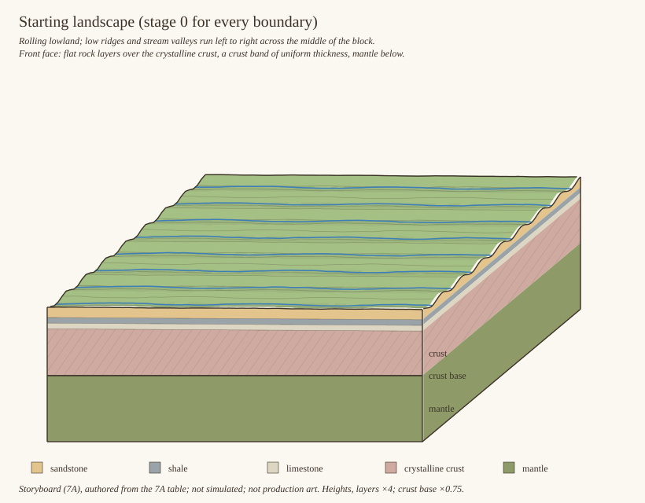
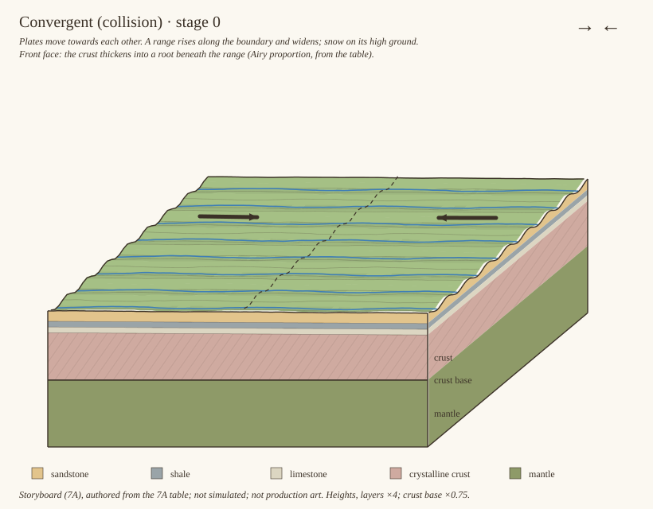
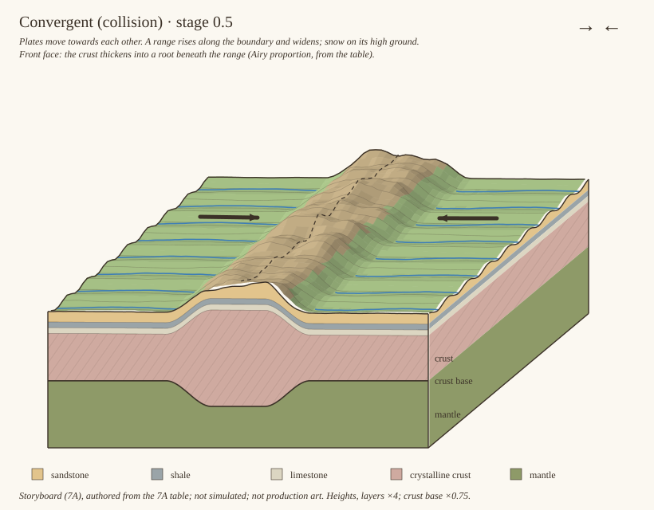
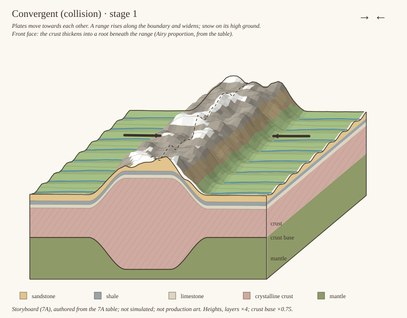
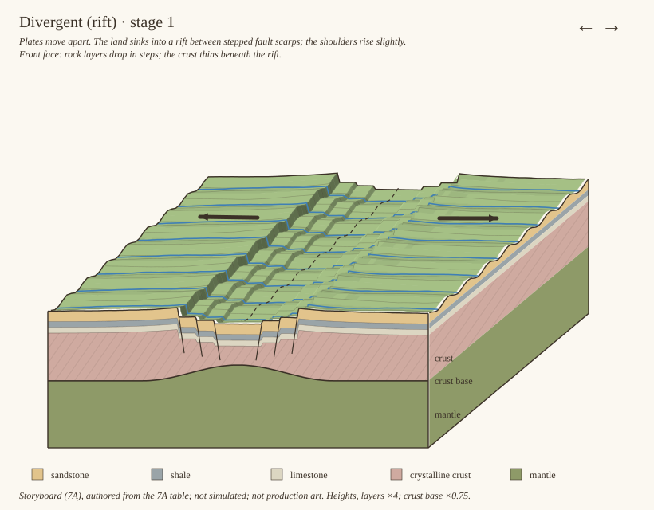
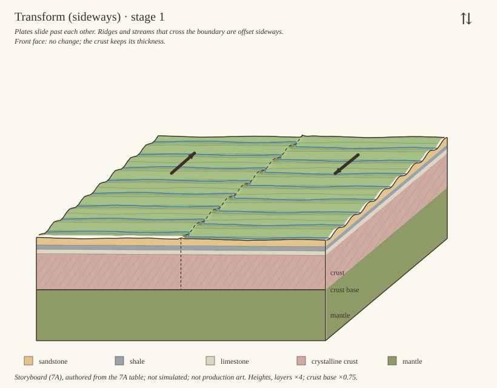
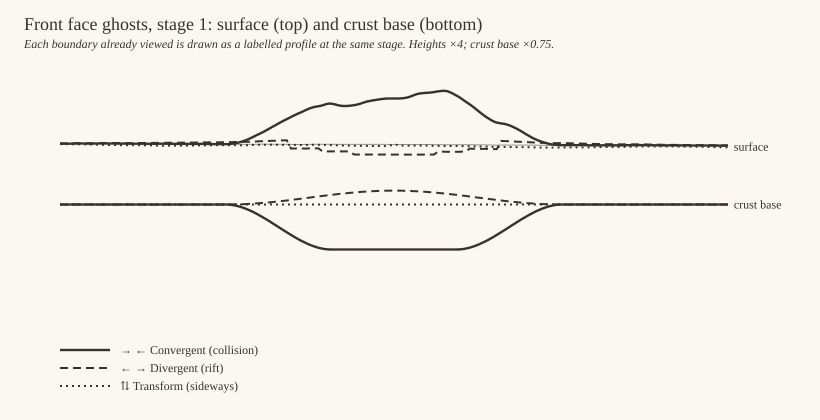
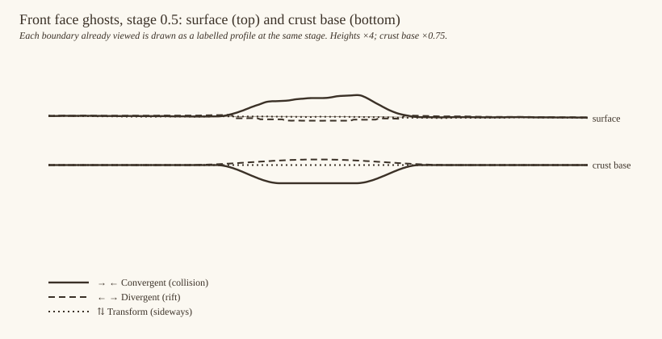

# Storyboard: Where plates meet (session 7A)

Storyboard frames for the owner, drawn from the 7A parameter table
([parameters.json](../../../science/plates/parameters.json), explained in
[parameters.md](../../../science/plates/parameters.md)). They are simple line drawings with natural
colours, not production art: 7C builds the real generators and 7R reviews them on the real block.

**Every shape here is authored, not simulated.** The scene is an illustration (D-L2-1); these frames are
sketches of it.

Regenerate from the repository root (deterministic; same output every time):

```sh
node docs/review/plates/brief/storyboard.mjs
```

The script also writes [crust-geometry.json](crust-geometry.json) (surface, crust thickness, Moho depth and
the crust-base field value at stage 0, 0.5 and 1 for each boundary), which 7C can use as expected values.

## How to read a frame

- Oblique block, about 160 km square. The plate boundary is the dashed line from back to front through the
  middle; the front face cuts across it.
- Heavy arrows on the surface are the two plates' motions, as on the page's picker glyphs (→ ← convergent,
  ← → divergent, ⇅ transform).
- Front face, top to bottom: three rock layers (sandstone, shale, limestone), crystalline crust (hatched),
  the crust base (heavy line), mantle.
- **Two vertical scales:** heights and rock layers ×4; crust depths ×0.75 (compressed; an artistic choice,
  parameter row 3). Lines in blue are streams; white is snow above the cited snowline.

## The starting landscape (stage 0 for every boundary)

Rolling lowland, low ridges and stream valleys running left to right across the boundary, flat rock
layers, and a crust band of uniform thickness. See
[the science brief](../../../science/plates/README.md#the-starting-landscape).



## Convergent: a collision range (reference: the Himalaya and Tibet)

| Stage 0                                        | Stage 0.5                                         | Stage 1                                        |
| ---------------------------------------------- | ------------------------------------------------- | ---------------------------------------------- |
|  |  |  |

The range rises along the boundary and widens; snow appears on the highest ground only near stage 1. On
the front face the layers bend up with the range and the crust thickens into a root deeper than the range
is high (the cited Airy proportion).

## Divergent: a rift valley (reference: the East African Rift)

| Stage 0                                      | Stage 0.5                                       | Stage 1                                      |
| -------------------------------------------- | ----------------------------------------------- | -------------------------------------------- |
|  |  |  |

The land sinks between three stepped fault scarps on each side, and the shoulders rise slightly. The
ridges and streams drop with the floor. On the front face the layers are offset at each fault and the
crust thins beneath the rift.

## Transform: offset ridges and streams (reference: the San Andreas at Wallace Creek)

| Stage 0                                      | Stage 0.5                                       | Stage 1                                      |
| -------------------------------------------- | ----------------------------------------------- | -------------------------------------------- |
|  |  |  |

The two sides slide past each other (right-lateral: looking across the boundary, the far side moves to
the right), so every ridge and stream jogs where it crosses. Relief and crust do not change; the front face
is the same as at stage 0 apart from an optional fault line.

## Comparing boundaries: ghost profiles on the front face

As on the page, boundaries already viewed appear as labelled profiles at the same stage: the range rises
and its root deepens where the rift sinks and its crust thins.





## Observations for 7R (the owner's look review)

1. **Front face height.** With the crust compressed to ×0.75 the face, from the block base to the highest
   peak, is about 51 % of the block's width (63 % at true depth). Compressing further makes the root read
   shallower than the range is high; see the options table in
   [parameters.md](../../../science/plates/parameters.md#crust-display-scale-decision).
2. **Two vertical scales.** The layers near the surface are ×4 and the crust ×0.75, so the face is not one
   scale. The caption binds both factors. Alternative: one scale for everything, at the cost of either a
   flat range or a block taller than it is wide.
3. **The transform offset reads best from above.** At stage 0.5 (4 km) it is subtle in this oblique view;
   at stage 1 it is clear. 7D's camera or a top-down moment may help.
4. **The rift is shallow next to the range** (1,700 m of relief against 5,100 m), true to the references.
   Its steps and the dropped layers on the face carry it.
5. **Layers on the walls.** The front faces here bend and offset the layers with the surface. The real
   stage needs the per-cell layer offset (D-W7-7A) to do the same; otherwise the range looks carved from
   flat beds.
6. **Colours** are natural (vegetation green, rock tan and grey, snow, rock-layer colours, a pink crust and
   an olive mantle). The boundary picker's own glyphs and patterns are 7D's.
