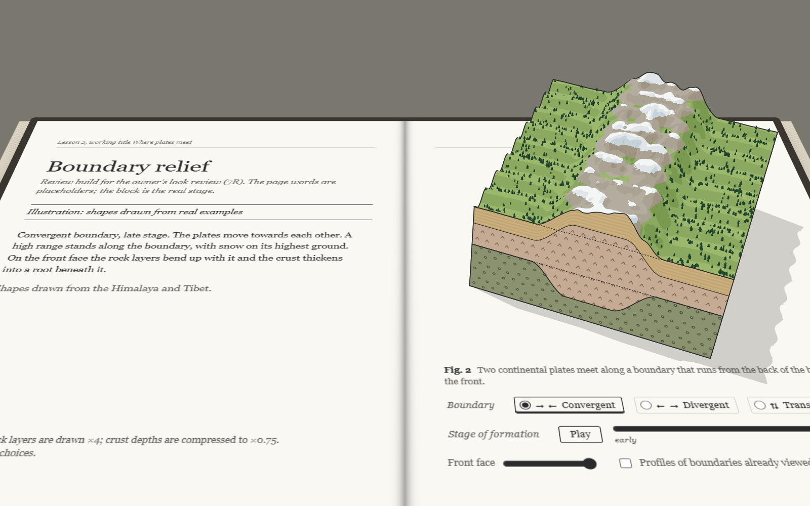
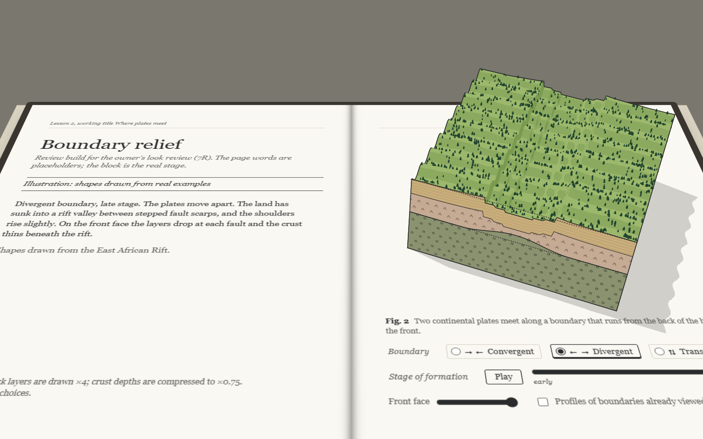
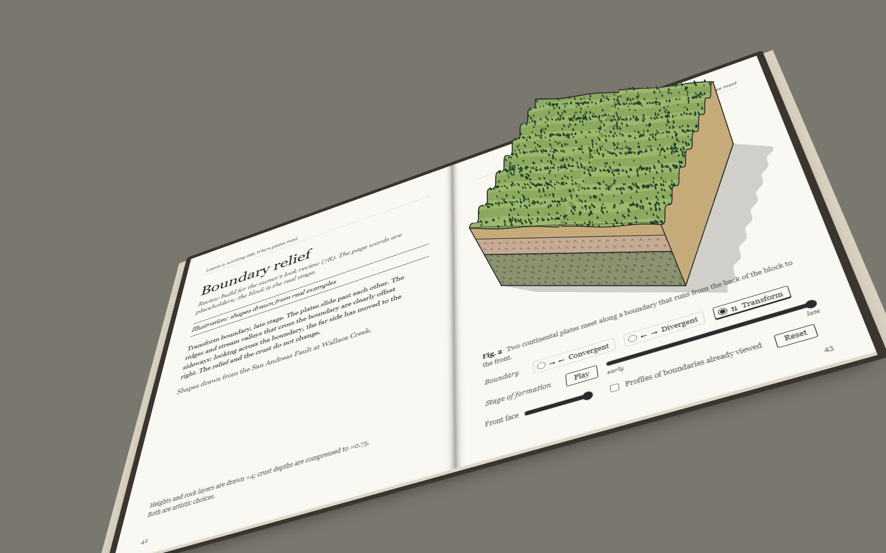
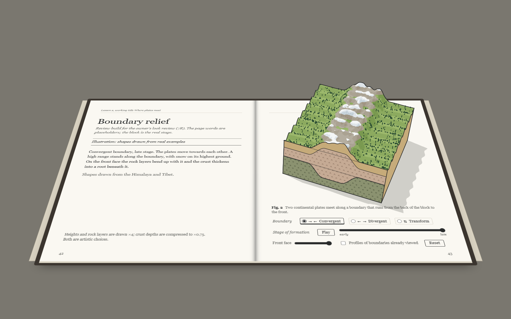
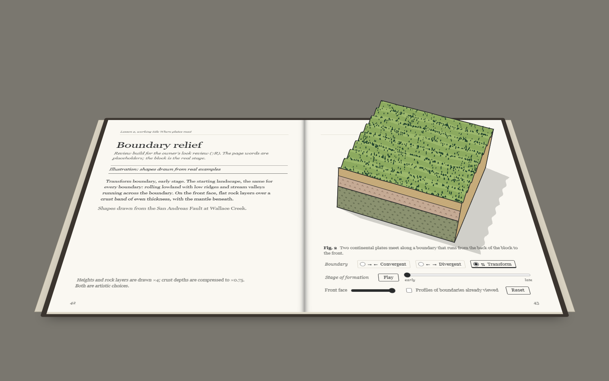
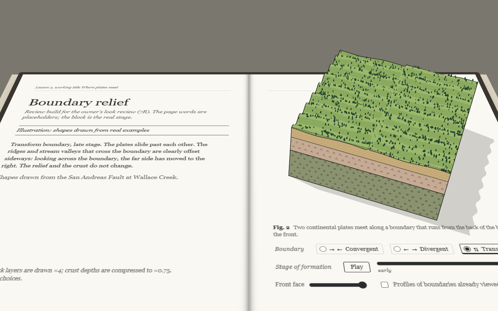
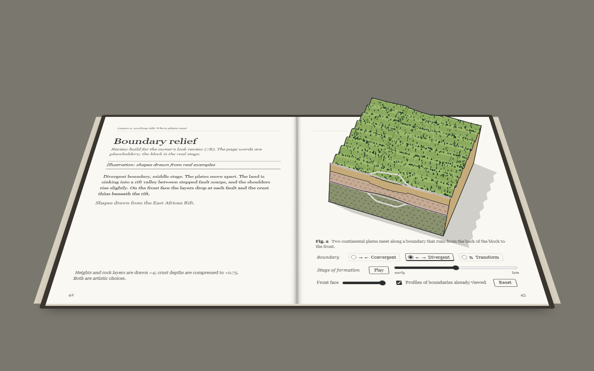
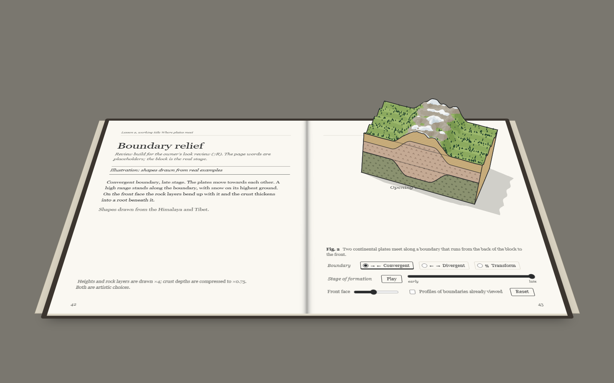
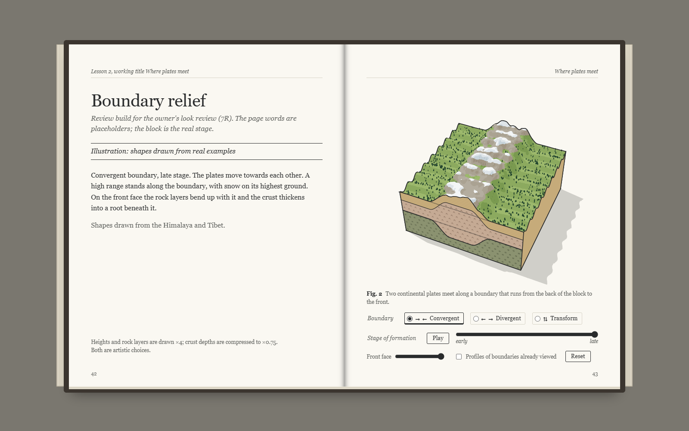

# Boundary relief on the real block (7C, updated by 7R2 after the owner's look review)

Captures of the review build: the three boundary relief generators
(`uplift/book/src/scenes/plates/relief/`) drawn on the real book stage. That is 7B's `ValleyDiorama`, with
the crust band on the front face and the rock-layer offset, standing on the tilted book page.

**Every shape here is authored, not simulated** (D-L2-1). The block is an illustration drawn from formulas
in the parameter table (`docs/science/plates/parameters.md`, version 7R-1). Nothing flows, moves material
or forms. The page words in the captures are review placeholders; 7E writes the lesson copy.

**What changed since the 7R review (D-W7-7R, implemented in 7R2, D-W7-7R2).**

1. Starting ridges are 1,500 m crest to trough (row 10, ARTISTIC; was 500 m), for all three boundaries.
2. The rift's shoulder-to-floor relief is 2,100 m (rows 28 + 29: floor 1,500 m down, shoulders 600 m up;
   was 1,700 m), the top of the cited range. The crust under the rift axis stays 25 km.
3. **Cover rock above the crust.** The front face now shows the layered cover rock (the start's three
   layers, 3 × 600 m) from the surface down to the new `coverBaseM`. It bends up under the range, steps
   down at each rift fault and is unchanged by the transform. The crust band starts under it.
4. The tan streaks in the mantle band are gone (see "Mantle streaks" below).

## How to open and regenerate

```sh
pnpm dev   # then open http://localhost:5173/src/scenes/plates/relief/review/
node uplift/book/src/scenes/plates/relief/review/capture.mjs   # rewrites the PNGs and captures.json here
node uplift/book/src/scenes/plates/relief/review/capture.mjs --gpu --only=front-face   # real GPU → gpu/
```

Query parameters (all view-only): `boundary=convergent|divergent|transform`, `stage=0..1`,
`viewed=<boundary>,…` (ghost profiles), `cut=0..1`, `mode=tilted|flat`, `tilt=`, `orbit=`, `zoom=`,
`trees=0..1`, `hachure=0..1`, `tile=<m>` (wall pattern tile), and two labelled look probes, `ridge=<m>`
and `crust=0`. The page also has the boundary picker, a stage scrubber with Play, the front-face slider
and a ghost toggle. All of them run through 7B's authored-sequence source, with no model time.

Captured headless with Chromium (Playwright, SwiftShader WebGL2) at 1600 × 1000 CSS px. The relief is
seeded, so the fields are identical on every run. [captures.json](captures.json) records each frame's
query, backend, renderer and text alternative. [gpu/](gpu/) holds the front faces rendered on a real GPU
(Intel Arc 140V, ANGLE Direct3D 11), with their own captures.json.

## For the owner: the four to look at

| What to confirm                                                        | Capture                                                      |
| ---------------------------------------------------------------------- | ------------------------------------------------------------ |
| Cover rock bends up under the range, over the crust band and its root  |  |
| Cover rock steps down at each rift fault; the deeper rift; crust thins |    |
| Transform from above: the 1,500 m ridges offset across the boundary    |            |
| Transform from an oblique camera                                       |          |

On the front face, from the top: the **layered cover rock** (the top layer's sandstone colour, with a
bedding line every 600 m that follows the layer offset), a **light ink line** at the cover base, the
**crust band** ("v" ticks), a **heavy ink line** at the crust base, and the **mantle** (rings). The three
bands read apart without colour: parallel bedding lines, ticks, rings, and two line weights. The dashed
lines are the starting surface and the starting crust base.

## The starting landscape (stage 0 for every boundary)


## The three boundaries at stage 0, 0.5 and 1

| Boundary   | Stage 0                                        | Stage 0.5                                         | Stage 1                                        |
| ---------- | ---------------------------------------------- | ------------------------------------------------- | ---------------------------------------------- |
| Convergent |  |  |  |
| Divergent  |    |    |    |
| Transform  |    |    |    |

Stage 0 is bit-for-bit the same field for all three boundaries (tested).

## Inspecting

| What                                                             | Capture                                                    |
| ---------------------------------------------------------------- | ---------------------------------------------------------- |
| Front face, transform at stage 1: cover, crust, mantle unchanged |  |
| Transform from above, without trees                              |          |
| Ghost profiles: convergent at stage 1, with divergent, transform |                    |
| Ghost profiles: divergent at stage 0.5, with the other two       |                 |
| Front face slid halfway along the boundary                       |             |
| Flat (untilted) page                                             |                   |

7C's look probes for 7R (bare and hachured blocks, the 1,500 m ridge probe, the crust-off front faces and
the side wall) were answered by D-W7-7R and are no longer captured; they remain in the 7C commit
(3a8324f).

## Mantle streaks (lead item in D-W7-7R)

7C saw thin tan streaks across the mantle band. **Cause:** the front wall was drawn from the surface down
to the block's base, and the crust and mantle meshes lay in front of it, only 10 m (0.01 cell) away on a
160 km block. Where the two surfaces' depths rounded to the same value, the wall's sandstone won. The
streaks run along lines of constant depth, which is why they are near-vertical, parallel and sparse.
**Real GPU:** the same build with the fix disabled shows no streaks on an Intel Arc 140V (ANGLE
Direct3D 11, 24-bit depth; [gpu/streaks-before-fix-gpu.png](gpu/streaks-before-fix-gpu.png)), while
SwiftShader does ([gpu/streaks-before-fix-swiftshader.png](gpu/streaks-before-fix-swiftshader.png)). So it
was a depth-precision artefact of the software renderer, which a weaker GPU could also show. **Fix
(engine):** with a crust band, the front wall now stops at the top of the band (the cover base, or the
surface without one), so nothing lies behind the band and there is nothing to fight. The streaks are gone
on SwiftShader and on the GPU (all captures here and in [gpu/](gpu/)).

## Still open (for 7D and the lead)

- **One lithology in the cover.** The walls draw the snapshot's rock (the top layer, sandstone) with a
  bedding line every 600 m. The three named layers (sandstone, shale, limestone) are not drawn in their
  own colours; that would need a layered wall look in the engine. The bedding lines are horizontal at
  multiples of 600 m, so they do not line up exactly with the slightly tilted layer bases (1.5 m/km).
- **Side walls** keep the rock pattern down to the block's base, with no crust or mantle (a D-W7-7B open
  look question).
- **Streams, tree density and scarp shading** are 7D's (D-W7-7R).
