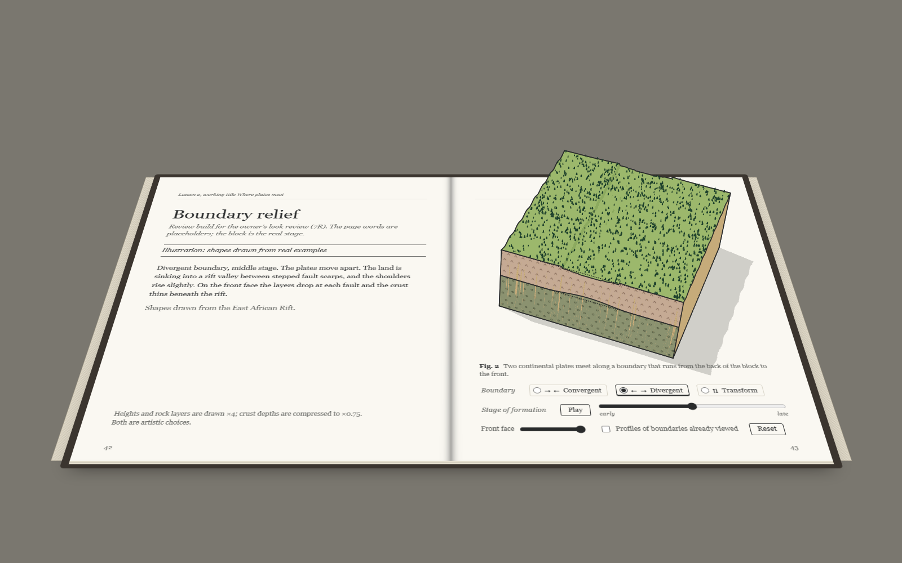
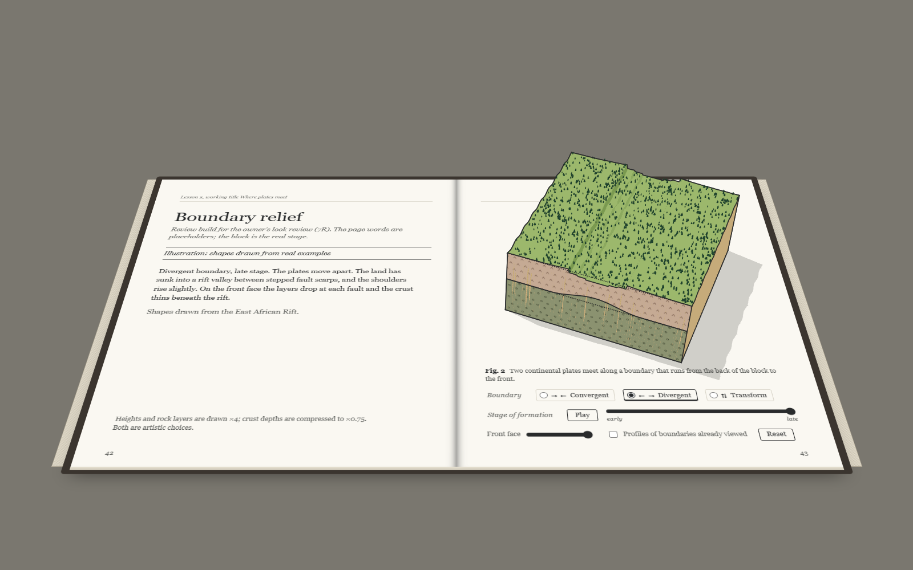
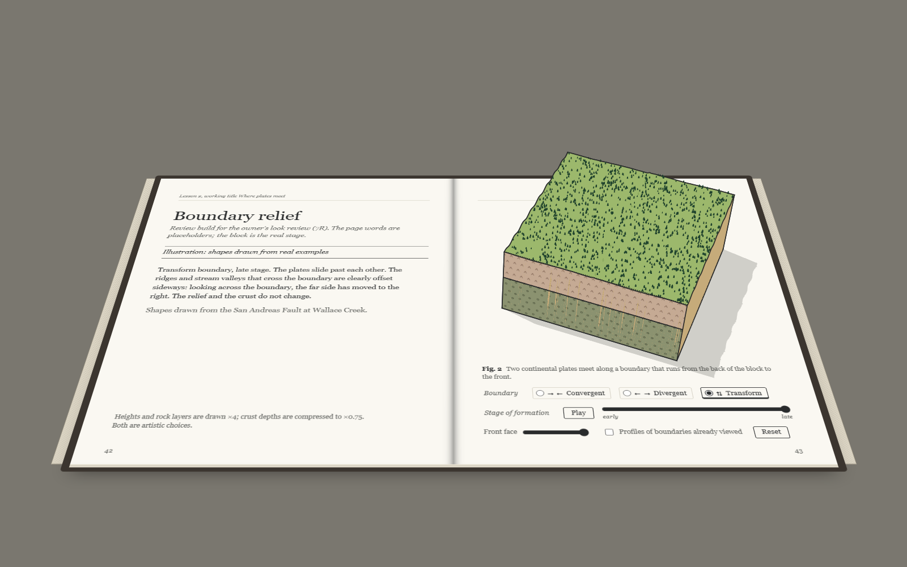
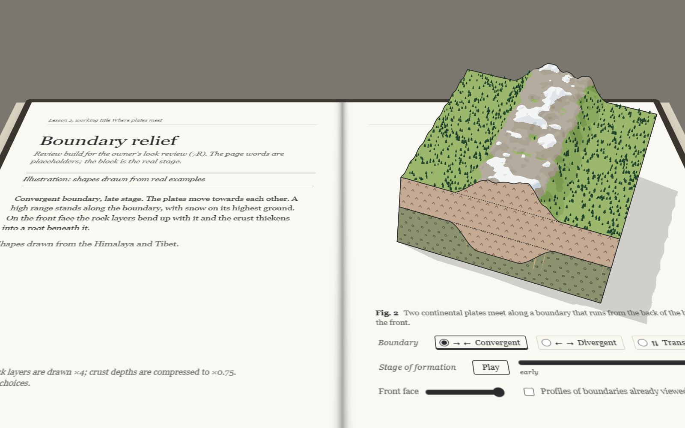
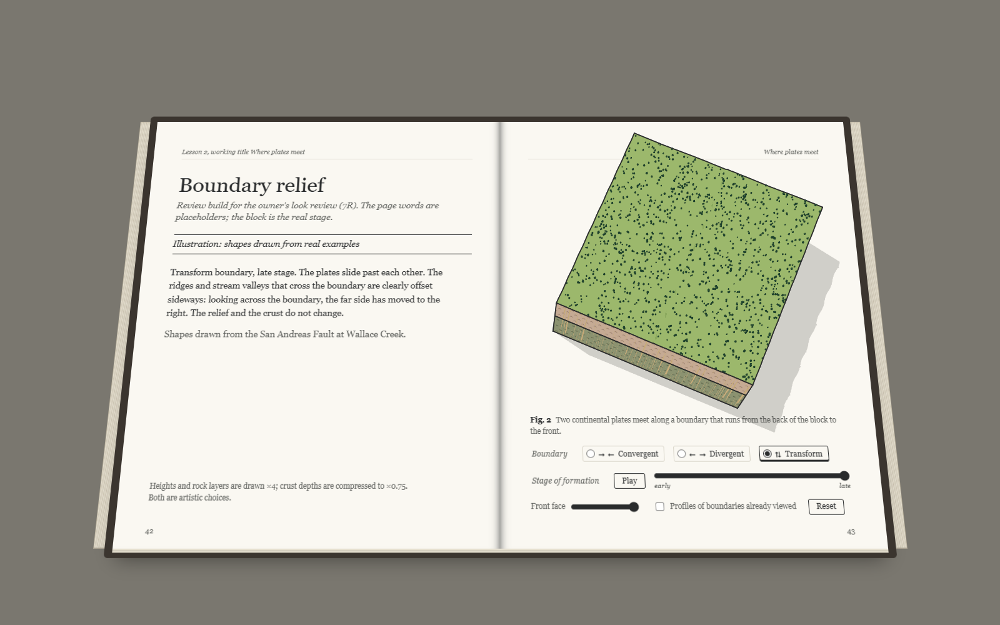
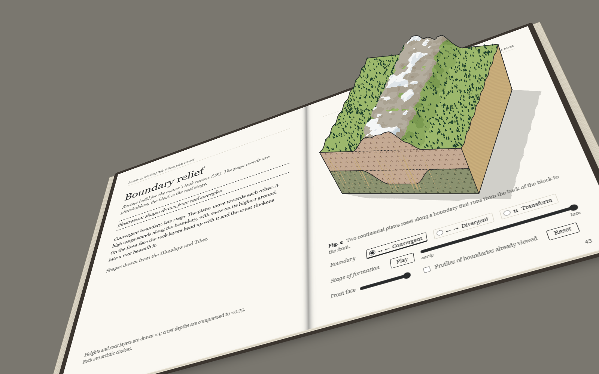
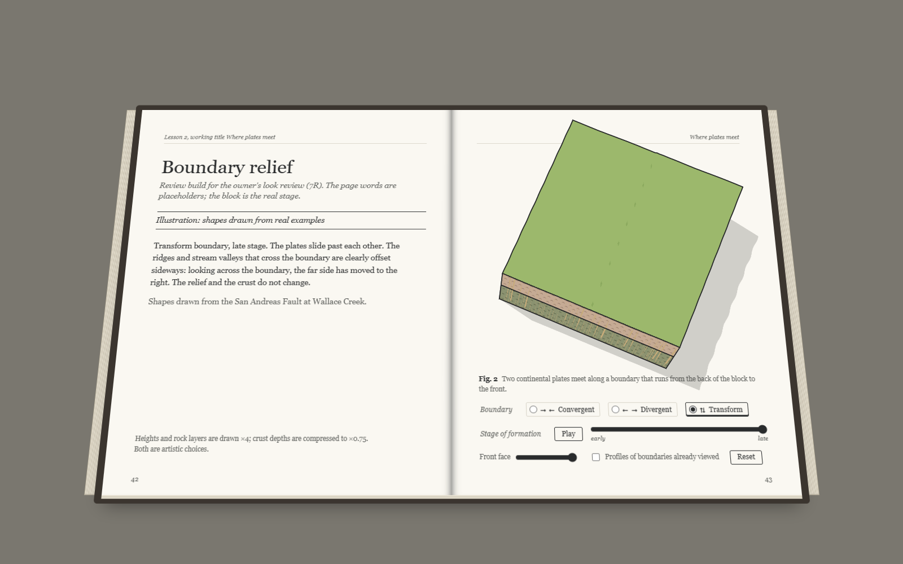
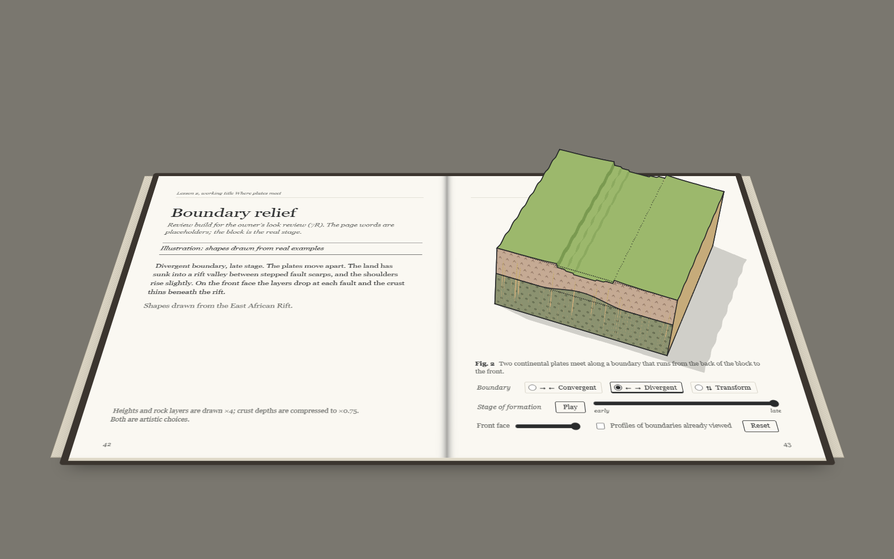
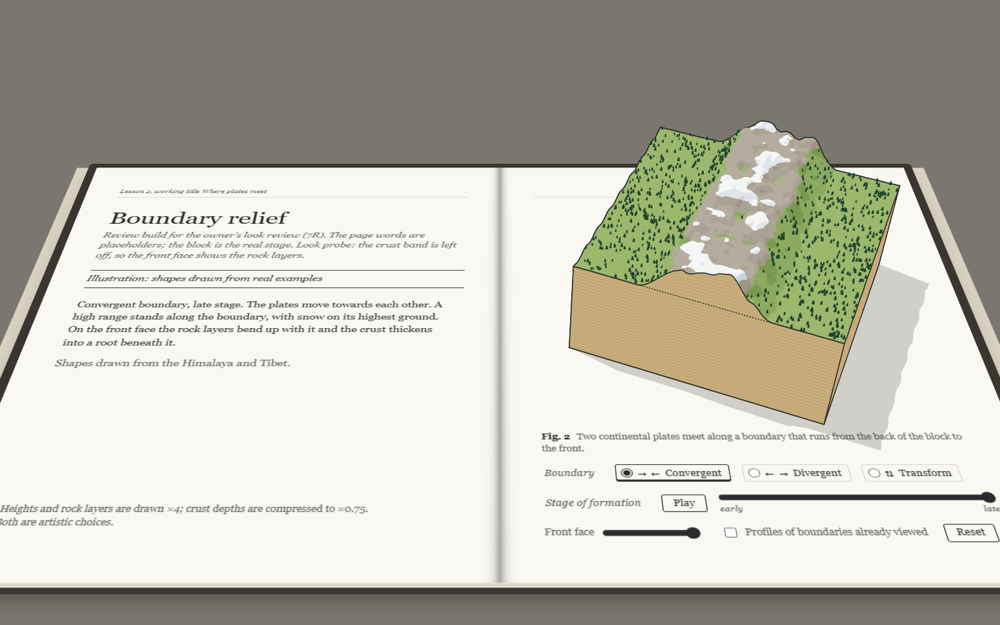
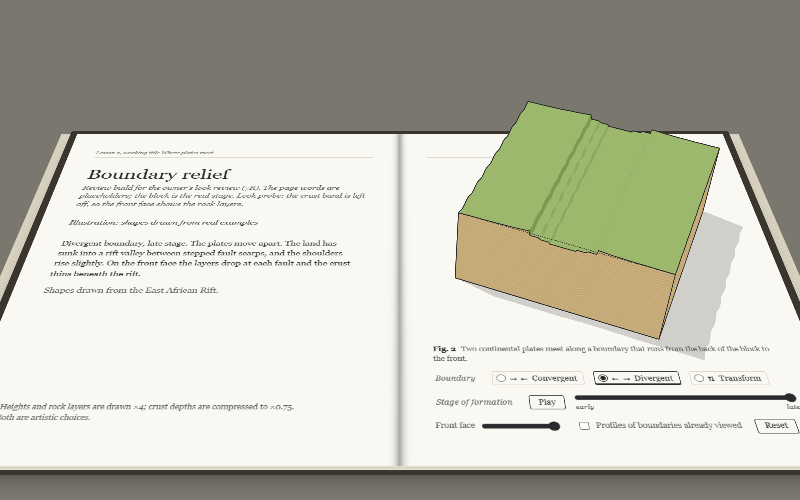

# Boundary relief on the real block (session 7C, for the 7R look review)

Captures of the 7C review build: the three boundary relief generators
(`uplift/book/src/scenes/plates/relief/`) drawn on the real book stage. That is 7B's `ValleyDiorama`, with
the crust band on the front face and the rock-layer offset, standing on the tilted book page.

**Every shape here is authored, not simulated** (D-L2-1). The block is an illustration drawn from formulas
in the 7A parameter table (`docs/science/plates/parameters.md`). Nothing flows, moves material or forms.
The page words in the captures are review placeholders; 7E writes the lesson copy.

## How to open and regenerate

```sh
pnpm dev   # then open http://localhost:5173/src/scenes/plates/relief/review/
node uplift/book/src/scenes/plates/relief/review/capture.mjs   # rewrites the PNGs and captures.json here
```

Query parameters (all view-only): `boundary=convergent|divergent|transform`, `stage=0..1`,
`viewed=<boundary>,…` (ghost profiles), `cut=0..1`, `mode=tilted|flat`, `tilt=`, `orbit=`, `zoom=`,
`trees=0..1`, `hachure=0..1`, `tile=<m>` (wall pattern tile), and two labelled look probes, `ridge=<m>`
and `crust=0` (below). The page also has the boundary
picker, a stage scrubber with Play, the front-face slider and a ghost toggle. All of them run through 7B's
authored-sequence source, with no model time.

Captured headless with Chromium (Playwright, SwiftShader WebGL2) at 1600 × 1000 CSS px. The relief is
seeded, so the fields are identical on every run. Pixels may differ slightly on a real GPU.
[captures.json](captures.json) records each frame's query, backend and text alternative.

## The starting landscape (stage 0 for every boundary)


## The three boundaries at stage 0, 0.5 and 1 (the 7A table, unchanged)

| Boundary   | Stage 0                                        | Stage 0.5                                         | Stage 1                                        |
| ---------- | ---------------------------------------------- | ------------------------------------------------- | ---------------------------------------------- |
| Convergent |  |  |  |
| Divergent  |    |    |    |
| Transform  |    |    |    |

Stage 0 is bit-for-bit the same field for all three boundaries (tested). On the front face the solid line is
the crust base, the dashed lines are the starting surface and the starting crust base, and the mantle lies
below.

## Inspecting

| What                                                                          | Capture                                               |
| ----------------------------------------------------------------------------- | ----------------------------------------------------- |
| Ghost profiles: convergent at stage 1, with divergent, transform              |               |
| Ghost profiles: divergent at stage 0.5, with the other two                    |            |
| Front face slid halfway along the boundary                                    |        |
| Camera zoomed in on the front face                                            |                 |
| Flat (untilted) page                                                          |              |
| Transform from a steep camera (the offset reads best from above)              |     |
| Camera turned to the right-hand side wall: flat layers, far from the boundary |  |

## Look probes (not the 7A table; for 7R to judge)

These change only the view or one ARTISTIC row, for comparison. Nothing here is the default.

| Probe                                                                                                | Capture                                                        |
| ---------------------------------------------------------------------------------------------------- | -------------------------------------------------------------- |
| No trees, steep camera: does the transform offset read on bare ground?                               |              |
| No trees: the rift's scarps on bare ground                                                           |                  |
| No trees, full-strength slope hachures                                                               |           |
| Same, divergent                                                                                      |           |
| **Starting ridges 1,500 m instead of 500 m** (row 10, ARTISTIC), no trees                            |          |
| **Crust band off**: the front face shows the rock layers bent up under the range by the layer offset |  |
| **Crust band off**: the layers drop in steps at each rift fault                                      |    |

## What the owner should judge at 7R

1. **The transform offset does not read at page size with the 7A table.** The starting ridges are 500 m
   crest to trough (row 10), drawn at ×4. On a block 160 km across that is about 1 % of the width, and the
   stage's three-tone shading gives their slopes the same tone as flat ground. The offset ridges are
   invisible in `transform-stage-1.png`, even from above and with hachures. With 1,500 m ridges (the probe)
   the offset reads at once. Options: raise row 10 (ARTISTIC, so the sourcing is untouched), draw stream
   lines in the valleys (7D dressing), or both. Raising the ridges also changes the starting landscape for
   the other two boundaries.
2. **The rift reads on one side only.** The scarps that face away from the light are shaded. Those that
   face it get the same tone as the floor and show only as an ink line. Is the 1,700 m of rift relief (rows
   28 and 29, cited) at ×4 enough, or does it need ink or shading help from 7D?
3. **The range reads well.** Snow on the highest ground from the cited snowline, a root on the front face
   about as deep as the range is high (crust ×0.75), and the range widening with the stage. Is ×4 right,
   and is the block's height acceptable?
4. **The bent rock layers do not show anywhere in the lesson's view (D-W7-7B2 open fact).** 7C emits
   `layerOffsetM` (range: `E(x)`, rift: `Δ(x)`, transform: 0), and the stage moves the wall layers by it.
   But with `crustBaseM` present, the crust band covers the whole front face from the surface down to the
   crust base. The left and right walls run parallel to the boundary and 80 km from it, where the offset is
   near zero (`layers-side-wall-convergent-stage-1.png`: flat bedding), and the back wall faces away. The
   `crust=0` probes show the bent and stepped layers on the front face when the band is off. Options:
   - (a) Keep the crust band over the whole face and drop the bent layers from the lesson's look. No
     engine work.
   - (b) Add an optional engine field, for example a cover thickness, so that the band starts below a
     layered cover rock, as in the storyboard. That is engine work in Hachure; the lead names the field,
     and 7C would emit it (the cover is the three start layers, 1,800 m, row 14).
   - (c) Toggle between the two views: crust band, or rock layers. That is a 7D interaction, with no
     engine work.

   Whichever is chosen, the walls draw **one** lithology repeated, with a bedding line every
   `patternTileM`. This build sets that tile to one start layer (600 m, row 14, bound from the config):
   the stage's default 220 m tile is far below a pixel on a 160 km block, and the walls read as plain
   colour. The three named layers (sandstone, shale, limestone) are not drawn as separate colours. That
   would also need engine work.

5. **Tree density.** At the stage's default the forest hid the ridges, so this build draws trees at a
   twentieth of eligible cells (`trees=0.05`), a review choice. 7D owns the dressing. Should the lowland be
   sparse forest, meadow, or something else?
6. **Streams are not drawn.** Lesson 1's single meltwater-river rule does not fit this block, so it is off.
   One stream per valley by steepest descent is 7D's dressing (wave plan §3).
7. **Mantle depth.** The stage adds a 20 % margin below the deepest crust base, so the block base sits
   about 15.6 scene km below sea level (about 83 km on the crust's scale), not the 13.5 scene km (72 km)
   of row 4. The mantle band is thicker than the storyboard's. The side walls also keep the rock pattern
   down to the base, with no crust or mantle on them (a D-W7-7B open look question).
8. **Colours** are natural: vegetation, bare rock, snow, a pink crust band and an olive mantle (7B's
   crust look). Do they match the storyboard the owner approved?

## Engine facts seen in the captures (for the lead and 7B)

- **Tan streaks in the mantle band** on every front face: the side wall's sandstone colour shows through
  the mantle mesh, probably z-fighting between the wall and the mantle quads on the cut face. Seen on
  SwiftShader; check on a real GPU before 7R.
