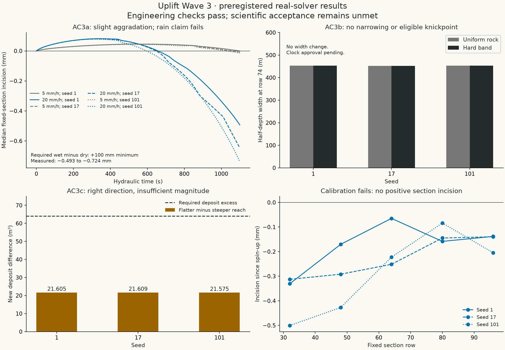

<!-- expert-review -->

# Wave 3 validation packet: scientific exit not met

Run date: 2026-11-09 UTC. The corrected CPU model completed all eighteen preregistered
experiments without a stability rejection. Every sampled solid/water budget passed.
**AC3a, AC3b and AC3c nevertheless fail their specified acceptance conditions on every
seed. T6 is inconclusive. Landscape calibration failed. Wave 3's scientific gate remains open.**



| Criterion                                   |                  Seed 1 |                 Seed 17 |                Seed 101 | Required result                                                             |
| ------------------------------------------- | ----------------------: | ----------------------: | ----------------------: | --------------------------------------------------------------------------- |
| AC3a wet-minus-dry incision (m)             |            -0.000492767 |            -0.000638131 |            -0.000723714 | At least +0.1 m, wet incision positive; final three samples agree           |
| AC3b uniform/band width (m)                 | 452.670866 / 452.670866 | 452.514047 / 452.514047 | 452.588696 / 452.588696 | Band at most 90% of uniform and at least half a cell narrower               |
| AC3b eligible final knickpoints             |                       0 |                       0 |                       0 | Persistent candidate in band or specified upstream reach, absent in uniform |
| AC3c flatter-minus-steeper new deposit (m³) |               21.605105 |               21.608556 |               21.575206 | At least 64.000001 m³ (5% of stored initial suspension)                     |
| T6 scored prediction                        |            Inconclusive |            Inconclusive |            Inconclusive | Same supported classification across final samples and all seeds            |
| Calibration positive sections               |                  0 of 5 |                  0 of 5 |                  0 of 5 | Resolved positive incision suitable for an approved field analogy           |

All fixed baseline and final current channel paths are complete. For AC3c, exact incoming
sediment is positive in both arms and reach storage closes against actual limited face
transfers. Thus the deposition direction is observed, but its preregistered magnitude
does not pass. The rainfall sections show slight aggradation at the endpoint. The hard
band's widths and geometry are unchanged relative to uniform rock over this horizon.
These are observations from this model, not claims about all natural catchments.

The final width changes in the rainfall comparison are about 0.003–0.006 m, below the
specified approximately 22.63 m threshold. Neither the deeper nor the wider predicate
passes. An inconclusive result is not an answer choice. Keep the prediction unscored.

## Calibration and release status

All fifteen fixed sections have nonpositive incision between steps 2000 and 22000.
There is no valid positive measurement from which to derive the proposed geological
clock. Each uniform-arm JSON includes the raw section values, rejection reasons,
proposed literature target and sensitivity range, null candidate factor, solver/config
provenance, and pending approver/date. The factor remains the default sentinel in the
typed configuration; no numerical landscape years are authorised.

The public `V_VALLEY_SCIENCE_STATUS` metadata is generated from this assessment. It is
not approval. Domain-expert review of the resistance adaptation, parameter envelope,
field analogy and content remains pending. A test passing for code correctness cannot
be substituted for the failed scientific acceptance conditions.

## What was run

The protocol remains [the preregistered specification](../validation-spec.md):
CPU 128², 10 m cells, fixed 0.05 hydraulic seconds, seeds 1/17/101, 22000 steps for
landscape arms and 10000 for transport arms. The actual tilted-plateau preset supplies
geometry and the spring. Hardness is changed only in the specified band. The AC3c
fixture derives from the same preset, continuously changes the downstream slope,
and adds the prescribed initial suspended/water pulse. No scripted landform, altered
horizon, selected seed, relaxed acceptance threshold or fitted outcome was used.

`seed-<seed>-<arm>.json` contains every 200-step metric sample, resolved config, config
SHA-256, initial/final state hash, outlet base level, source, empty terrain-tool log,
stability diagnostics and SHA-256 fingerprints of the exact source files used.
The recorded Git base is the merged hydraulic correction; fingerprints additionally
identify the uncommitted diagnostic/validation implementation used for the run.
Later rebasing onto content-only main changes does not change those run inputs.

Incision and mass closure use authoritative CPU float64 stocks. Widths and profiles
use the public float32 snapshots, as the existing probe contract does. This distinction
is explicit; the small rainfall endpoint changes are not promoted to a passed claim.

Baseline paths are frozen at step 2000. Current paths are traced separately at each
sample. Baseline and current knickpoint candidate sets and completeness are stored
separately; incomplete paths cannot satisfy a full-reach claim. Persistence remains
unapproved because no geological calibration exists.

## Exact reach diagnostic

The CPU's optional full-width row-reach diagnostic captures the stage-five limited
sediment face transfers before slumping reuses the scratch buffers. It integrates
north/south interfaces plus exterior side outflow, in cubic metres, and accumulates
only after the step's guards accept it. Reset clears its counters.

This is not the point probe's post-step discharge-times-concentration estimate.
Synthetic tests verify reach stock closure, unchanged solver state with the diagnostic
enabled, rejection/reset behaviour, and unchanged shared CPU/GPU water fixtures.
GPU kernel comparisons remain owned by session 3C; no GPU-parity claim is made here.

## Retained evidence and explicit deviation

- JSON and summary CSV retain measurements every 200 steps, including float64 section
  minima/incision, widths, both path-completeness flags and candidate sets, budgets,
  guard state and exact reach transfers.
- `*-profiles.csv` and `*-sections.csv` retain full sampled profiles and fixed-section
  ground/water/discharge rows only at step 0, step 2000 and the final step.
- Full terrain snapshots are **not archived**. This is a retention deviation from the
  specification's full-state save schedule, not a changed experiment. The approximately
  ten-megabyte draft packet retains the samples used for every acceptance decision;
  exact configs, seeds and source fingerprints allow deterministic replay for denser
  inspection. No full-snapshot archive is claimed.
- `summary.json` is recomputed from raw records, and the test suite verifies the
  published classifications and engineering checks. `outcomes.png` is generated by
  Matplotlib from the same records; `plot.py` is included.

## Reproduce and check

From the repository root:

```sh
node hachure/terrain/src/validation/run.mjs
node hachure/terrain/src/validation/assess.mjs
pnpm check
pnpm build
node hachure/terrain/src/validation/assess.mjs --require-pass
```

The first command runs three independent seeded workers, each processing its six arms
serially; per-run arithmetic and reductions remain fixed-order. It takes several minutes.
Pass a seed (for example `run.mjs 17`) to replay that seed. Dependencies come from the
locked workspace; generated runner bundles live in ignored node_modules cache.

The final command is the **scientific acceptance gate** and currently exits nonzero,
as it must. Ordinary implementation/evidence tests are green; they do not assert that
failed scientific criteria passed. Regenerate the figure with `python plot.py` in this
directory after installing Matplotlib; the image is an evidence artifact, not a model input.

## Sources and next decision

The process equations and units are in [model.md](../model.md) and
[hydraulic-resistance.md](../hydraulic-resistance.md), with USACE references for the
Manning-style adaptation. Measurement definitions and acceptance margins are engineering
proposals in [validation-spec.md](../validation-spec.md). The provisional denudation
analogy and its limitations remain in [time-scale.md](../time-scale.md) and the
[source verification register](../sources.md).

The next science session must diagnose why the corrected model does not satisfy the
intended learning claims and propose a preregistered revision for review. It must not
relax thresholds after observing these outcomes or retrofit a landform to obtain a pass.
