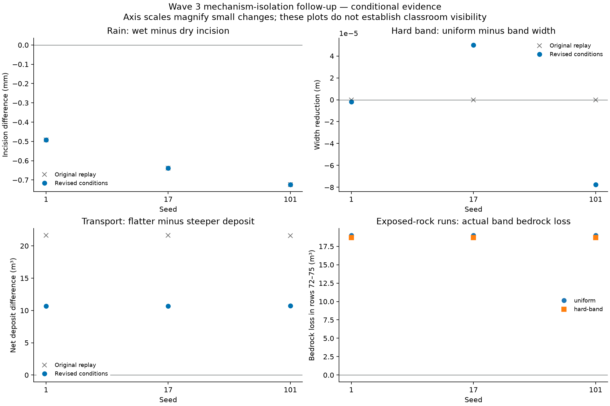

<!-- expert-review -->

# Wave 3 follow-up: causes diagnosed; prioritize visible relationships

Completed 2026-11-09. **All 36 registered arms finished**: eighteen original replays
and eighteen revised experiments, using all seeds and unchanged fixed horizons.
Every recorded solid/water budget and stability check passed. All eighteen original
final state hashes, every scientific sample, configs and calibration records replay
exactly. The [original failed packet](../README.md) and public lesson status are preserved.

The [preregistration](preregistration.md) and experiment implementation were frozen
in commit [0835b51](https://github.com/JohnnnyTang/uplift/commit/0835b51) before the runs.
Raw records carry that commit, exact configs, source fingerprints and state hashes.
No solver equations, thresholds, seeds or durations were tuned after seeing results.

During execution, the owner clarified that this is an education app: clear visible
cause and effect and relative outcomes take priority over quantitative field accuracy.
That direction is now recorded in [education-policy.md](../../education-policy.md)
and the handoff/plan. Geological calibration is optional for a clearly labelled
qualitative model. The historical numeric criteria remain unchanged in this packet;
they no longer constitute the entire educational release gate.



## What the experiments establish

The revised landscape arms expose bedrock by removing the uniform loose cover.
Ground and outlet shift down equally, preserving relief exactly. The transport
arms move the same water/sediment pulse immediately upstream of the slope change.
Everything else is unchanged. Descriptive ratios below summarize endpoints; they
are not newly invented pass thresholds or field predictions.

| Seed | Wet/dry gross erosion ratio | Wet-minus-dry fixed-section incision (mm) | Hard-band bedrock-loss reduction vs uniform | Flatter-minus-steeper new deposit (m³) | Deposit increase vs steeper |
| ---- | --------------------------: | ----------------------------------------: | ------------------------------------------: | -------------------------------------: | --------------------------: |
| 1    |                      2.4084 |                                 -0.492698 |                                     1.5682% |                              10.690951 |                    24.3430% |
| 17   |                      2.4092 |                                 -0.638044 |                                     1.5640% |                              10.699510 |                    24.3578% |
| 101  |                      2.4087 |                                 -0.723608 |                                     1.5661% |                              10.701170 |                    24.3576% |

**Rain: material movement, not demonstrated valley deepening.** Higher rain causes
more gross erosion in this controlled model, but the fixed section minima aggrade
slightly. The new exposed-rock setup does not reverse that result. More mobilized
material is therefore a promising teaching relationship; “a deeper valley” is not
an interchangeable description of it. A new question/visual demonstration should
be registered and validated before changing the current unscored prediction.

**Rock resistance: shielding was real, but exposure alone is insufficient for the
intended landform.** All original uniform/hard-band runs have zero bedrock erosion;
minimum remaining band cover is about 0.9984 m. The hardness intervention never
reaches bedrock. Removing that cover makes the intervention active: harder rock
loses about 1.57% less bedrock volume within the band. Nevertheless, width differences
are extremely small, have mixed signs across seeds, and the slope-break detector
finds no eligible candidates. Do not present that as a visible gorge or waterfall.

| Seed | Uniform half-depth width (m) | Hard-band half-depth width (m) | Eligible final slope-break candidates |
| ---- | ---------------------------: | -----------------------------: | ------------------------------------: |
| 1    |                452.670931448 |                  452.670933324 |                                     0 |
| 17   |                452.513925540 |                  452.513875475 |                                     0 |
| 101  |                452.588548327 |                  452.588625809 |                                     0 |

**Slope: a consistent relative deposition effect survives both setups.** Original
flatter-reach sediment entry is only about 2.19% of the initial pulse. Conservation
bounds its net deposit below the old 5%-of-pulse absolute difference requirement.
Adjacent pulse placement increases entry to about 4.78% in the flatter arm and
8.20% in the steeper arm. Net deposits are about 54.6 versus 43.9 m³: roughly 24%
more in the flatter reach, with exact reach closure on every seed. The difference
is actually smaller than the original roughly 21.6 m³ contrast. This rejects the
stronger interpretation that moving supply nearer would necessarily increase the
between-arm contrast. It supports a conditional relative effect, not a claim that
all initial sediment reached the experiment or that the old magnitude gate passed.

## Historical scores and educational interpretation

The unchanged legacy assessment fails AC3a, AC3b and AC3c on every revised seed.
T6 remains inconclusive and every uniform-arm calibration still fails. The revised
incision contrast is negative; no consistent narrowing or qualifying knickpoint
appears; deposition excess is about 10.7 m³ against the recorded 64 m³ margin.
The [machine-readable assessment](summary.json) preserves all endpoint and final-three
sample values. `assess-followup.mjs --require-pass` exits 1 for those legacy criteria.
That expected nonzero result is separate from the passing engineering test suite.

Under the owner's updated priorities, the deposition direction and greater gross
erosion are useful findings even though a historical absolute threshold fails.
The remaining educational work is to make the chosen relationship clear in the
actual renderer, compare the paired states, and align one question/explanation
with it. These magnified-axis plots are diagnostic figures, not proof of classroom
legibility. No visual demonstration, revised scored answer or successful waterfall
challenge is claimed by this packet.

**Next Wave 3 work should prioritize the visible teaching interaction**, using the
new policy: register the claim/view and practical run horizon; show a stable relative
effect at classroom scale with an accessible text counterpart; then wire the tested
answer. Avoid extending the calibration study merely to obtain landscape years.
If a slope-break challenge uses model-time persistence, register and implement that
explicitly before awarding a stamp. No further scenario tuning was done in this run.

## Verification

`pnpm check` passed: typecheck, lint, formatting and all 431 tests across 45 files.
`pnpm build` passed. The frozen numeric gate returned the expected exit 1.
The generated Matplotlib figure was visually inspected; the original records,
CPU/GPU physics and public prediction/calibration status are unchanged.

## Evidence and reproduction

- `baseline-replay/` and `revised/`: every JSON run, metric CSV, section/profile CSV
  and per-seed completion manifest. No failed seed or arm was removed.
- Passive diagnostics record actual global/band bedrock loss, minimum loose cover
  and wet exposed band cells. They do not mutate the model.
- Retention remains as registered: metric samples every 200 steps; full section/profile
  rows initially, at step 2000 and at the endpoint. Full terrain snapshots are not
  archived. Source/config hashes allow replay; no full snapshot archive is claimed.
- `followup.test.ts` checks intervention isolation for every seed/arm.
  `followup-evidence.test.ts` rejects missing/duplicate/mixed cohorts, verifies replay
  and recomputes the complete published assessment. These are engineering checks.
- Physics and GPU code are unchanged. Existing solver/comparison tests remain intact.

From the repository root:

```sh
node hachure/terrain/src/validation/run.mjs --followup
node hachure/terrain/src/validation/assess-followup.mjs
python docs/science/validation/followup/plot.py  # requires Matplotlib
pnpm check
pnpm build
node hachure/terrain/src/validation/assess-followup.mjs --require-pass
```

The last command intentionally tests the frozen numeric criteria, not the new
educational gate. It remains nonzero. Calibration approval stays false, and no
numeric geological years or prediction answer were installed.

Sources: the inspected layered-material mechanism in
[Šťava et al. (2008), §§3/5](https://www.cs.purdue.edu/cgvlab/www/resources/papers/Stava-2008-Interactive_Terrain_Modeling_Using_Hydraulic_Erosion.pdf),
our explicit [model](../../model.md), [measurement definitions](../../validation-spec.md),
and all raw experiments linked above. These findings describe this model and its
registered conditions; scientific explanations remain marked for expert review.
