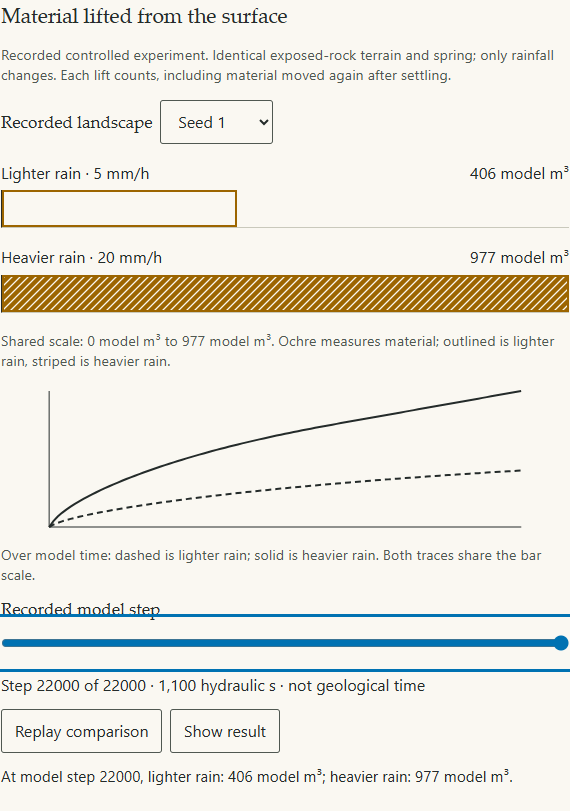

<!-- expert-review -->

# More rain, more material moved?

The supported teaching claim is deliberately narrow: **in these matched
exposed-rock model runs, heavier rain lifts more material from the surface over
the same model time**. Gross erosion counts every lift, including repeated
erosion after deposition. It is neither net incision nor catchment export.

The [presentation protocol](protocol.md) was committed at
`a8464b6` before extraction and browser inspection. This work reuses all six
rain arms from the [completed follow-up](../followup/README.md); it is not an
independent new simulation experiment. There was no parameter tuning, seed
selection, new terrain generation or numerical interpolation of landforms.

## Evidence and visual result

All three paired runs retain every sample through the registered horizon.
The extractor verifies source/configuration agreement, identical initial state
hashes, the fixed grid/timestep/horizon, stocks, conservation and endpoint
direction before producing the compact reader dataset. Raw-file SHA-256 hashes,
solver revisions, configs and state hashes are retained in [manifest.json](manifest.json).
Tests regenerate the compact data from those sources and reject incomplete,
changed-intervention, unhealthy and reversed-effect cohorts.

| Seed | Lighter rain, gross erosion (model m³) | Heavier rain, gross erosion (model m³) | Higher/lower |
| ---- | -------------------------------------: | -------------------------------------: | -----------: |
| 1    |                             405.800268 |                             977.324078 |     2.408387 |
| 17   |                             405.588636 |                             977.153535 |     2.409223 |
| 101  |                             405.702670 |                             977.218527 |     2.408706 |

These are evidence-table values; reader numbers bind directly to the stored
counter/config samples. Both bars use one zero and one maximum for every seed
and frame. Their shared-scale difference exceeds 331 CSS px at 1366×900 and
185 CSS px at 390×844 on every seed, above the preregistered 40 px legibility
target. The time traces use the same vertical scale. Browser inspection found
no horizontal page overflow or overlapping labels. Screenshots were inspected;
this is developer visual QA, not a human classroom study.



[All viewport/seed measurements and browser checks](../../../../uplift/book/src/app/evidence/rain-comparison/results.json)
and [normal-speed recording](../../../../uplift/book/src/app/evidence/rain-comparison/comparison.webm)
are committed with the [browser evidence notes](../../../../uplift/book/src/app/evidence/rain-comparison/README.md).
Normal playback completes in approximately twenty seconds. Every frame uses an
actual sample; pause, keyboard scrubbing and endpoint inspection remain available.

## Matching lesson and scientific limits

The question asks which rain input lifts more material: lighter, heavier, or the
same amount. The supported answer is heavier. Feedback appears after inspecting
the endpoint and names the reader's committed choice. It makes no success claim
about an unobserved live run. Both reading levels preserve the replay and the
separate live sandbox; changing the latter cannot modify the recordings.

The [earlier morphology results](../README.md) stay failed/inconclusive.
The [follow-up assessment](../followup/summary.json) remains unchanged. Numeric
geological years are still hidden, and the slope-break challenge cannot award a
stamp. Expert approval is explicitly false in the comparison artifact. Stage 1
still requires expert mechanism/content review and human classroom/accessibility
checks. Field-rate calibration is required only if those claims are introduced.

Under the owner's [education-first policy](../../education-policy.md), this
completes the supported comparison and matching lesson needed for Wave 3.
It does not convert legacy AC3/T6 failures into successes or complete Stage 1.

## Reproduction

```sh
node hachure/terrain/src/validation/build-rain-comparison.mjs
pnpm exec prettier --write hachure/terrain/src/validation/rain-comparison-data.json docs/science/validation/rain-comparison/manifest.json
pnpm check
pnpm build
pnpm --filter @uplift/book dev --host 127.0.0.1 --port 5183
node uplift/book/src/app/comparison-smoke.mjs
node uplift/book/src/app/smoke.mjs
```

Set `LESSON_BASE_URL` when using a different port. Browser scripts use installed
Chrome. Source mechanisms: [model.md](../../model.md), motivated by the cited
Šťava layered-material model and conservative transfer scheme therein.
