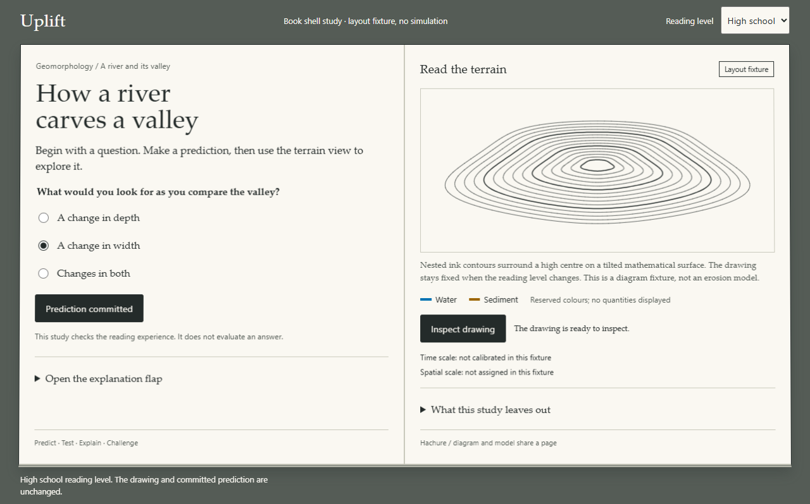

# 1D · Book shell and page technology

Session: S1 / W1 / 1D. Branch: `s1/w1/1d-book-shell`.
Decision: **use DOM pages with an embedded terrain canvas**.

## Run and reproduce

From the worktree root:

```sh
pnpm install
pnpm --filter @uplift/spike-book-shell dev
# Open http://127.0.0.1:5174
pnpm --filter @uplift/spike-book-shell smoke
pnpm --filter @uplift/spike-book-shell typecheck
pnpm --filter @uplift/spike-book-shell build
pnpm check
```

The smoke script uses an installed Chrome through Playwright's `chrome` channel.
It expects the dev server to be running, and accepts `SHELL_BASE_URL` to override its URL.
Screenshots, geometry measurements and an accessibility-tree snapshot live in
[`spikes/book-shell/evidence/`](../../spikes/book-shell/evidence/).
Spikes are excluded from the root TypeScript project, so run the separate spike typecheck too.

## What the prototype establishes

The initial HTML contains the book, question, labelled native controls and diagram description.
CSS makes the desk and paper; a very shallow perspective is applied to the book as a whole.
The canvas stays inside the right page, while headings, captions, controls, the flap and equations
stay in the DOM. Text remains selectable. KaTeX is bundled locally with its fonts, producing
HTML and MathML rather than painting an equation into a texture.
See the [KaTeX API](https://katex.org/docs/api.html).

The mathematical contour drawing is an immutable layout fixture, not a solver, a heightfield
contour-extraction implementation or scientific evidence. Nothing evolves, no answer is scored,
and no time or spatial calibration is invented. Water and sediment swatches reserve the semantic
colours without implying quantities. The production implementation must replace the fixture with
1C/2C's geometry-derived drawing and bind scales, model tier and all numerical values.

The level toggle changes explanatory text and equation visibility only. Browser checks compare
canvas data URLs before and after the toggle and check that the chosen prediction and unlocked
control survive. This is a shell-isolation check; the real solver hash check remains 2D/4E's job.

## Layout evidence

Measured in headless installed Chrome 156.0.8078.80 on Windows. These are CSS viewports,
not physical projector or tablet hardware tests. Full-page screenshots intentionally include
content below the viewport; pages scroll naturally rather than clipping content or shrinking text.

| Viewport              | Layout                              | High school / university                                                                           |
| --------------------- | ----------------------------------- | -------------------------------------------------------------------------------------------------- |
| Laptop, 1440 × 900    | Equal facing pages                  | No horizontal overflow; longer university content scrolls                                          |
| Projector, 1280 × 720 | Facing pages, compact spacing       | Question, commit and inspect controls visible; footers and university details need vertical scroll |
| Tablet, 768 × 1024    | Pages stack in reading order        | No horizontal overflow; terrain follows question                                                   |
| Mobile, 390 × 844     | Stacked, wrapping header and legend | No horizontal overflow in either level                                                             |



The check asserts actual canvas pixels, accessible MathML, facing versus stacked geometry and
horizontal fit for both levels at every size. Screenshot review caught and fixed a white-on-paper
native selector and an overly tall projector drawing. Native focus outlines stay visible.

## Keyboard and screen-reader smoke note

**Keyboard: passed in Chrome.** Tab exposes the skip link; Enter moves to the spread. Radio arrows
choose a prediction; Space selects it; Tab reaches commit; Enter unlocks inspect. The level select,
explanation disclosure and inspect button work by keyboard. Changes are announced through a polite,
atomic status region. A hidden university section is removed from the tab order by `hidden`.

**Screen-reader structure: checked, speech output pending.** The browser accessibility-tree snapshot
contains named main/article/regions, the labelled radio group and select, the canvas image description,
native disclosure groups, status text and the university equation as math. Hidden university text is
not visually exposed at high-school level. This is structural evidence, not an NVDA/JAWS/VoiceOver
listening test; perform that human smoke check before accepting production widgets in 2E/4D.
No claim of full screen-reader certification is made.

**Reduced motion:** no autoplay or animation exists; the shallow perspective is removed when the
preference is set. **Forced colours:** native controls remain visible and the diagram retains a
text alternative. **Without JavaScript:** question, headings, labels and diagram description still
render; this is an initial-content fallback, not an interactive lesson.

## DOM versus page texture

| Criterion                            | DOM pages                                                               | Canvas page texture                                            |
| ------------------------------------ | ----------------------------------------------------------------------- | -------------------------------------------------------------- |
| Selectable text and native semantics | Present directly                                                        | Needs a separate synchronized DOM layer                        |
| Equation access                      | KaTeX HTML + MathML                                                     | Would need a separate math alternative                         |
| Focus order and disclosures          | Browser-native                                                          | Requires parallel hit targets and focus handling               |
| Responsive reading                   | Reflow and natural scroll                                               | Raster text would need rerasterization and alternate layout    |
| Book appearance                      | Paper, gutter and shallow CSS perspective meet this study's visual goal | Could support complex page curl, which this wave does not need |
| Initial content                      | Static HTML before renderer initialization                              | Depends on painting a texture and presenting it                |

Choose DOM now. No canvas texture comparison renderer was implemented; the visual judgement is
based on the working DOM prototype, and the accessibility/selection tradeoffs are architectural,
not a performance benchmark. No cold-network first-paint target is claimed from a local dev run.
A later animated page-turn study may add decorative textures while retaining semantic DOM content.

## Layout and tokens for 2E

Use equal columns above 900 CSS px and stack at or below that width. Preserve DOM order: heading,
predict, explanatory material, terrain, legend, view controls and model notes. Keep the global level
select before the spread. Use native fieldsets, inputs, buttons, select and details; keep pointer
targets at least 44 CSS px. Do not assign a fixed page height or hide overflow to fit a projector.

| Token                          | Value / role                                                               |
| ------------------------------ | -------------------------------------------------------------------------- |
| Paper                          | `#faf8f2`                                                                  |
| Ink                            | `#242b2a`                                                                  |
| Secondary text                 | `#505852`                                                                  |
| Desk                           | `#555c56`                                                                  |
| Rule / gutter                  | `#c9c9bc`, structural only                                                 |
| Water / focus                  | `#0072b2`                                                                  |
| Sediment                       | `#9c6500`                                                                  |
| Reading type                   | Palatino Linotype / Book Antiqua / Palatino / serif                        |
| Controls and supporting labels | Segoe UI / sans-serif                                                      |
| Base reading size              | 17 px, 16 px in short desktop viewports; line height 1.5                   |
| Page padding                   | `clamp(1.25rem, 2.7vw, 2.75rem)`; 1.5rem for tablet and short projector    |
| Focus                          | 3 px water-blue outline, 4 px offset                                       |
| Canvas                         | Right-page figure; resizes with its frame; independent of text-level state |

The contour area is the main visual device; no decorative gradients, glow, web-font downloads or
page-turn animation. Colour tokens are provisional coordination inputs for 1C and 2C, not a replacement
for their palette simulation and projector checks. Keep legends labelled with words, not colour alone.
The equation is a flagged, cited typesetting specimen, not validated scientific content for release.

## Handover

**Done:** runnable isolated two-page prototype; level toggle; locally bundled KaTeX; canvas slot;
prediction gate; native flap; responsive layouts; keyboard and accessibility-structure evidence;
DOM decision and tokens.

**Not done:** screen-reader speech check, physical projector assessment, cold-network timing,
production widgets, terrain renderer, binding engine or simulation integration. These stay with
2E, 2C, 2D, 3A and 4D as planned.

**Surprises:** a full university spread does not fit projector height without scrolling. Preserve
readable type and natural page growth rather than rasterizing or shrinking the page.

**Plan input:** 2E should explicitly allow vertical scroll at projector size and retain DOM text.
Its screen-reader listening check must not be substituted with an accessibility-tree snapshot.

**Owned-path exception:** `pnpm-lock.yaml` was regenerated by `pnpm install` to register this spike's
KaTeX and Playwright dependencies. No root manifest, production package or parallel session path changed.
`DECISIONS.md` receives the required append-only decision record.
